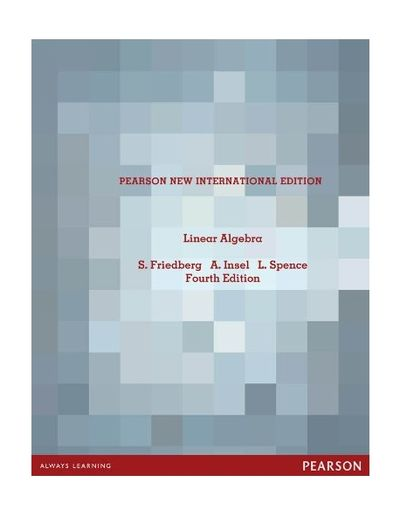

MathAstro에서 다루는 학문 분야별 추천 교재 및 참고문헌을 정리한 공간입니다. 객관적인 도서 정보들을 제외한 코멘트들은 관리자들의 개인적인 경험 및 생각에 기반한 것임을 알립니다.

---

<!--
[작성 가이드 - 도서 추가 방법]
1. 책 표지 이미지를 `images/books/` 폴더에 저장합니다. (예: `images/books/mybook.jpg`)
2. 아래 템플릿의 `images/books/book-placeholder.svg` 경로를 실제 이미지 파일명으로 변경합니다.
3. 책을 추가하실 때 아래 블록을 복사하여 원하는 과목 아래에 붙여넣으시면 됩니다.

::: {.callout-note appearance="simple"}
### 📖 [도서명 입력]

:::: {.book-entry}
::: {.book-cover}

:::

::: {.book-info}
* **저자 / 출판사**: [저자명, 출판사, 판본]
* **난이도 및 대상**: [학부 기초 / 학부 심화 / 대학원]
* **선수 과목**: [선수 지식 입력]
* **주요 특징**: [교재의 특징 및 서술 스타일 정리]
* **한줄평 / 추천 이유**: [이 교재를 추천하는 이유]
:::
::::
:::
-->

# 📐 수학 (Mathematics)

## 미적분학 & 해석학 (Calculus & Analysis)

::: {.callout-note appearance="simple"}
### 📖 [도서명 입력]

:::: {.book-entry}
::: {.book-cover}

:::

::: {.book-info}
* **저자 / 출판사**: [저자명, 출판사, 판본]
* **난이도 및 대상**: [학부 기초 / 학부 심화 / 대학원]
* **선수 과목**: [선수 지식 입력]
* **주요 특징**: [교재의 특징 및 서술 스타일 정리]
* **한줄평 / 추천 이유**: [이 교재를 추천하는 이유]
:::
::::
:::

## 선형대수학 (Linear Algebra)

::: {.callout-note appearance="simple"}
### 📖 [Linear Algebra]

:::: {.book-entry}
::: {.book-cover}

:::

::: {.book-info}
* **저자 / 출판사**: [S. H. Friedberg, A. J. Insel, and L. E. Spence, Linear Algebra, 4th ed. (Pearson New International Edition), Pearson, 2013.]
* **난이도 및 대상**: [학부 기초]
* **선수 과목**: [집합론(Set Theory), 미적분학(Calculus)]
* **주요 특징**: [학부 2학년 수준의 선형대수학을 다루는 교재로, 통칭 프리드버그라고 부른다. 대부분의 선형대수학 교재가 행렬을 중심으로 서술하는 반면 이 교재는 시작부터 벡터공간을 정의하고 이를 중심으로 이론을 전개한다. 마찬가지로 선형 변환과 고유값, 고유벡터 또한 일반적인 벡터공간을 기준으로 삼는다. 때문에 행렬 분해법이나 계산과 관련된 내용들은 거의 등장하지 않는다는 점에서 일반적인 공대 교재들과 차이점일 지닌다. 특이하게 행렬식을 라플라스 전개(Laplace Expansion) 혹은 여인수 전개(Cofactor Expansion)라 불리는 방법으로 정의한 채 사용한다.]
:::
::::
:::

## 추상대수학 (Abstract Algebra)

::: {.callout-note appearance="simple"}
### 📖 [도서명 입력]

:::: {.book-entry}
::: {.book-cover}

:::

::: {.book-info}
* **저자 / 출판사**: [저자명, 출판사, 판본]
* **난이도 및 대상**: [학부 기초 / 학부 심화 / 대학원]
* **선수 과목**: [선수 지식 입력]
* **주요 특징**: [교재의 특징 및 서술 스타일 정리]
* **한줄평 / 추천 이유**: [이 교재를 추천하는 이유]
:::
::::
:::

## 위상수학 (Topology)

::: {.callout-note appearance="simple"}
### 📖 [도서명 입력]

:::: {.book-entry}
::: {.book-cover}

:::

::: {.book-info}
* **저자 / 출판사**: [저자명, 출판사, 판본]
* **난이도 및 대상**: [학부 기초 / 학부 심화 / 대학원]
* **선수 과목**: [선수 지식 입력]
* **주요 특징**: [교재의 특징 및 서술 스타일 정리]
* **한줄평 / 추천 이유**: [이 교재를 추천하는 이유]
:::
::::
:::

## 미분기하학 (Differential Geometry)

::: {.callout-note appearance="simple"}
### 📖 [도서명 입력]

:::: {.book-entry}
::: {.book-cover}

:::

::: {.book-info}
* **저자 / 출판사**: [저자명, 출판사, 판본]
* **난이도 및 대상**: [학부 기초 / 학부 심화 / 대학원]
* **선수 과목**: [선수 지식 입력]
* **주요 특징**: [교재의 특징 및 서술 스타일 정리]
* **한줄평 / 추천 이유**: [이 교재를 추천하는 이유]
:::
::::
:::

## 복소해석학 (Complex Analysis)

::: {.callout-note appearance="simple"}
### 📖 [도서명 입력]

:::: {.book-entry}
::: {.book-cover}

:::

::: {.book-info}
* **저자 / 출판사**: [저자명, 출판사, 판본]
* **난이도 및 대상**: [학부 기초 / 학부 심화 / 대학원]
* **선수 과목**: [선수 지식 입력]
* **주요 특징**: [교재의 특징 및 서술 스타일 정리]
* **한줄평 / 추천 이유**: [이 교재를 추천하는 이유]
:::
::::
:::

## 그래프 이론 (Graph Theory)

::: {.callout-note appearance="simple"}
### 📖 [도서명 입력]

:::: {.book-entry}
::: {.book-cover}

:::

::: {.book-info}
* **저자 / 출판사**: [저자명, 출판사, 판본]
* **난이도 및 대상**: [학부 기초 / 학부 심화 / 대학원]
* **선수 과목**: [선수 지식 입력]
* **주요 특징**: [교재의 특징 및 서술 스타일 정리]
* **한줄평 / 추천 이유**: [이 교재를 추천하는 이유]
:::
::::
:::

## 수치해석학 (Numerical Analysis)

::: {.callout-note appearance="simple"}
### 📖 [도서명 입력]

:::: {.book-entry}
::: {.book-cover}

:::

::: {.book-info}
* **저자 / 출판사**: [저자명, 출판사, 판본]
* **난이도 및 대상**: [학부 기초 / 학부 심화 / 대학원]
* **선수 과목**: [선수 지식 입력]
* **주요 특징**: [교재의 특징 및 서술 스타일 정리]
* **한줄평 / 추천 이유**: [이 교재를 추천하는 이유]
:::
::::
:::

---

# 🔭 천문학 (Astronomy & Astrophysics)

## 천체물리학 일반 (General Astrophysics)

::: {.callout-note appearance="simple"}
### 📖 [도서명 입력]

:::: {.book-entry}
::: {.book-cover}

:::

::: {.book-info}
* **저자 / 출판사**: [저자명, 출판사, 판본]
* **난이도 및 대상**: [학부 기초 / 학부 심화 / 대학원]
* **선수 과목**: [선수 지식 입력]
* **주요 특징**: [교재의 특징 및 서술 스타일 정리]
* **한줄평 / 추천 이유**: [이 교재를 추천하는 이유]
:::
::::
:::

## 전파천문학 (Radio Astronomy)

::: {.callout-note appearance="simple"}
### 📖 [도서명 입력]

:::: {.book-entry}
::: {.book-cover}

:::

::: {.book-info}
* **저자 / 출판사**: [저자명, 출판사, 판본]
* **난이도 및 대상**: [학부 기초 / 학부 심화 / 대학원]
* **선수 과목**: [선수 지식 입력]
* **주요 특징**: [교재의 특징 및 서술 스타일 정리]
* **한줄평 / 추천 이유**: [이 교재를 추천하는 이유]
:::
::::
:::

## 일반상대론 & 우주론 (General Relativity & Cosmology)

::: {.callout-note appearance="simple"}
### 📖 [도서명 입력]

:::: {.book-entry}
::: {.book-cover}

:::

::: {.book-info}
* **저자 / 출판사**: [저자명, 출판사, 판본]
* **난이도 및 대상**: [학부 기초 / 학부 심화 / 대학원]
* **선수 과목**: [선수 지식 입력]
* **주요 특징**: [교재의 특징 및 서술 스타일 정리]
* **한줄평 / 추천 이유**: [이 교재를 추천하는 이유]
:::
::::
:::

## 고에너지 천체물리학 (High Energy Astrophysics)

::: {.callout-note appearance="simple"}
### 📖 [도서명 입력]

:::: {.book-entry}
::: {.book-cover}

:::

::: {.book-info}
* **저자 / 출판사**: [저자명, 출판사, 판본]
* **난이도 및 대상**: [학부 기초 / 학부 심화 / 대학원]
* **선수 과목**: [선수 지식 입력]
* **주요 특징**: [교재의 특징 및 서술 스타일 정리]
* **한줄평 / 추천 이유**: [이 교재를 추천하는 이유]
:::
::::
:::

---

# ⚛️ 물리학 (Physics)

## 고전역학 & 열통계물리학 (Classical Mechanics & Thermodynamics)

::: {.callout-note appearance="simple"}
### 📖 [도서명 입력]

:::: {.book-entry}
::: {.book-cover}

:::

::: {.book-info}
* **저자 / 출판사**: [저자명, 출판사, 판본]
* **난이도 및 대상**: [학부 기초 / 학부 심화 / 대학원]
* **선수 과목**: [선수 지식 입력]
* **주요 특징**: [교재의 특징 및 서술 스타일 정리]
* **한줄평 / 추천 이유**: [이 교재를 추천하는 이유]
:::
::::
:::

## 전자기학 & 양자역학 (Electrodynamics & Quantum Mechanics)

::: {.callout-note appearance="simple"}
### 📖 [도서명 입력]

:::: {.book-entry}
::: {.book-cover}

:::

::: {.book-info}
* **저자 / 출판사**: [저자명, 출판사, 판본]
* **난이도 및 대상**: [학부 기초 / 학부 심화 / 대학원]
* **선수 과목**: [선수 지식 입력]
* **주요 특징**: [교재의 특징 및 서술 스타일 정리]
* **한줄평 / 추천 이유**: [이 교재를 추천하는 이유]
:::
::::
:::

---

# 💻 컴퓨터과학 (Computer Science)

## 머신러닝 & 강화학습 (Machine Learning & Reinforcement Learning)

::: {.callout-note appearance="simple"}
### 📖 [도서명 입력]

:::: {.book-entry}
::: {.book-cover}

:::

::: {.book-info}
* **저자 / 출판사**: [저자명, 출판사, 판본]
* **난이도 및 대상**: [학부 기초 / 학부 심화 / 대학원]
* **선수 과목**: [선수 지식 입력]
* **주요 특징**: [교재의 특징 및 서술 스타일 정리]
* **한줄평 / 추천 이유**: [이 교재를 추천하는 이유]
:::
::::
:::

## 알고리즘 & 자료구조 (Algorithms & Data Structures)

::: {.callout-note appearance="simple"}
### 📖 [도서명 입력]

:::: {.book-entry}
::: {.book-cover}

:::

::: {.book-info}
* **저자 / 출판사**: [저자명, 출판사, 판본]
* **난이도 및 대상**: [학부 기초 / 학부 심화 / 대학원]
* **선수 과목**: [선수 지식 입력]
* **주요 특징**: [교재의 특징 및 서술 스타일 정리]
* **한줄평 / 추천 이유**: [이 교재를 추천하는 이유]
:::
::::
:::
