```{=html}
<!-- Top Utility Bar (KIAS Horizon style) -->
<div class="magazine-utility-bar">
  <div class="magazine-utility-inner">
    <div class="magazine-utility-left">
      <span class="magazine-edition-badge">ACADEMIC WEBZINE</span>
      <span class="magazine-motto">MathAstro · 세상 모든 학문의 백과사전화</span>
    </div>
    <div class="magazine-utility-right">
      <span>공동 운영: 이영정 (천문학) · 천유민 (수학)</span>
    </div>
  </div>
</div>

<!-- Masthead (Quanta Magazine & KIAS Horizon style) -->
<header class="magazine-masthead">
  <div class="masthead-brand-container">
    <div class="masthead-main-title" role="heading" aria-level="1">MathAstro<span class="title-accent">.</span></div>
    <p class="masthead-sub-title">과학과 수학의 지평 — The Horizons of Science & Mathematics</p>
    <p class="masthead-desc">대학교 및 대학원 수준의 전공 학술 지식을 친근하고 엄밀하게 전하는 오픈 백과사전 & 웹진</p>
  </div>
  <div class="masthead-rule-line"></div>
</header>

<script>
(function() {
  if (window.location.hash && window.location.hash.indexOf('category=') !== -1) {
    var raw = decodeURIComponent(window.location.hash.split('category=')[1] || '').trim();
    if (raw && raw.toLowerCase() !== 'all') {
      document.documentElement.classList.add('category-active');
    }
  }
})();

document.addEventListener("DOMContentLoaded", function() {
  var catInfo = {
    // Top-level sections
    'math': { title: 'Mathematics (수학)' },
    'astronomy': { title: 'Astronomy (천문학)' },
    'physics': { title: 'Physics (물리학)' },
    'computer': { title: 'Computer Science' },

    // Math fields & subfields
    'calculus': { title: 'Calculus (미적분학)' },
    'vector calculus': { title: 'Vector Calculus (벡터미적분학)' },
    'abstract algebra': { title: 'Abstract Algebra (추상대수학)' },
    'group theory': { title: 'Group Theory (군론)' },
    'ring theory': { title: 'Ring Theory (환론)' },
    'binary algebraic structure': { title: 'Binary Algebraic Structure (이항대수구조)' },
    'field theory': { title: 'Field Theory (체론)' },
    'linear algebra': { title: 'Linear Algebra (선형대수학)' },
    'matrix algebra': { title: 'Matrix Algebra (행렬대수학)' },
    'complex analysis': { title: 'Complex Analysis (복소해석학)' },
    'analysis': { title: 'Analysis (해석학)' },
    'multivariable': { title: 'Multivariable Analysis (다변수해석학)' },
    'topology': { title: 'Topology (위상수학)' },
    'differential geometry': { title: 'Differential Geometry (미분기하학)' },
    'curve theory': { title: 'Curve Theory (곡선론)' },
    'graph theory': { title: 'Graph Theory (그래프 이론)' },
    'graph': { title: 'Graph (그래프)' },
    'network analysis': { title: 'Network Analysis (네트워크 분석)' },
    'tree': { title: 'Tree (트리)' },
    'algorithm': { title: 'Algorithm (알고리즘)' },
    'numerical analysis': { title: 'Numerical Analysis (수치해석학)' },

    // Astronomy fields & subfields
    'radio astronomy': { title: 'Radio Astronomy (전파천문학)' },
    'radio software': { title: 'Radio Software (전파 소프트웨어)' },
    'aips': { title: 'AIPS (Astronomical Image Processing System)' },
    'resolve': { title: 'resolve (Bayesian Radio Imaging)' },
    'general relativity': { title: 'General Relativity & Equivalence Principle (일반상대론 & 등가원리)' },
    'equivalence principle': { title: 'Equivalence Principle (등가원리)' },
    'high energy': { title: 'High Energy Astrophysics (고에너지 천체물리학)' },
    'high energy astrophysics': { title: 'High Energy Astrophysics (고에너지 천체물리학)' },
    'relativistic jets': { title: 'Relativistic Jets (상대론적 제트)' },

    // Physics
    'thermodynamics': { title: 'Thermodynamics (열역학)' },

    // Computer Science
    'machine learning': { title: 'Machine Learning (머신러닝)' },
    'reinforcement learning': { title: 'Reinforcement Learning (강화학습)' }
  };

  function updateView() {
    var hash = window.location.hash || '';
    var isCat = hash.indexOf("category=") !== -1;
    var rawCat = isCat ? decodeURIComponent(hash.split("category=")[1] || '').trim() : "";
    var catKey = rawCat.toLowerCase();
    var isFiltered = isCat && catKey && catKey !== 'all';

    var knowledgeEl = document.querySelector('.knowledge-tree');
    var sectionTitleEl = document.querySelector('.magazine-section-title');
    var sectionSubEl = document.querySelector('.magazine-section-sub');
    var listingEl = document.querySelector('.quarto-listing[id]');
    var listing = listingEl ? (window['quarto-listings'] ? window['quarto-listings'][listingEl.id] : null) : null;

    if (isFiltered) {
      document.documentElement.classList.add('category-active');
      document.body.classList.add('category-active');
      if (knowledgeEl) knowledgeEl.style.display = 'none';

      var leafKey = catKey.split(' > ').pop();
      var info = catInfo[catKey] || catInfo[leafKey] || { title: rawCat.split(' > ').pop() };
      if (sectionTitleEl) sectionTitleEl.textContent = info.title;
      if (sectionSubEl) {
        sectionSubEl.textContent = '';
        sectionSubEl.style.display = 'none';
      }

      if (listing) {
        listing.filter(function(item) {
          var rawCats = [];
          if (item.values && item.values().categories) {
            try {
              rawCats.push(decodeURIComponent(atob(item.values().categories)));
            } catch(e) {}
          }
          if (item.elm) {
            item.elm.querySelectorAll('.listing-category').forEach(function(c) {
              rawCats.push(c.textContent.trim());
            });
          }
          if (item.values && item.values()['listing-categories']) {
            rawCats.push(item.values()['listing-categories']);
          }
          return rawCats.some(function(category) {
            var segments = category.replace(/&gt;/g, '>')
              .split(/\s*(?:>|\/|::)\s*/)
              .map(function(s) { return s.trim().toLowerCase(); })
              .filter(Boolean);
            var path = segments.join(' > ');
            // New menu links use full paths; retain existing short bookmarks.
            if (catKey.indexOf(' > ') !== -1) {
              return path === catKey || path.startsWith(catKey + ' > ');
            }
            return segments.some(function(seg) {
              return seg === catKey || (catKey === 'high energy' && seg === 'high energy astrophysics');
            });
          });
        });
      }
    } else {
      document.documentElement.classList.remove('category-active');
      document.body.classList.remove('category-active');
      if (knowledgeEl) knowledgeEl.style.display = '';

      if (sectionTitleEl) sectionTitleEl.textContent = '최근 발행 글';
      if (sectionSubEl) {
        sectionSubEl.textContent = '';
        sectionSubEl.style.display = 'none';
      }

      if (listing) {
        listing.filter();
      }
    }

    // Highlight active link in navbar
    updateNavbarActive(isFiltered ? catKey : '');
  }

  function updateNavbarActive(activeCatKey) {
    var navLinks = document.querySelectorAll('.navbar-nav .nav-link, .navbar-nav .dropdown-item');
    navLinks.forEach(function(link) {
      link.classList.remove('active');
    });

    if (!activeCatKey) {
      var homeLinks = document.querySelectorAll('.navbar-nav a[href="./index.html"], .navbar-nav a[href="index.html"]');
      homeLinks.forEach(function(h) { h.classList.add('active'); });
    } else {
      navLinks.forEach(function(link) {
        var href = decodeURIComponent((link.getAttribute('href') || '').toLowerCase());
        var linkKey = (href.split('#category=')[1] || '').trim();
        if (linkKey && (activeCatKey === linkKey || activeCatKey.startsWith(linkKey + ' > ')
            || (activeCatKey.indexOf(' > ') === -1 && linkKey.split(' > ').pop() === activeCatKey))) {
          link.classList.add('active');
          var parentDropdown = link.closest('.nav-item.dropdown');
          if (parentDropdown) {
            var toggle = parentDropdown.querySelector('.nav-link.dropdown-toggle');
            if (toggle) toggle.classList.add('active');
          }
          var parentSubmenu = link.closest('.dropdown-submenu');
          if (parentSubmenu) {
            var subToggle = parentSubmenu.querySelector('a.dropdown-item');
            if (subToggle) subToggle.classList.add('active');
          }
        }
      });
    }
  }

  // Intercept navbar clicks for instantaneous SPA-like transition
  document.addEventListener('click', function(e) {
    var link = e.target.closest('.navbar-nav .nav-link, .navbar-nav .dropdown-item, .navbar-brand');
    if (!link) return;
    var href = link.getAttribute('href') || '';
    var isHome = href === './index.html' || href === 'index.html' || href === '/' || href.endsWith('/index.html') || link.classList.contains('navbar-brand');

    if (isHome) {
      if (window.location.hash) {
        e.preventDefault();
        history.pushState(null, null, window.location.pathname + window.location.search);
        updateView();
        window.scrollTo({ top: 0, behavior: 'smooth' });
      }
    } else if (href.indexOf('#category=') !== -1) {
      var targetHash = href.substring(href.indexOf('#category='));
      if (window.location.hash === targetHash) {
        e.preventDefault();
        updateView();
      }
    }
  });

  window.addEventListener('hashchange', updateView);
  window.addEventListener('popstate', updateView);
  window.addEventListener('blogCategoryNavigationReady', updateView);

  updateView();
  setTimeout(updateView, 150);
  setTimeout(updateView, 400);
});
</script>

<!-- The entrance is visible in the initial HTML; JavaScript only enhances the link. -->
<section id="knowledge-tree" class="knowledge-tree" data-view="entry" aria-label="지식 수목도">
  <div class="knowledge-entrance notranslate" translate="no" lang="ko">
    <div class="knowledge-entrance-body">
      <div class="knowledge-entrance-copy">
        <p class="knowledge-entrance-eyebrow"><span aria-hidden="true">✦</span> MATHASTRO <span aria-hidden="true">/</span> CELESTIAL LIBRARY</p>
        <h1 class="knowledge-entrance-title"><span data-launch-text="title">지식의 우주</span> <span class="knowledge-entrance-gold" data-launch-text="subtitle">도서관</span></h1>
        <p class="knowledge-entrance-description" data-launch-text="description">별을 잇듯 개념을 이어 보세요. 네 가지 별자리에서 나만의 공부 길이 시작됩니다.</p>
        <a class="knowledge-launch" href="#listing-sample-listings">
          <span data-launch-text="action">지식 여행하기</span>
          <svg viewBox="0 0 24 24" width="20" height="20" fill="none" stroke="currentColor" stroke-width="1.5" stroke-linecap="round" stroke-linejoin="round" aria-hidden="true"><path d="M4 12h15m-6-6 6 6-6 6"/></svg>
        </a>
      </div>
      <div class="knowledge-entrance-scene" aria-hidden="true">
        
        <span class="knowledge-entrance-plate">FIG. 01 <span>·</span> THE CELESTIAL GATE</span>
      </div>
    </div>
    <ul class="knowledge-entrance-legend" aria-label="네 가지 지식 별자리">
      <li><span aria-hidden="true">01</span><span data-launch-field="Math">수학</span></li>
      <li><span aria-hidden="true">02</span><span data-launch-field="Astronomy">천문학</span></li>
      <li><span aria-hidden="true">03</span><span data-launch-field="Physics">물리학</span></li>
      <li><span aria-hidden="true">04</span><span data-launch-field="Computer">컴퓨터 과학</span></li>
    </ul>
  </div>
  <div id="knowledge-content" tabindex="-1" hidden></div>
  <p class="knowledge-status" role="status" aria-live="polite" aria-atomic="true"></p>
  <noscript><p class="knowledge-loading">지식 수목도를 탐색하려면 JavaScript를 켜주세요. 상단 학문 메뉴와 아래 글 목록에서도 모든 글을 읽을 수 있습니다.</p></noscript>
</section>
<script src="assets/knowledge-tree-data.js"></script>
<script type="module" src="assets/knowledge-tree.mjs"></script>

<!-- Section Header for Recent Articles -->
<div class="magazine-section-divider">
  <div class="section-title-wrap">
    <h2 class="magazine-section-title">최근 발행 글</h2>
  </div>
</div>
```

::: {#sample-listings}
:::

```{=html}
<!-- Academic Pull Quote Section (Quanta style) -->
<section class="magazine-pull-quote-section">
  <div class="pull-quote-box">
    <blockquote class="pull-quote-text">
      “자연이라는 위대한 책은 우리 눈앞에 펼쳐져 있으나,<br>그것은 수학이라는 언어로 쓰여 있기에 그 기호를 이해하지 못하면 단 한 단어도 해독할 수 없다.”
    </blockquote>
    <div class="pull-quote-author">— 갈릴레오 갈릴레이 (Galileo Galilei), 『황금측량자』</div>
  </div>
</section>
```
