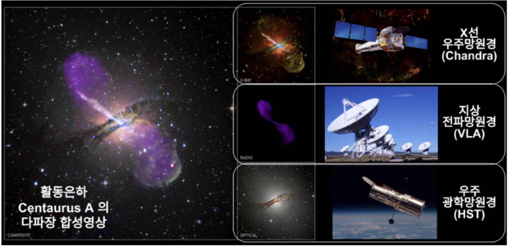

# 1. AGN Introduction 

- 대부분의 은하는 중심에 **초대질량 블랙홀(Supermassive Black Hole)** 을 가지고 있는데, 이 블랙홀이 주변 물질을 빨아들이면서 엄청난 에너지를 방출할 때, 그 중심을 AGN이라고 한다.
    - 태양과 같은 무게를 가진 가스가 일 년 동안 SMBH로 빨려 들어가게 되면 대략적으로 우리은하 전체 밝기보다 수십 배 밝은 빛을 낼 수 있다.
- AGN 중심부에서는 물질이 블랙홀로 떨어지기 전에 회전하면서 낙하한다. 이 과정에서 마찰열과 중력 에너지 방출 때문에 X선, 자외선, 심지어 전파까지 다양한 파장대의 빛을 정상적인 은하보다 많이 발산한다.
    - 이때 방출되는 에너지는 부착원반의 열적 복사와 싱크로트론 복사와 같은 비열적 복사(예: 상대론적 제트)를 함께 포함한다.  
    - AGN의 약 10%는 가시광에 비해 전파에서 두드러지게 밝다.
    - AGN의 X-ray는 주로 corona에서 기원하는 것으로 생각되며, AGN의 X-ray 방출의 5~10%가 AGN의 bolometric luminosity에 기여한다.
- AGN은 밝기가 은하 전체보다 밝을 수 있다.(~$10^{37} \ {\rm W}$ 이상)
    - 일반적인 퀘이사는 $L_{\text{bol}} \sim 10^{46}$–$10^{47} \ {\rm erg \ s^{-1}}$ 정도의 광도를 가진다.
    - 우리은하 중심부의 밝기는 약 $10^{35} \ {\rm W}$ 로 보통의 AGN과 달리 높은 에너지를 내지 않는다.
- AGN은 대표적인 다파장 발광/변광 천체이다. 그래서 AGN에서는 밝기가 급격하게 변하는 작은 영역이 존재하기도 한다. 또한, 핵 영역과 거대 규모 구조 간에 뚜렷하게 나타나는 밝기의 대조가 나타난다.  

 

- **AGN의 스펙트럼 특징** 
- 수소의 ${\rm H \beta}$, 탄소, 마그네슘 선 등이 넓은 선의 형태로 나타난다. 이는 가스가 도플러 효과에 의해 높은 속도로 움직이고 있음을 시사한다.
    - ${\rm H \beta}$ 방출선: 전자 천이 n = 4 → n = 2에서 생성되고 파장은 $4861{\rm \mathring{A}}$ 에 해당한다. 
- 주로 연속선이 나타나며, 흡수선 및 방출선이 섞여서 나타난다. 
    - 넓은 방출선, 자외선, 가시광 및 적외선에서 강한 방출선을 보인다. 이때, 넓은 방출선은 도플러효과에 의한 것으로 SMBH 가까이에 있는 BLR에서 나오는 것으로 생각된다. 
- 은하핵에서는 주로 ${\rm H\alpha}$, [OIII] (372.7nm)가 발견된다.

