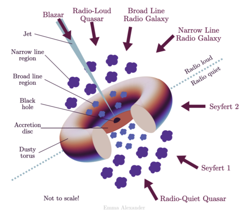
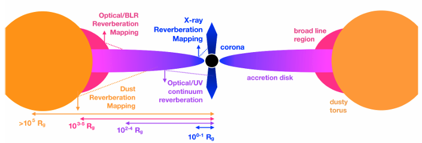
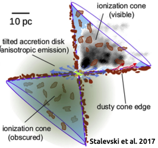
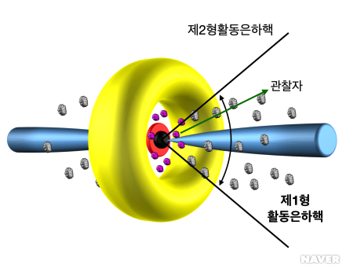
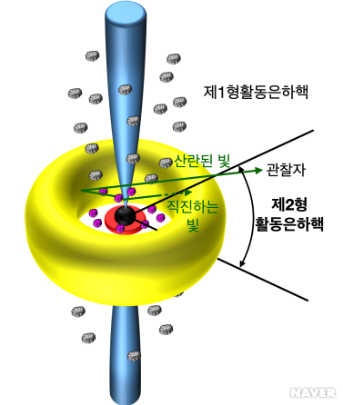

# 1. AGN unification model 

- **AGN unification model**은 관측 방향(viewing angle)과 방출 선폭(line width), 전파 세기 및 기본 구조 요소들의 존재를 기준으로 AGN의 다양한 유형(퀘이사, 세이퍼트 은하, 블레이자 등)을 하나의 기본 구조로 설명하려는 이론이다. 퀘이사, 세이퍼트 은하, 블레이자, BL Lac 등에서 나타나는 현상들이 다 비슷해서 나타나게된 모형이다. 
- AGN unification model은 AGN이 각 진화 단계에 따라 다양한 모습으로 관측된다고 설명한다. 
- 모델에 의하면 AGN은 **Supermassive Black Hole(SMBH)**, **부착원반(accretion disk)**, **Broad Line Region(BLR)**, **Narrow Line Region(NLR)**, **Torus**, **상대론적 제트(relativistic jets)** 등으로 구성된다.

- 모델에 의하면, Torus 방향(관측자에 대한 기울기)에 따라 관측하는 AGN의 유형이 달라진다. 
    - **Torus 측면(edge-on)**: Torus에 의해서 중심부가 가려진다. 이로 인해, BLR에 의한 방출선이 관측되지 않으며, 가스의 고속 운동도 관측되지 않다. 이 경우, **제2형 AGN(Type 2 AGN)** 으로 분류한다. 
    - **Torus 축 방향(face-on)**: Torus에 수직이기 관측하여 중심부의 구조를 볼 수 있다. 그래서 BLR에 의한 방출선이 관측되며, 가스의 고속 운동도 관측된다. 이 경우, **제1형 AGN(Type 1 AGN)** 으로 분류한다. 
- AGN unification model에서 설명하는 각 세부 유형 및 세부 구조는 아래의 글에서 확인할 수 있다: (추후 작성 예정)

---

# 2. AGN 구조(structure)

- 아래 그림은 AGN을 구성하는 은하 중심부 SMBH, 부착원반, Torus 등 여러 세부 구조와 이들이 주로 빛을 방출하는 파장 대역의 모식도를 보여준다. (Cackett et al. 2021) 

- 부착원반에서는 주로 자외선이 방출된다. 
- Torus에서는 주로 적외선이 방출된다. 
- (중심부) 코로나(corona)에서는 주로 X선이 방출된다. 
- BLR에서는 주로 넓은 방출선이 나타난다. 
- NLR에서는 주로 좁은 방출선이 나타난다. 

 

- **Ionization Cone**: 중심 광원에 의해 이온화된 가스가 원뿔 형태로 뻗어 나가는 구조이다. 중심 Torus로 향하는 방향이 아닌, 열린 방향으로 이온화 복사가 빠져나가면서 주변의 가스를 이온화시켜 양쪽으로 원뿔 모양의 빛나는 영역을 만든다. 이는 NLR의 일부이기도 하다. 

 

- AGN의 중심 구조는 강한 빛에너지 뿐만 아니라, 강한 중력, 압력, 자기장, outflow 등에 의해서 결정되기 때문에 복잡한 구조를 가진다.

---

# 3. Type 1 AGN and Type 2 AGN 

- Type 1 AGN과 Type 2 AGN에 대해서 좀 더 깊게 들여다 보자. 
- AGN은 가시광선(광학)에서 수소, 헬륨 등 허용선(allowed line)이 넓은지에 따라 Type 1 AGN과 Type 2 AGN으로 나뉜다. 
- Type 1 AGN은 AGN의 방출 선폭에 따른 분류에서 방출선의 폭이 넓은(선폭>1000km/s) AGN을 의미한다. 반면, Type 2 AGN은 선폭이 1000km/s 이하인 좁은 방출선이 관측되는 AGN을 의미한다.
- 아래 그림들은 Type 1 AGN과 Type 2 AGN의 모식도를 보여준다.

 

- **Real Type 2 AGN**: X선 흡수가 거의 없고 편광 관측에서도 넓은 방출선이 검출되지 않는 AGN의 유형이다.
- 연구에 의하면, Real Type 2 AGN은 torus에 의해 가려진 것이 아니라, 처음부터 BLR 자체가 없거나 매우 약할 것으로 추정된다.

---

# 4. The orientation-based unification model 

- AGN unification model에서 dusty torus의 시선 방향(orientation)은 AGN 스펙트럼에서 넓은 방출선의 여부에 따라 넓은 방출선이 나타나면, Type 1 AGN, 나타나지 않으면 Type 2 AGN으로 분류한다. 
    - Type 2 AGN에서는 dust tours에 의해서 BLR에서 방출되는 넓은 선들이 시선 방향에서 흡수 및 차폐되어 관측자에게 도달하지 못한다. 
- dust torus의 시선 방향에 따른 AGN 분류는 모은하의 별형성률(Star Formation Rate, SFR)과 같은 특징을 Type-1, Type-2로 구분하지 못한다. 
- 연구에 의하면, starburst 이후 10억 년 이내(1 Gyr 이내)에 급격하게 별형성을 중단(quenched)한 AGN 모은하는 단 10%에 불과하다. [1] 
- 그리고 Type-2 모은하가 quenching 과정을 겪은 시점이, Type-1 모은하가 겪은 시점보다 "상대적으로 최대 1억 년(100 Myr) 늦게" 일어난 것으로 보인다. [1] 
- 위와 같은 결과는 약 90%의 AGN이 최근에 별형성을 겪고 있으며, Type 2 AGN은 Type 1 AGN보다 더 젊은 항성 종족(stellar populations)과 연관되는 것을 시사한다. [1]

---

# 5. Discussion 

- **Changing-look AGN**: 넓은 방출선과 연속선이 나타났다가 사라지는 AGN이다. 
	- 시간에 따라 Type 1 AGN과 Type 2 AGN 사이를 오가는 Changing-look AGN의 경우, 관측자와 AGN 사이를 먼지 구름이 지나가거나 부착률의 변화가 수시로 일어난다. 
- 선폭이 넓거나 좁은선이 공존하는 중간 단계의 스펙트럼이 발견됨에 따라 AGN 분류가 세분화 되었다. 넓은선이 두드러진 제1.0형으로부터 제1.2, 1.5, 1.8, 1.9으로도 분류하며, 좁은선이 두드러진 제2.0형까지 분류하기도 한다. 
	- 이러한 분류는 세이퍼트 은하에 적용되었으나 퀘이사도 같은 기준으로 분류하기도 한다.
- 최근의 연구들은 AGN 활동성이 주로 은하 병합(merger)보다는 secular evolution 과정을 통해 일어난다고 제안한다. major merger를 겪는 시스템에서는 병합 시스템의 기하학적 구조가 매우 복잡하고 비대칭적이어서, 축대칭(axisymmetric) torus와 같은 정돈된 구조를 가정하기 어렵기 때문이다. 그러므로, 단순한 AGN unification model을 적용하기 어렵다는 시각도 존재한다.

---

# Reference 
- $1.$ [Beyond just a torus? Re-contextualising the AGN type paradigm using data-driven host galaxy quenching histories](https://arxiv.org/abs/2611.05353)
