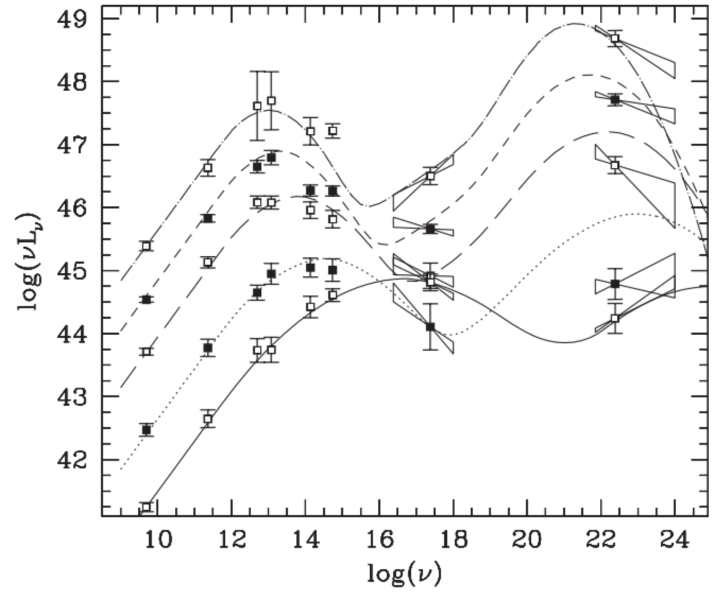
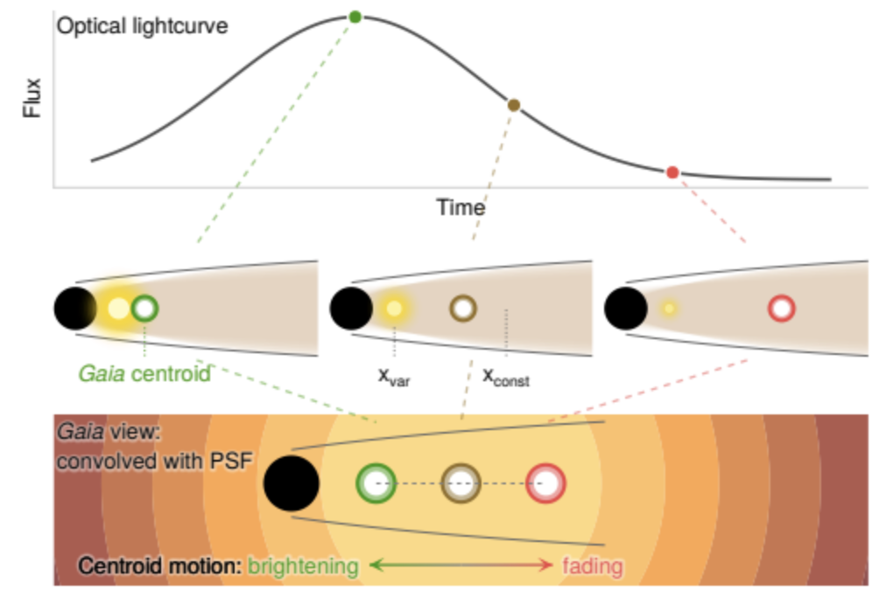

# 1. 블레이자 특징(Blazar Characteristic)

- 상대론적 제트가 지구 방향을 향할 때 보이는 AGN을 의미한다. 이로 인해, AGN의 활동성이 제트의 강력한 비열적 복사에 묻힌다.
- 전파에서 감마선 영역에 이르는 강한 연속복사 방출, 매우 빠른 변광, 대부분의 천체에서 나타나는 높은 편광도(광학 및 전파 대역 모두), 그리고 일부 천체에서는 강한 광학 방출선이 거의 없다.
    - 상대론적 제트에 의해서 방출선이 묻혀 방출선이 보이지 않는다고 생각된다.
- **플레어(flare)** 가 발생하여 밝기 변화가 짧은 시간에 갑자기 발생하기도 한다.
- 상대론적 제트의 운동으로 짧은 시간(수 시간~수일) 내에 밝기가 수십 퍼센트까지 변한다.
- BL Lac 천체의 특징과, 광학적격변 퀘이사(optically violent variable quasar 또는 OVV quasar)의 특징을 모두 보이기 때문에 이 두 천체의 이름을 합성해서 만들어진 블레이자로 명명되었다.

---

## 1.1. 블레이자 스펙트럼(Blazar Spectrum)

- 블레이자는 적어도 두 개의 넓은 방출 성분으로 이루어진 연속복사 스펙트럼을 방출한다.
- 아래는 여러 광도 class에 대한 블레이자의 SED를 보여준다.

- 위 그림에서 광도가 더 높은 블레이자일수록 더 "붉다(redder)"고 표현한다. 이는 광도가 높은 블레이자일수록 SED의 피크 주파수($\nu_{\rm peak}$)가 낮은 경향을 보인다는 것을 의미한다.
- 그러나, 이러한 경향에는 천체마다 상당한 차이가 있으며, 개별 천체는 이러한 일반적인 경향에서 벗어날 수도 있다. 

---

# 2. 블레이자 분류(Blazar Type)

- AGN unification model(Urry & Padovani, 1995)에 따르면, 블레이자는 두 가지 유형으로 나뉜다: **FSRQs**, **BL Lacs**
- 이러한 차이는 이들의 광학적 특징과 전파 morphology에서 기원한다고 설명한다. 

---

## 2.1. BL Lac 

- BL Lac은 원래 천체인 BL Lacertae의 이름을 따서 명명된 블레이자의 한 분류이다.
- 광학 스펙트럼에서 강하고 넓은 방출선이 존재하지 않는다.
    - 구체적으로는 방출선의 등가폭(equivalent width)이 ${\rm EW} < 5{\rm \mathring{A}}$ 인 경우로 정의된다.
- 상대적으로 약한 제트를 가진다.
- SED의 peak 위치에 따라 BL Lac은 다음과 같이 구분된다:
- $1.$ **Low-frequency peaked BL Lac(LBL)**: 저에너지 성분은 적외선 영역에서 peak를 가지는 반면, 고에너지 성분은 MeV 에너지 범위에서 peak를 가진다.
- $2.$ **Intermediate-frequency peaked BL Lac(IBL)**
- $3.$ **High-frequency peaked BL Lac(HBL)**: 저에너지 성분의 peak가 $100\mathrm{keV}$ 보다 높은 에너지에서 나타나며, 고에너지 성분은 $10\mathrm{TeV}$ 를 넘는 에너지까지 연장된다.

---

### 2.1.1. BL Lac과 유사한 천체

- BL Lac과 유사한 SED를 가지면서도 퀘이사와 같은 방출선을 보이는 천체들이 존재한다.
- 분류에 사용하는 특성(optical variability, optical polarization 또는 radio spectral index)에 따라 OVV(Optically Violent Variables), HPQ(High-Polarization Quasars), 또는 FSRQ(Flat-Spectrum Radio Quasars)로 분류된다. 
- $1.$ **FSRQ**
    - 폭넓은 방출선과 강력하고 매우 collimated 제트를 가진다. 
    - 높은 $\gamma$-ray 플럭스를 가진다.
    - 강한 광학 편광 현상을 보인다. 
    - 높은 전파 주파수 영역에서 outburst를 보인다.

---

## 2.2. Blazar Type Discussion

- BL Lac에서는 $\gamma$-ray 방출과 전파 변동성의 상관관계는 없는 것으로 보인다.
- FSRQs, BL Lac 모두 radio core의 brightness와 $\gamma$-ray 플럭스 사이의 연관성은 존재한다. 또한, superluminal radio knots 방출과 $\gamma$-ray outburst의 연결점이 존재한다.

---

# 3. 광학 플레어(Optical Flares)

- 블레이자의 광학 플레어에 의한 광도 곡선은 아래 그림에서 확인할 수 있다: [1] 

- $x_{\mathrm{var}}$: 광학적으로 **시간에 따라 변하는 flare 성분의 위치**이다. 즉, 순간적으로 밝아졌다 어두워지는 **compact flaring region**이 하늘에서 어디에 있는지를 뜻한다. flare가 밝아지면 Gaia centroid가 $x_{\mathrm{var}}$ 쪽으로 이동한다.
- $x_{\mathrm{const}}$: 광학적으로 **거의 일정하게 방출하는 성분의 중심 위치**이다. 주로 **extended jet emission**이 만든 평균 위치로 이해하면 된다. flare가 약해지면 전체 centroid는 다시 $x_{\mathrm{const}}$ 쪽으로 돌아간다.
- Gaia 망원경은 이러한 구조를 분해(resolve)할 수 없는데, 이는 Gaia의 ${\rm PSF}$ 가 제트의 규모보다 훨씬 크기 때문이다.  

---

# 4. 블레이자 관측(Observational Blazar)

- 블레이자는 innermost 영역에서 PA의 급격한 변동을 보이지만, kpc 스케일에서 collimated되어 남는다. (for a review of several sources, see Agudo 2009)
- 블레이자도 two-sided의 형태를 가지지만, pc-스케일 관측에서는 전형적으로 one-sided의 'core-jet'만 관측된다.
    - 이는 관측자 방향으로 향하는 상대론적 제트의 복사가 Doppler boosting되기 때문이다. 그래서 관측자에게서 멀어지는 제트는 희미하게 관측된다.

---

# 5. Discussion 

- 블레이자는 극한 환경 조건에서 상대론적인 플라즈마의 물리에 대해서 검증할 수 있는 실험실로 사용될 수 있다.
- $1\text{ GeV}$ 이상의 에너지에서, 중심 엔진 근처의 역컴프턴 산란된 compact 광자장(photon-field)은 $\gamma \gamma \rightarrow e^{\pm}$ 반응을 통해 방출되는 $\gamma$-선에 대해 매우 불투명할 것으로 예상되며(예: Ghisellini and Tavecchio, 2009), 이는 여러 블레이자에서 관측되는 $\text{GeV}$ 스펙트럼 꺾임(spectral break)의 원인이 될 수 있다(Poutanen and Stern, 2010).
- one-zone synchrotron self-Compton, SSC 및/또는 external Compton, EC 모형을 사용하는 전통적인 SED 모델링 체계에서, 블레이자는 sub-pc 크기 방출 영역 또는 더 작은 영역을 가질 것으로 생각된다. (Kubo et al. 1998)
  - 방출 영역은 제트의 기저와 연관된다고 생각된다.

- **블레이자 연구의 주요 목표** 
- $1.$ 물질을 부착하는 SMBH와 그 주변 환경의 특성에 근거하여 다양한 블레이자 분류 사이의 차이를 설명하는 것. 
- $2.$ 블레이자의 broadband 스펙트럼 특성을 결정하는 물리적 과정이 무엇인지 규명하는 것.
- $3.$ 어떤 메커니즘이 블레이자에서 나타나는 전자기 복사의 극적인 플레어를 일으키는가?

---

# Reference 

- $1.$ [Gaia Sees Blazars Move: Locating Optical Flares Using Astrometry, Alexander Plavin, 2026](https://arxiv.org/abs/2603.26662)

