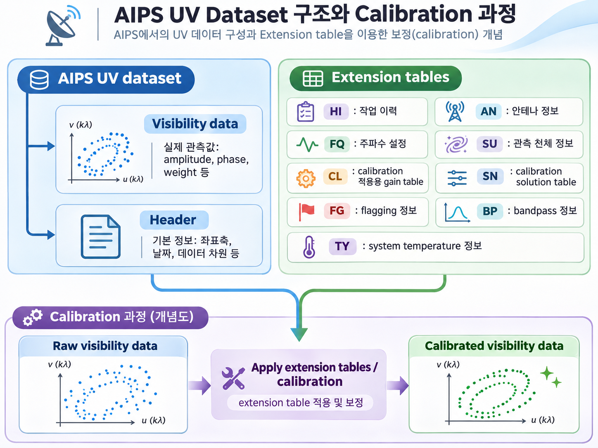

- 이 글은 VLBI 데이터를 보정할 때, 실제로 사용되는 AIPS 코드들에 대해서 소개한다. 연습용 데이터 및 AIPS 설치 과정에 관련해서는 추후에 글을 업로드 하겠다.

---

# 1. AIPS task 
- AIPS의 대부분 작업은 **task**를 통해서 이루어진다. 
	- 예: `task 'prtab'`을 입력했다면, 여기서 input은 `prtab`이 된다. 이때의 input을 **adverb**라고 한다. 
- `help`와 같은 간단한 용어는 **verb**라고 한다.

---

## 1.1. Extension Table 

- AIPS 파일은 보통 **Header + data + extension table**로 구성된다.
- 이렇게 구성하는 이유는 원본 UV data를 직접 덮어쓰지 않고, 여러 extension table을 이용하여 보정된 데이터를 새롭게 생성하기 위함이다.
- **Extension Table**은 여러 관측 정보 및 calibration 정보를 담고 있는 테이블이다.
	- 데이터 자체가 수정되지 않으므로, 테이블 삭제해서 다시 생성할 수도 있다.
- AIPS에 있는 UV data의 구조를 대략적으로 보면 아래 그림과 같다: 

{ width="100%" }

- AIPS에서 사용하는 대표적인 extension table을 정리하면 다음과 같다:

| 이름 | 역할 |
| :--- | :--- |
| **`HI`** (History) | 데이터의 처리 이력과 실행한 task 및 주요 parameter 기록 |
| **`AN`** (Antenna) | 각 안테나의 위치, 좌표, 편광 및 array 관련 정보 |
| **`FQ`** (Frequency) | 각 IF의 주파수 offset, channel 간격, bandwidth 정보 |
| **`SU`** (Source) | 관측 천체 이름, 좌표, source ID, flux 등 source 정보 | 
| **`NX`** (Index) | 관측 시간, 천체, scan 및 visibility 데이터 위치에 대한 인덱스 정보 |
| **`SN`** (Solution) | Calibration 과정에서 계산된 안테나별 complex gain, delay, rate 및 phase solution |
| **`CL`** (Calibration) | 시간에 따른 안테나별 complex gain 및 누적된 보정 정보 |
| **`BP`** (Bandpass) | 주파수 채널에 따른 안테나별 complex gain 보정 정보 |
| **`TY`** (System Temperature) | 각 안테나의 시간 및 IF에 따른 시스템 온도와 안테나 온도 정보 |
| **`GC`** (Gain Curve) | 각 안테나의 고도 등에 따른 gain curve와 감도(sensitivity) 정보 |
| **`FG`** (Flag) | Flagging 대상인 baseline, 시간, IF, channel 및 편광 정보 |
| **`PL`** (Plot) | AIPS에서 생성한 그래프의 출력 parameter와 plot 명령어 정보 |
: AIPS 주요 Extension Table 정리 {.striped .hover tbl-colwidths="[30, 70]"}

- 예를 들어, CL table은 Calibration table이라고 부른다.

---

# 2. Data get in AIPS (AIPS 안으로 데이터 불러오기) {#AIPS_Data_get}

- 관측 데이터를 AIPS 안으로 가져와서 데이터 처리를 수행하게 된다.
- AIPS는 원본 데이터를 수정하지 않고 보정을 마친 후, 얻어낸 새로운 파일을 저장하는 방식으로 데이터를 처리한다.
- AIPS 안으로 데이터를 불러올 때, `task 'fitld'`를 사용한다. `fitld`는 fits/uvfits 형태의 파일을 AIPS 안으로 불러오는 task이다. 

::: {.codeblock name="AIPS" stage="FITLD / Load data"}
```AIPS 
default fitld 
  # task 앞에 default를 붙이면, 이전에 작업했던 input parameter를 모두 초기화함. 
task 'fitld'
datain 'DATA:a25h3a.fits
  # AIPS 안에서 데이터 처리를 수행할 파일 이름을 적음.
  # AIPS는 사용자 끝에 따옴표(')를 사용하지 않으면, 대소문자를 구분한다. 'DATA:a25h3a.fits'처럼 양 끝에 따옴표를 모두 붙이면, 대소문자를 구분하지 않음.
bif 0 
  # Beginning IF로 사용할 첫 번째 IF 번호를 의미하며, 0을 주면 모든 IF를 사용함.
eif 0 
  # Ending IF로 사용할 마지막 IF 번호를 의미하며, 0을 주면 모든 IF를 사용함.
bchan 0
  # Beginnig Channel의 약자로 사용할 첫 번째 Channel 번호를 의미하며, 0을 주면 각 IF의 모든 Channel을 사용함.
echan 0
  # Ending Channel의 약자로 사용할 마지막 Channel 번호를 의미하며, 0을 주면 각 IF의 모든 Channel을 사용함.
clint 0.05 
  # CL table의 시간 샘플링(sampling) 간격으로 '분' 단위를 가지며, 보통 3초(0.05분)를 줌.
douvcomp 1
  # uv 데이터를 AIPS로 저장한다는 의미를 담고 있음.
digicor 1 
  # 디지털 보정(digital correction)을 적용함.
outdisk 1
  # AIPS disk 1번에 불러온 데이터를 저장함.
outname 'a25h3a'
	# AIPS 카탈로그에서 사용할 이름을 설정함.
inp 
  # 입력 parameter를 확인함.
go 
  # task 'fitld'를 수행함.
```

:::

<div height="2rem"></div> 

- `fitld`를 수행할 때, 특별한 용도가 아니라면, bif, eif, bchan, echan은 모두 0으로 둔다. 
- AIPS에 익숙하지 않다면 task를 수행할 때, `inp`를 항상 수행하여, 입력 parameter에 대해서 익숙해지는 것을 권장한다. 반면, 익숙하다면 `inp`를 하지 않아도 된다. 

---

## 2.1. 자주 사용하는 AIPS 명령어 정리

- 본격적인 데이터 처리 단계로 넘어가기 전에 자주 사용하는 명령어를 정리하고 가자. 
- `kleenex`: AIPS 종료
- `pca`: 현재 AIPS 내부에 있는 데이터 카탈로그를 모두 보여주는 코드
- `abort`: 특정 AIPS task를 중단하는 코드
	- 예: `abort fitld`
- `getn m`: 현재 AIPS의 `indisk`에 있는 catalog 번호 `m`번 파일을 첫 번째 입력 파일로 선택하는 코드
- `zap`: 선택한 카탈로그 파일을 제거하는 코드
	- 예: 만약에 `getn 1` 
- `help taskmane`: AIPS task에 대한 도움말을 보여주는 코드
	- 에: `help fitld`
- `starttv`: AIPS를 이루는 창 중 하나가 닫혔을 때, 복원할 수 있는 코드
- `clrmsg`: AIPS에서 사용하는 메모리에서 메시지를 초기화하는 코드
- `clrstat`: AIPS에서 파일이 읽거나(READ) 쓰고 있는(WRITE) 상태일 때, 해제하는 코드

---

## 2.2. Data check

- 이제 [2. Data get in AIPS (AIPS 안으로 데이터 불러오기)]{#AIPS_Data_get} 에서 불러온 데이터의 구조를 확인해보자. 이를 위해서 다음과 같이 수행한다.

::: {.codeblock name="AIPS" stage="Catalog and header"}
```aips 
pca 
	# disk 안에 있는 카탈로그 번호 확인
getn 1
	# 확인할 데이터의 카탈로그 번호 선택
imhe
	# 데이터 header 정보를 확인함
```
:::

---

### 2.2.1. Data Sort 
- 이 과정은 데이터 헤더(header)에서 **Sort order TB**로 확인되면 수행하지 않아도 된다.
- AIPS task들이 데이터를 안정적으로 읽고 처리할 수 있도록 UV 데이터의 행(row) 순서를 정리해야 한다. 이는 `task 'msort'`로 수행할 수 있다.

::: {.codeblock name="AIPS" stage="MSORT / Sort UV data"}
```aips 
default msort 
task 'msort'
getn 1 
	# 정렬할 데이터 카탈로그 번호 선택
sort 'TB'
	# 데이터를 '시간 순'에서 'Baseline 순'으로 정리
inp
go
```
:::

- 이 과정을 마치면, disk 안에 새로운 데이터가 생성된다.

---

### 2.2.2. AIPS table 확인 및 삭제

- AIPS task를 통해서 생성된 table, plot 목록은 다음과 같이 수행하여 확인할 수 있다.

::: {.codeblock name="AIPS" stage="EXTLIST / Inspect table"}
```AIPS 
getn 2
	# 보고 싶은 테이블이 있는 데이터 카탈로그 번호
inext 'PL'
	# 보고 싶은 table 형태 설정
inver 1
	# 보고 싶은 table 번호
extlist 
```

:::

- AIPS의 다양한 table 중에서 특정 테이블(예: SN table)을 지우고 싶다면 다음과 같이 수행한다. 

::: {.codeblock name="AIPS" stage="EXTDEST / Delete table"}
```AIPS
getn 2
	# 지우고 싶은 테이블이 있는 데이터 카탈로그 번호
inext 'PL'
	# 지우고 싶은 extension table 형태 설정
invers 2
	 #숫자는 지우고 싶은 table 번호를 의미하며, -1을 값으로 주면 모두 지움
extdest
```

:::

---

## 2.3. Possm 

- `task 'possm'`은 관측 데이터를 위상, 진폭 vs IF 별로 확인할 수 있게 해주는 기능을 한다. 
  - 전파 천문학의 visibility 스펙트럼을 그린다고 생각해도 된다. 

::: {.codeblock name="AIPS" stage="POSSM / Plot spectra"}
```AIPS  
default possm 
task 'possm'
getn 1
sources 'NRAO530' ''
	# 보고 싶은 천체 이름 설정
docalib -1
	# calibration table (CL table)을 사용하지 않음
doband -1
	# bandpass calibration을 적용하지 않음
bif 1
eif 16
bchan 2
echan 255
solint -1
	# parameter 설명은 아래 참고
aparm 0
aparm(8) 0
	# parameter 설명은 아래 참고
aparm(9) 3
	# parameter 설명은 아래 참고
nplots 4
	# 한 페이지에 4개의 안테나/IF/편광 그래프를 그림
dotv -1
	# AIPSTV에 결과를 출력함
go
```

:::

- `task 'possm'`에서 `solint`는 어떤 시간으로 스펙트럼을 볼지 결정하는 parameter이다.
  - `solint -1`: 데이터를 각 scan마다 평균해서 스펙트럼을 본다.
  - `solint 0`: 데이터의 관측 시간 전체를 평균하여 하나의 스펙트럼을 생성한다. 
  - `solint 1`: 데이터를 1분마다 평균하여 스펙트럼을 생성한다. 
  - 보통 처음 possm을 볼 때, `solint -1`으로 스펙트럼을 그려서 각 scan에서 데이터가 비어있거나 이상이 있는지 확인한다.
- `aparm(8)`은 어떤 스펙트럼을 표시할 것인지 결정하는 parameter이다. 
  - `aparm(8) 0`: Cross-power spectrum (baseline visibility) 
  - `aparm(8) 1`: Auto-power spectrum  
- `aparm(9)`는 여러 IF를 어떻게 표시할지 결정하는 parameter이다. 
  - `aparm(9) 0`: IF들을 개별적으로 표시한다. 
  - `aparm(9) 1`: 여러 IF를 하나의 plot에 함께 표시한다. 
  - `aparm(9) 3`: 여러 IF와 편광을 하나의 plot에 함께 표시한다. 

<div height="2rem"></div> 

- 만약 특정 baseline으로만 이루어진 possm을 보고 싶다면 다음의 명령어를 추가하면 된다. 

::: {.codeblock name="AIPS" stage="POSSM / Select baseline"}
```AIPS 
antennas 6
	# 6번 안테나를 기준 안테나로 설정함
baseline 8
	# 보고 싶은 안테나 번호 설정, 이 경우에는 6-8 baseline의 possm을 보게됨
	# 만약 `baseline 0`으로 주면 기준 안테나와 연결되는 모든 baseline possm을 볼 수 있음
```

:::

---

# 3. 진폭 보정(Amplitude Calibration)

- 이번 섹션에서는 AIPS에서 visibility의 진폭(amplitude)을 보정하는 방법을 살펴보자. 

---

## 3.1. ACCOR 

- `task 'accor'`은 digital sampler bias를 제거할 때, 사용한다. 
  - 참고: `task 'accor'`를 적용하기 위해서는 앞선 `task 'fitld'` 단계에서 `digicor 1`로 실행되었어야 한다.
- 간섭계 안테나에서 측정된 auto-correlation 스펙트럼의 평균값으로 cross-correlation 진폭을 보정할 수 있다. 
- `task 'accor'`은 현재 데이터에 속한 모든 안테나의 auto-correlation 스펙트럼의 평균값을 추정하여 데이터 보정을 수행한다. [1] 
- `task 'accor'`은 현재 처리 중인 데이터의 모든 SN, CL table을 무시하기 때문에 fringe fitting 혹은 추후에 수행할 self-calibration과 같은 후속 보정을 수행하기 전에 이뤄져야 한다.
- `task 'accor'`은 다음과 같이 수행한다: 

::: {.codeblock name="AIPS" stage="ACCOR / Sampler bias"}
```aips 
default accor 
task 'accor'
getn 2 
timer 0 
	# 전체 시간 데이터 선택
solint -1 
	# 각 scan마다 digital sampler bias gain 값을 추정함
go
```

:::

- 위 코드의 실행 결과로 SN table이 형성된다.
- AIPS에서는 형성된 SN table을 CL table에 업데이트하고 최종적으로 얻은 CL table을 입력 데이터에 적용하여 최종적으로 보정된 데이터를 얻는다. 
  - 이 과정에서 원본 데이터는 손실되지 않는다.
- 즉, SN -> CL -> SN -> CL이 반복되는 구조이다. 어떤 task의 시행 결과로 얻어낸 SN table을 CL table에 입력하는 방법은 다음과 같다:

::: {.codeblock name="AIPS" stage="CLCAL / Apply ACCOR solutions"}
```aips
default clcal 
task 'clcal'
getn 2 
snver 1
	# CL table에 적용할 SN table 번호 - 반드시 확인!
gainver 1 
	# 입력으로 사용할 CL table 번호 지정
gainuse 2
	# 결과를 저장할 Cl table 번호 지정
go
```

:::

- 보통 `task 'clcal'`을 처음 수행한다면, `gainver 1`로 두면 된다. 
- 어떤 번호로 해야할지 모를 때는 `imhe`를 통해서 현재 기록된 CL table 번호를 확인한 후, 그 숫자를 적어주면 된다. 

---

## 3.2. CLCOR 

- 안테나가 하늘을 추적하면서 생기는 편광 좌표계 회전 효과를 보정하여 CL table에 기록하기 위해서 다음 코드를 입력한다:

::: {.codeblock name="AIPS" stage="CLCOR / Parallactic angle"}
```aips 
default clcor 
task 'clcor'
getn 2
gainver 2
gainuse 3
opcode 'pang'
	# parallactic angle 보정을 적용하는 옵션
clcorprm 1,0
	# task 'clcor'의 세부 parameter 값으로 보편적으로 1,0을 줌
go
```

:::

- `task 'clcor'`은 **위상 보정에 전에 진행**되어야 한다.

---

## 3.3. APCAL 

- `task 'apcal'`은 안테나의 시스템 온도, gain curve를 이용하여 SEFD를 추정한 후, visibility 진폭을 보정하는 과정이다.
- 안테나의 시스템 온도와 gain curve는 **antab**이라는 파일에 기록되어 있다. antab 파일을 AIPS 내부로 가져오기 위해서 다음을 실행한다:

::: {.codeblock name="AIPS" stage="ANTAB / Load calibration data"}
```aips
default antab 
task 'antab'
getn 2
calin 'PWD:(antab 파일 이름) 
	# 예: a2418eKYS.ANTAB2.1 
tyver 2
	# 시스템 온도를 불러와서 저장할 table 번호
gcver 1
	# gain curve를 불러와서 저장할 table 번호
go
```

:::

- `task 'antab'`은 계속 수행하면 해당 파일에 데이터를 덮어 쓴다.
- a priori method를 통해서 진폭 보정을 수행하기 위해 `task 'apcal'`을 이용한다.

::: {.codeblock name="AIPS" stage="APCAL / Amplitude calibration"}
```aips 
default apcal 
task 'apcal'
getn 2
tyver 2 
	# task 'apcal'에 사용할 시스템 온도 table 번호
gcver 1 
	# task 'apcal'에 사용할 gain curve table 번호
snver 2 
	# 저장할 SN table 번호
```

:::

- 안테나의 시스템 온도와 `task 'apcal'`로 얻어낸 gain 값을 보기 위해서 `task 'snplt'`를 아래와 같이 수행한다.

::: {.codeblock name="AIPS" stage="SNPLT / System temperature"}
```aips 
default snplt 
task 'snplt'
getn 2
inext 'ty'
	# Ty table 지정 
inver 2
	# 시스템 온도가 기록된 table 번호
optype 'tsys'
	# 그래프의 y축에 시스템 온도 설정
opcode 'alif'
	# 모든 IF에 기록된 시스템 온도를 봄
nplots 4 
	# 하나의 페이지에 출력할 "시스템 온도 vs 시간" 그래프 개수
dotv -1 
go 
```

:::

- 위 코드는 시스템 온도에 대한 결과만 알려준다. gain에 대한 결과도 보기 위해서 다음과 같이 수행한다.

::: {.codeblock name="AIPS" stage="SNPLT / Amplitude gain"}
```aips 
tget snplt 
	# 이전에 사용한 task 'snplt' 설정을 그대로 유지함
inext 'sn'
	# SN table 지정
inver 2 
	# gain 값이 기록된 SN table 번호 지정
optype 'amp'
	# 안테나별 amplitude gain 보정 값을 보여줌
go
```

:::

- 시스템 온도와 gain의 경향성이 유사하게 따라가는 것을 확인했다면, 진폭 보정이 완료된 것이다. 진폭 보정을 거친 SN table을 CL table에 넣기 위해 다음과 같이 수행한다.

::: {.codeblock name="AIPS" stage="CLCAL / Apply amplitude solutions"}
```aips 
default clcal 
task 'clcal'
getn 2
interpol 'self' 
snver 2
gainver 3
gainuse 4
go
```

:::

- `interpol`: calibrator solution을 시간 보간해서 다른 source에도 적용할 수 있는 기능이다.
  - `interpol 'self'`: 이 설정은 각 source를 보정할 때, 다른 source를 정보를 이용하지 않고, source 자체가 지닌 데이터만 이용하여 보정한다는 것을 뜻한다.

---

## 3.4. Amplitude Calibration Discussion

- 만약에 특정 안테나의 antab 없어서 따로 진폭 보정을 수행하게 된다면, `task 'apcal'`에서 `antenna` 옵션을 주어서 해당 안테나만 진폭 보정을 수행한 후, 기존의 CL table에 `task 'clcal'`을 수행하면 된다.


---

# Reference 

- $1.$ [Effect of Digitizers Errors on the Cross and Auto Correlation Response of an FX Correlator, L.Kogan, 1995](https://science.nrao.edu/facilities/vlba/publications/memos/sci/sci09memo.pdf)


<style>
h2 {
border-bottom: none !important;
}
</style>

