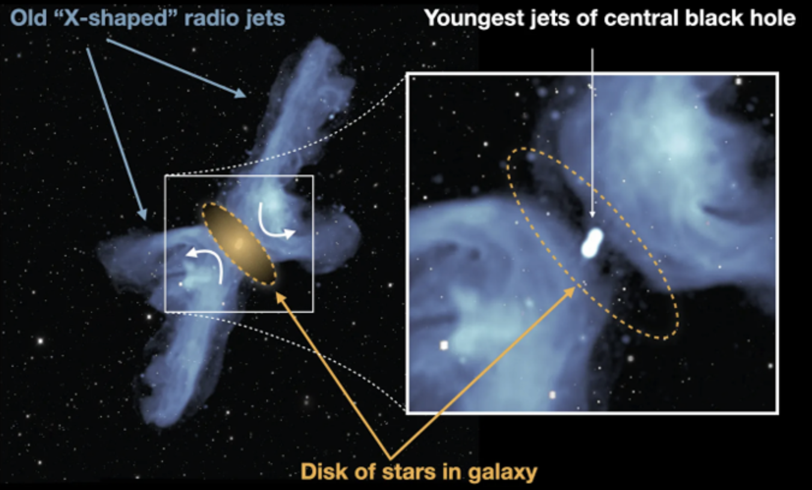

# 1. 상대론적 제트 특징

- **상대론적 제트(relativisitc jet)**: AGN(SMBH)의 "central engine"에서 방출되는 매우 collimated outflow를 지칭한다. 
- 제트는 AGN의 중심부에서 양극 방향으로 방출되는 거대한 에너지 흐름이다. (e.g., Barthel, 1989; Urry and Padovani, 1995) 
    - 제트는 central engine으로부터 멀리 떨어진 영역까지 운동량과 에너지를 운반한다. 
    - 일부 천체에서는 이러한 운동량과 에너지가 은하핵으로부터 수백 kpc ~ Mpc 스케일까지 운송된다. 
- 제트가 관측되는 천체들의 예시: young stellar objects (YSOs), X-ray binaries (XRBs), AGN and $\gamma$-ray bursts (GRBs), 백색왜성, 마이크로퀘이사 등...
- 이렇듯 제트는 다양한 천체에서 관측되며, 대체로 비슷한 특징을 고유한다. 
- 특히, AGN에서 방출되는 대규모 제트는 은하 중심을 넘어 모은하 및 은하단까지 영향을 미친다. (Fabian 2012) (아래 그림 참고)

- 대부분의 제트는 수 도 정도의 좁은 opening angle을 가진다. 
- 제트는 자기화되어 방대한 싱크로트론 복사를 방출한다. 
- 방출된 outflows는 수kpc, 때로는 Mpc 거리까지 방해받지 않고 전파되며, 전자기 스펙트럼의 광범위한 구간에 걸쳐 복사를 방출한다.
- 제트의 total power는 보통 $10^{43} - 10^{48} {\ \rm erg/s}$  (Ghisellini et al., 2014) 범위에서 변하며, 복사 형태가 아니라 다양한 다른 형태로 전달된다.
    - 예: 제트 입자(전자, 양성자, 플라즈마 등)의 bulk 운동, 자기장이 운반하는 에너지, 플라즈마의 내부에너지(열, 난류), shock 및 팽창을 통해 주변 매질에 전달하는 일(전파 로브 형성), 우주선 가속 등
- 이러한 강력한 전파 제트는 주로 거대 타원 은하에서 관측된다. (Padovani et al. 2017)
- AGN 제트의 초상대론적(ultrarelativistic) flow 속도는 관측되는 beaming, aberration, 그리고 light-travel delay에 영향을 받는다. 이러한 물리적 효과들은 겉보기(apparent) superluminal motion, 플럭스 밀도의 상승, 플럭스와 편광의 variability timescales 감소와 같은 현상을 만들 수 있다.
