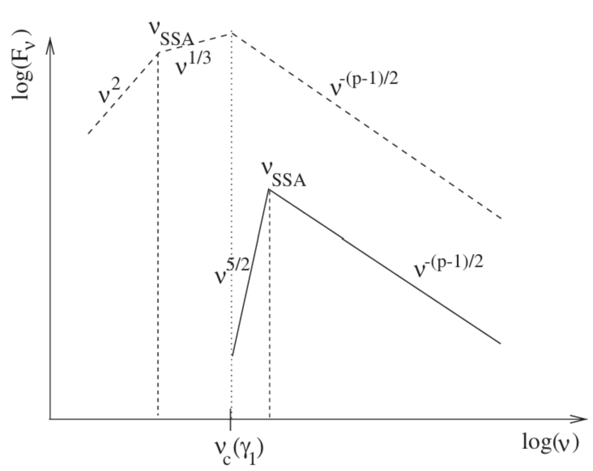
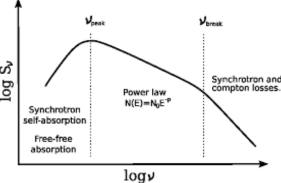

# 1. Sychrotron Self-Absorption, SSA 

- **Sychrotron Self-Absorption(SSA)** 는 저주파 영역에서 싱크로트론 복사로 방출된 "광자"가 자기장 속의 전하와 상호작용한 뒤, 흡수되어 자신의 에너지를 "전하"에 넘겨주는 현상이다. 
- SSA를 알아보기 위해, 흡수된 광자의 에너지가 상대론적 전자 에너지보다 매우 작다고 가정하자: $h\nu \ll E$. 
- 이러한 가정 아래, 복사 과정과 연관된 흡수 계수(absorption coefficient)는 다음과 같다: 

$$ 
\alpha_\nu=-\frac{1}{8\pi m\nu^2}  \int_1^\infty  d\gamma  
P_\nu(\gamma)
\gamma^2  
\frac{\partial}{\partial\gamma}  
\left(  
\frac{n[\gamma]}{\gamma^2}  
\right).  \tag{1.1}
$$

- 식 (1.1)에서 입자들의 분포가 오로지 다음과 같은 spectral index $p$ 를 가지는 power-law 형태라면,

$$
n(\gamma) = n_0 \gamma^{-p} \tag{1.2}
$$

- 식 (1.1)은 다음과 같다: 

$$
\alpha_\nu^{\mathrm{PL}}
=
-\frac{(p+2)}{8\pi m\nu^2}  
\int_1^\infty  
d\gamma  
P_\nu(\gamma)  
\frac{n(\gamma)}{\gamma}.  \tag{1.3}
$$

 

- 식 (1.3)을 계산하기 위해서는 $P_{\nu}(\gamma)$ 를 알아야하는데, 이를 결정하는 것은 쉽지 않다. 
- 가장 단순한 근사는 Lorentz factor $\gamma$ 를 가진 전자가 방출하는 싱크로트론 복사가 주로 characteristic frequency $\nu_c$ 근처에서 나온다고 보고 그때의 방출률(emissivity)을 델타함수(delta-function)로 나타내는 것이다. 이러한 근사는 방출이 특정한 characteristic frequency 근처에서 가장 강하므로 거의 타당하다. 이때, $P_\nu^{\mathrm{sy},\delta}(\gamma)$ 는 다음과 같다:
    - 실제로는 어떤 전자가 Lorentz factor $\gamma$ 를 가질 때, 그 전자는 넓은 주파수 범위에 걸쳐 싱크로트론 복사를 방출한다. 

$$ 
P_\nu^{\mathrm{sy},\delta}(\gamma)
=
\frac{32\pi}{9}  
\left(  
\frac{q^2}{mc^2}  
\right)^2  
u_B\beta^2\gamma^2  
\delta(\nu-\nu_c). \tag{1.4}
$$

- $u_B =B^2 /8\pi$: 자기장 에너지 밀도
- $\beta = v /c$: 입자의 속도($v$)를 광속($c$)으로 나눈 값
- $\nu_c$ 는 다음과 같이 정의된다: 

$$
\nu_c= \frac{3}{2}\gamma^2\nu_G\sin\alpha=\frac{3}{2}\gamma^3\nu_B\sin\alpha
$$

- $\nu_G=\omega_G / 2\pi$: 비상대론적 자이로 주파수(non-relativistic gyro-frequency)
- $\nu_B:$ 상대론적 자이로 주파수(relativistic gyro-frequency)
- $\alpha$: pitch angle 
- 이제 식 (1.4)를 이용하면 식 (1.3)의 적분 결과는 다음과 같다: 

$$ 
\alpha_\nu^\delta
=
\frac{(p+2)}{18\pi m}  
\left(  
\frac{3q}{4\pi mc}  
\right)^{\frac{p-2}{2}}  
\left(  
\frac{q^2}{mc^2}  
\right)^2  
B^{\frac{p+2}{2}}  
\nu^{-\frac{p+4}{2}}. \tag{1.5} 
$$

- 식 (1.5)는 SSA에 대한 opacity는 주파수가 감소함에 따라서 빠르게 증가하는 것을 보여준다.
- 따라서 비열적 싱크로트론 전파원(non-thermal synchrotron source)은 critical break frequency $\nu_{\mathrm{SSA}}$ 이하에서 optically thick한 경향을 가진다. 이때, $\nu_{\mathrm{SSA}}$ 를 **synchrotron self-absorption frequency**라고 한다. 
    - $\nu_{\mathrm{SSA}}$ 는 $\tau_{\nu_{\mathrm{SSA}}}=R\alpha_{\nu_{\mathrm{SSA}}}=1$ 을 만족한다. 이때 $R$ 은 optical depth의 정의에 의해 source size 또는 path length를 의미한다. 
- $\nu_{\mathrm{SSA}}$ 이하의 주파수에서는 optically thick한 경향을 가지기 때문에 이때의 스펙트럼은 다음과 같이 주어진다: 

$$ 
I_\nu(\tau_\nu \gg 1)
=
S_\nu\left(1-e^{-\tau_\nu}\right)  
\approx  
S_\nu =\frac{j_\nu}{\alpha_\nu} \tag{1.6}
$$

- 만약 $\nu_{\mathrm{SSA}}$ 가 $\alpha_{\mathrm{sy}}={p-1} / {2}$ 의 power-law가 성립하는 주파수 범위 안에 있다면 optically thick한 스펙트럼은 다음과 같이 주어진다: (즉, $\nu_{\mathrm{SSA}}>\nu_c(\gamma_1)$)

$$
S_\nu  
\Big|_{\nu_{\mathrm{SSA}}>\nu_c(\gamma_1)}
=
\frac{j_\nu}{\alpha_\nu}  
\Big|_{\nu_{\mathrm{SSA}}>\nu_c(\gamma_1)}  
\propto  
\nu^{5/2}B^{-1/2} \tag{1.7} 
$$

- 그러나, $\nu_{\mathrm{SSA}}$ 가 power-law 범위 밖에 있다면(즉, $\nu_{\mathrm{SSA}}<\nu_c(\gamma_1)$), 전자 하나당 spectral power는 모든 $n(\gamma)>0$ 에 대해 $P_\nu(\gamma)\propto \nu^{1/3}$ 로 근사된다. 이 경우, $j_\nu\propto \nu^{1/3}$, $\alpha_\nu\propto \nu^{-5/3}$ 이므로 source function은 다음과 같다: 

$$ 
S_\nu  
\Big|_{\nu_{\mathrm{SSA}}<\nu_c(\gamma_1)}  
\propto  
\nu^2  \tag{1.8}
$$

- 각 케이스를 종합하여 스펙트럼 그리면 아래 그림과 같다: [1]

{width=300px}

- 위 그림에서 점선은 $\nu_{\mathrm{SSA}}<\nu_c(\gamma_1)$ 인 경우를, 실선은 $\nu_{\mathrm{SSA}}>\nu_c(\gamma_1)$ 인 경우를 의미한다. 
- $\nu_{\mathrm{SSA}}<\nu_c(\gamma_1)$: $\nu < \nu_{\text{SSA}}$ 인 경우, optically thick하며 주파수가 감소함에 따라 $\nu^2$ 에 비례하여 플럭스가 감소한다. $\nu_{\mathrm{SSA}}< \nu <\nu_c(\gamma_1)$ 라면 optically thin하며 주파수가 증가함에 따라 플럭스가 $\nu^{1/3}$ 에 비례하여 증가한다. 
- $\nu_{\mathrm{SSA}}>\nu_c(\gamma_1)$: $\nu_c(\gamma_1) < \nu  < \nu_{\mathrm{SSA}}$ 인 경우, optically thick하며, 주파수가 감소함에 따라 $\nu^{5/2}$ 에 비례하여 플럭스가 감소한다. 
- 2가지 경우 모두 주파수가 높은 영역에서 optically thin하며, 그때의 플럭스는 주파수가 증가함에 따라 $\nu^{-(p-1)/2}$ 에 비례하여 감소한다. 
    - 즉, 높은 주파수에서는 입자 개수가 적어 대체로 광자들이 탈출하기 쉬워 제트 관측에 유리하다.
- 그림 1에서 실선 부분만 확대하면 아래 그림과 같다: 

{width=300px}

- SSA 현상은 주파수가 낮은 경우, 광자의 수가 더 많기 때문에 광자와 전자의 상호작용이 활발하여 더 나타나기 쉽다. 
- SSA 현상과 같은 흡수 현상은 블랙홀 중심부에서 단위 부피당 입자 개수가 더 크기 때문에 더 활발하여 일어난다. 반면, 블랙홀 중심부에서 멀어질수록 단위 부피가 작아져 다양한 주파수의 광자가 탈출할 수 있게 된다. 
- 식 (1.8)은 관측되는 intensity가 주파수와 자기장에 따라서 달라질 수 있음을 보여준다.

---

# 2. Discussion 

- 40GHz 이하에서는 SSA등과 같은 현상으로 인해 관측에 어려움이 존재한다. 
- conical jet model에서도 저주파수에서 기울기가 양수임이 보고되었다. (Blandford & Konigl 1979)

---

# Reference 

- $1.$ Relativistic Jets from Active Galactic Nuclei Markus Böttcher et al.
- $2.$ [https://encrypted-tbn0.gstatic.com/images?q=tbn:ANd9GcRfxVSueZskXK4Fn_2deiLhNgtSwGVn26V0_py8QAxyVhrvv6fQWZmOi5E&s=10](https://encrypted-tbn0.gstatic.com/images?q=tbn:ANd9GcRfxVSueZskXK4Fn_2deiLhNgtSwGVn26V0_py8QAxyVhrvv6fQWZmOi5E&s=10)