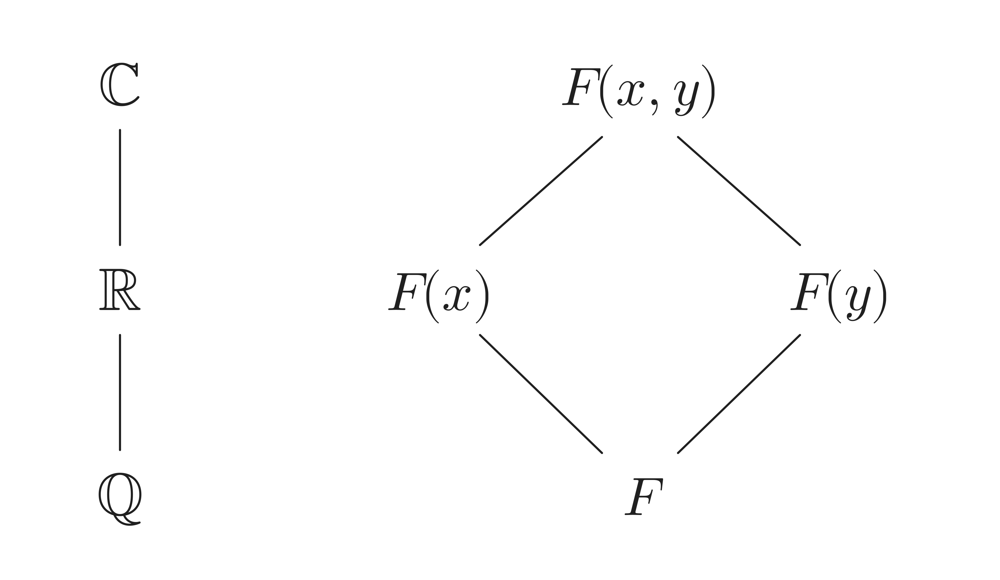

# Extension Field
## Definition 1
::: {.math-box}
A field $E$ is an ***extension field*** of a field $F$ if $F$ is a subfield of $E$. In this case, we write $F \le E$.
:::

정의 자체는 단순하게 주어진 필드 $F$를 포함하는 필드 $E$를 $F$의 확대체(extension field)라고 부른다. 간단한 예시로 $\mathbb{Q} \le \mathbb{R} \le \mathbb{C}$가 있고, $F \le F(x), F(y) \le F(x, y)$ 등이 있다.

## Theorem 1 (Kronecker's Theorem)
::: {.math-box}
Let $F$ be a field and let $f(x) \in F[x]$ with $\deg(f(x)) \ge 1$. Then there exists an extension field $E$ of $F$ and $\alpha \in E$ such that $f(\alpha) = 0$.
:::

확대체를 공부하는 이유는 너무 자연스럽게도 실수계수 다항식 $x^2 + 1 \in \mathbb{R}[x]$은 $\mathbb{R}$에서는 영점이 존재하지 않지만 그 확대체 $\mathbb{C}$를 생각하면 영점이 존재하는 상황을 익히 다뤄왔기 때문이다. 크로네커 정리는 이러한 상황을 일반적으로 보장해주는 정리로써, 주어진 다항식의 해를 포함하는 확대체가 반드시 존재한다는 강력한 정리이다.

예컨대 $x^4 - 5x^2 + 6 \in \mathbb{Q}[x]$와 같은 다항식은 $(x^2-2)(x^2-3)$으로 인수분해되므로 $\mathbb{Q}$ 위에서는 영점을 가지지 않는다. 그러나 $\mathbb{Q}$의 확대체 $\mathbb{R}$을 고려하면 $x^2 - 2 = 0, x^2 - 3 = 0$을 만족하는 $x$들이 $\mathbb{R}$에 존재함을 보일 수 있다.

증명 과정을 보면 알겠지만 다이렉트하게 $F \subset E$는 아니고 적당한 함수 $\phi$를 줄 수 있어서 $F$가 $\phi$를 통해 $E$에 임베딩 될 수 있음을 보인다. 이때 $E = F[x] / (p(x))$와 같이 정의하며 $F$는 $\phi: F \to E$에 의해 $\phi(a) = a + (p(x))$와 같이 임베딩된다.

::: {.callout-note title="Proof" icon=false collapse="true"}
:::

## Corollary
::: {.math-box}
$\mathbb{R}[x]/(x^2+1) \cong \mathbb{C}$
:::

이제 $\mathbb{R}$의 확대체를 통해 위에서 언급한 $f(x) = x^2+1 \in \mathbb{R}[x]$의 영점이 확대체에 존재함을 보여보자. 자명하게 $f(x)$는 $\mathbb{R}$에서 기약원이고, 따라서 $\mathbb{R}[x]/(x^2+1)$은 체가 된다. 그러면 실수 $r \in \mathbb{R}$은 $r + (x^2+1) \in \mathbb{R}[x]/(x^2+1)$과 같이 확대체 $\mathbb{R}[x]/(x^2+1)$의 원소로 간주함으로 임베딩된다.

이제 $\alpha = x + (x^2+1)$로 두면 $\alpha \in \mathbb{R}[x]/(x^2+1)$이고 다음의 계산이 성립한다.

$$\begin{align*}
f(\alpha) &= \alpha^2 + 1 \\
&= (x + (x^2+1))^2 + (1+(x^2+1)) \\
&= (x^2+ (x^2+1)) + (1+(x^2+1)) \\
&= (x^2+1)+(x^2+1) \\
&= (x^2+1) \\
&= 0
\end{align*}$$

따라서 $\alpha$는 $\mathbb{R}[x]/(x^2+1)$ 안에서 $x^2+1$의 영점이 된다.

# Algebraic and Transcendental
## Definition 2
::: {.math-box}
Let $E$ be an extension field of a field $F$, and let $\alpha \in E$.

**(i)** $\alpha$ is said to be ***algebraic over*** $F$ if $f(\alpha) = 0$ for some $f(x) \in F[x] \setminus \{ 0 \}$.

**(ii)** $\alpha$ is said to be ***transcendental over*** $F$ if $\alpha$ is not algebraic over $F$.
:::

쉽게 말해 어떤 수가 주어진 체 위에서 방정식의 해가 되면 대수적이고, 대수적이지 않다면 초월적이라고 부른다. 간단한 예시로 $\sqrt{2}$는 $x^2 - 2 \in \mathbb{Q}[x]$의 영점이므로 $\mathbb{Q}$ 위에서 대수적이고, 허수 $i$ 또한 마찬가지로 $x^2 + 1 \in \mathbb{Q}[x]$의 영점이므로 $\mathbb{Q}$ 위에서 대수적이고, 당연하게도 $\mathbb{R}$ 위에서도 대수적이다. 또한 $\sqrt{1+\sqrt{3}}$과 같은 수도 간단한 계산을 통해 $\mathbb{Q}$ 위에서 대수적임을 보일 수 있다. 반면 잘 알려진 사실로써, 무리수 $\pi$와 $e$는 $\mathbb{Q}$ 위에서 초월적이다.

나아가 특별하게 $\mathbb{Q}$ 위에서 대수적이냐, 초월적이냐를 기준으로 대수적 수와 초월적 수를 구분한다.

::: {.math-box}
Let $\alpha \in \mathbb{C}$.

**(iii)** $\alpha$ is called an ***algebraic number*** if $\alpha$ is algebraic over $\mathbb{Q}$.

**(iv)** $\alpha$ is a ***transcendental number*** if $\alpha$ is transcendental over $\mathbb{Q}$.
:::

## Theorem 2
::: {.math-box}
Let $E$ be an extension field of $F$, and let $\alpha \in E$. 

**(i)** Let $\phi_\alpha: F[x] \to E$ be the evaluation homomorphism of $F[x]$ into $E$. Then 

$$\begin{align*}
\alpha \text{ is transcendental over } F &\iff \phi_\alpha \text{ gives an isomorphism of } F[x] \text{ with a subdomain of } E \\
&\iff \phi_\alpha \text{ is a ring homomorphism}
\end{align*}$$

**(ii)** Suppose that $\alpha$ is algebraic over $F$. Then there exists a polynomial $p(x) \in F[x]$ such that 

1. $p(\alpha) = 0$,

2. $p(x)$ is irreducible in $F[x]$,

3. $p(x)$ is uniquely determined up to a constant in $F$,

4. $1 \le \deg(p(x)) \le \deg(f(x))$ for any $f(x) \in F[x]$ with $f(\alpha) = 0$, that is, $p(x)$ is of minimal degree $\ge 1$ in $F[x]$ having $\alpha$ as a zero,

5. $p(x)$ divides $f(x)$ for any $f(x) \in F[x]$ with $f(\alpha) = 0$.
:::

정리 **(ii)**는 매우 강력한 사실을 말해주는데, 대수적인 수 $\alpha$를 기준으로 $F[x]$의 다항식들을 분류할 수 있는 기준이 되는 다항식 $p(x)$를 만들어낼 수 있음을 말해준다. 예컨대 $\sqrt{2}$는 앞서 살펴본 것처럼 $\mathbb{Q}$ 위에서 대수적이고, $\sqrt{2}$를 영점으로 갖는 다항식들을 생각해보면 $x^2 - 2, x^3 - 2x, x^4 - 3x^2 + 2$등이 존재한다. 자세히 보면 뒤의 두 다항식은 모두 $x^2 - 2$의 배수임을 알 수 있는데, 이게 특수한 상황이 아니라 지극히 일반적인 상황이라는 것이다. 

::: {.callout-note title="Proof" icon=false collapse="true"}
**(i)**

**(ii)**
:::

## Theorem 3

# Reference
- John B. Fraleigh. (2004). A First Course in Abstract Algebra (7th ed.). Pearson.