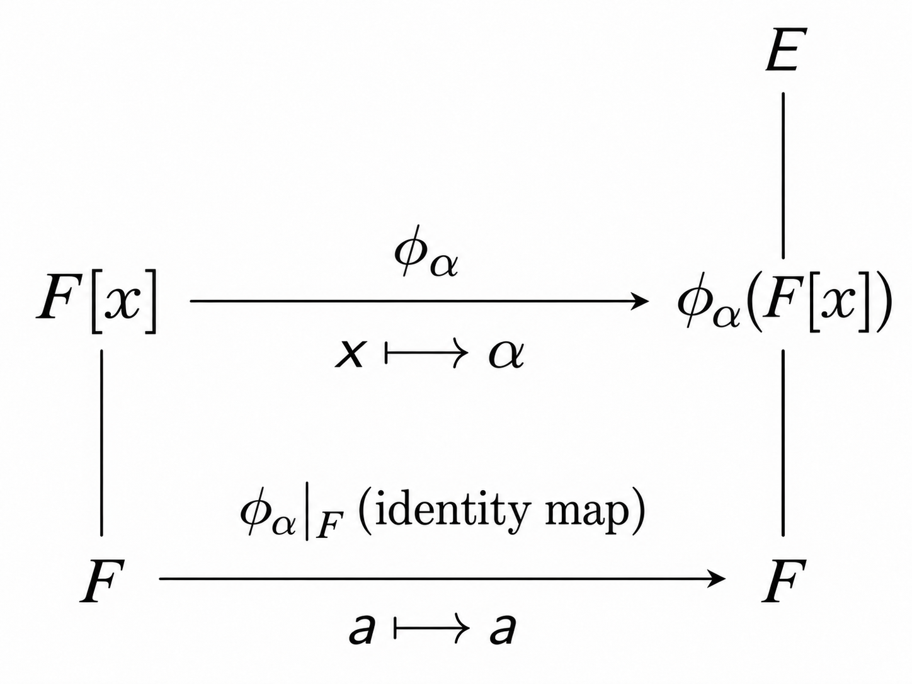

# Polynomial Ring
## Definition 1
Let $R$ be a ring. A ***polynomial*** $f(x)$ with coefficients in $R$ is 

$$f(x) = \sum_{i=0}^\infty a_ix^i = a_0 + a_1x + a_2x^2 + \cdots$$

where $a_0, a_1, \cdots \in R$ and $a_i = 0$ for all but finite numbers of values of $i$. Each $a_i$ is called a ***coefficient*** of $f(x)$. If $a_i \neq 0$ for some $i \ge 0$, then the largest such value of $i$ is the ***degree*** of $f(x)$. We define the degree of $0 \in R[x]$ as $-\infty$. The set of all polynomials in $x$ with coefficients in $R$ is denoted by $R[x]$.

대수적으로 다항식은 환 $R$ 위에서 정의된다. 다시 말해 어떤 환이 주어지느냐에 따라서 다항식이 속하는 범위가 달라진다. 예컨대 $\frac{1}{2} + 3x \notin \mathbb{Z}[x]$이지만 $\frac{1}{2} + 3x \in \mathbb{Q}[x]$이다. 따라서 다항식을 다룰 때는 어떤 환 위에서 주어졌는지 반드시 파악해야 한다.

한편 다항식 $f(x) = 0$의 차수는 $0$이 아닌 $-\infty$로 정의한다. 이는 다항식의 곱에서 차수를 보존하는 문제와 관련되어 있는데, 예컨대 $n$차 다항식 $f(x)$와 $m$차 다항식 $g(x)$가 주어졌을 때 우리는 두 다항식을 곱해서 얻은 다항식 $f(x)g(x)$의 차수가 $(n+m)$ 차가 되기를 바란다. 만약 $f(x) = 0$이라면 $f(x)g(x) = 0$이고, 곱의 차수는 $0+m = m$차가 아닌 $0$차가 되버리는 일이 생긴다. 이런 일을 허용하지 않으려면 $f(x) = 0$의 차수를 $\infty$ 혹은 $-\infty$와 같이 정의해야 할 필요가 생기고, 여기서는 $-\infty$로 정의한다.

또한 주의해야 할 점은 $R[x]$에서 $x$의 사용법이다. 다항**식**과 다항**함수**는 엄연히 다른 대상이다. 예컨대 함수 $f: \mathbb{R} \to \mathbb{R}$가 $f(x) = x^2 + 4$와 같이 정의되었다면 $f(x)$는 다항**함수**이다. 여기서 $x$의 역할은 변수이며, $\mathbb{R}$의 임의의 값을 "대입"해도 된다. 반면 $f(x) = x^2 + 4 \in \mathbb{R}[x]$는 다항**식**이며, 여기서 $x$의 역할은 단순히 각 항의 차수를 표현하는 역할을 하는 $\mathbb{R}[x]$의 어떤 원소이다. 즉 $x$는 $1 \cdot x \in \mathbb{R}[x]$로 취급되며, $x = 2, 3$과 같이 어떤 값을 대입할 수 있는 대상이 아니다. 이러한 맥락에서 $f(x) = 0$을 다항식의 언어로 보면 $f(x) \in \mathbb{R}[x]$가 영다항식이란 결론이 되고, 이는 우리가 흔히 생각하는 방정식과는 다른 개념이다.

때문에 다항식 $f(x) \in R[x]$를 $R$에서의 다항함수처럼 취급하기 위해서 evaluation homomorphism $\phi_\alpha$가 필요하다. 즉 $\alpha \in R$에서의 $f(x)$의 값 $f(\alpha)$를 $\phi_\alpha(f(x))$로 정의하는 것이다.

## Theorem 1
Let $R$ be a ring. 

**(i)** $\langle R[x], +, \cdot \rangle$ is a ring under the addition and multiplication defined as: for $f(x) = a_0 + a_1x + \cdots$ and $g(x) = b_0 + b_1x + \cdots$

$$\begin{align*}
(f + g)(x) &:= (a_0 + b_0) + (a_1 + b_1)x + \cdots \\
(fg)(x) &:= (a_0b_0) + (a_0b_1 + a_1b_0)x + (a_0b_2 + a_1b_1 + a_2b_0)x^2 + \cdots \\
&= \sum_{k=0}^\infty \left( \sum_{i=0}^k a_ib_{k-i} \right)x^k
\end{align*}$$

**(ii)** $R$ is commutative $\iff$ $R[x]$ is commutative.

**(iii)** $R$ has the unity $\iff$ $R[x]$ has the unity.

**(iv)** $R$ is an integral domain $\iff$ $R[x]$ is an integral domain.

**(v)** $R$ is a subring of $R[x]$.

당연하게도 환 $R$에서 정의된 다항식들의 집합 $R[x]$는 환이 됨을 알 수 있고, $R[x]$는 $R$과 여러 성질을 공유한다는 사실까지 알 수 있다. 관점을 바꿔서 보면 $R$은 $R[x]$에서 상수함수들을 모아놓은 집합이라고 볼 수 있고, 따라서 $R[x]$의 부분환으로 주어진다.

한편 위에서 $0$의 차수를 설명하면서 언급했던, 다항식의 곱에서 차수가 보존되는지에 대한 문제는 $R$이 정역(integral domain)이면 자연스럽게 해결됨을 알 수 있다. 만약 $R$이 정역이 아니라면, 예컨대 $R = \mathbb{Z}_6$와 같이 주어지면 $2x, 3x \in \mathbb Z_6[x]$에 대해서 $(2x)(3x) = 0$이므로 차수가 보존되지 않게 된다.

## Theorem 2
Let $F$ be a subfield of a field $E$, and let $\alpha \in E$. Then the ***evaluation map*** $\phi_\alpha: F[x] \to E$ defined by

$$\phi_\alpha(a_0 + a_1x + \cdots + a_nx^n) = a_0 + a_1\alpha + \cdots + a_n\alpha^n$$

for all $f(x) = a_0 + a_1x + \cdots + a_nx^n \in F[x]$ is a homomorphism. 

If $\phi_\alpha(f(x)) = f(\alpha) = 0$, then $\alpha$ is called a ***zero*** of $f(x)$. We define

$$\ker(\phi_\alpha) = \{ f(x) \in F[x] \mid f(\alpha) = 0 \}.$$

즉 $\phi_\alpha$는 $x \mapsto \alpha$로 치환하며, 상수는 $a \mapsto a$와 같이 그대로 매핑하는 사상이다. 다시 말해 $\phi_\alpha \big \vert_F : F \to E$는 항등함수이며, 이러한 관계를 요약하면 다음과 같다.

우리는 위 사실들을 가지고 다항식 $f(x) \in F[x]$에 대하여 방정식 $f(x) = 0$이 해를 갖는다는 사실이 어떤 $\alpha \in E$에 대하여 $f(x) \in \ker(\phi_\alpha)$와 정확히 동일함을 알 수 있다. 거꾸로 말해서, 만약 $f(x) \in \ker(\phi_\alpha)$라면 $f(x)$는 $(x-\alpha)$를 인수로 가지고 있음을 알 수 있다. 이와 같은 논의를 통해 방정식의 해라던지, 인수와 같은 개념을 대수적으로 풀어낼 수 있다.

# Factorization
## Theorem 3
Let $F$ be a field, and let $f(x), g(x) \in F[x]$.

**(i)** **(Division Algorithm for $F[x]$)** Let $f(x) = a_nx^n + \cdots + a_0$, $g(x) = b_mx^m + \cdots + b_0 \in F[x]$ with $a_n, b_m \neq 0$ and $m \ge 1$. Then there uniqely exists $q(x), r(x) \in F[x]$ such that

$$f(x) = q(x) g(x) + r(x)$$

where either $r(x) = 0$ or [$r(x) \neq 0$ and $\deg(r(x)) < m$.]

**(ii)** **(Factor Theorem)** An element $a \in F$ is a zero of $f(x)$ $\iff$ $x-a$ is a factor of $f(x)$ in $F[x]$.

**(iii)** If $f(x)$ is of degree $n \ge 1$, then $f(x)$ can have at most $n$ zeros in $F$.

**(iv)** Note that if $F^\ast = F \setminus \{ 0 \}$, then $\langle F^\ast, \cdot \rangle$ is a abelian group. If $G$ is a finite subgroup of $\langle F^\ast, \cdot \rangle$, then $G$ is cyclic. In particular, if $F$ is finite, then $\langle F^\ast, \cdot \rangle$ is a cyclic group.

**(v)** The units in $F[x]$ are precisely the nonzero elements of $F$.

### Proof
**(i)** First, we will show that such expression always exists.

Let $S = \{ f(x) - s(x)g(x) \mid s(x) \in F[x] \}$. Note that $S \subset F[x]$ and $S \neq \emptyset$. If $0 \in S$, then $f(x) = s(x)g(x)$ for some $s(x) \in F[x]$. Taking $q(x) = s(x)$ and $r(x) = 0$, we obtain $f(x) = q(x)g(x) + r(x)$.

If $0 \notin S$, then the set of degrees of polynomials in $S$ is nonempty subset of nonnegative integers. By Well-ordering principle, we can choose $r(x) \in S$ such that $\deg(r(x))$ is minimal in $S$. Let $r(x) = f(x) - q(x) g(x)$ for some $q(x) \in F[x]$. Then $f(x) = q(x) g(x) + r(x)$ and $r(x) \neq 0$.

Now we show that $\deg(r(x)) < m = \deg(g(x))$. If we write $r(x) = c_\ell x^{\ell} + \cdots + c_0$ with $c_\ell \neq 0$, then $\deg(r(x)) = \ell$. Suppose that $\ell \ge m$. If we define

$$h(x) := r(x) - \frac{c_{\ell}}{b_m} x^{\ell - m}g(x) \in F[x],$$

then $\deg(h(x)) < \ell$ because

$$\begin{align*}
h(x) &= r(x) - \frac{c_{\ell}}{b_m} x^{\ell - m}g(x) \\
&= (c_\ell x^\ell + c_{\ell - 1} x^{\ell - 1} + \cdots + c_0) - \frac{c_\ell}{b_m}x^{\ell - m} (b_mx^m + b_{m-1}x^{m-1} + \cdots + b_0) \\
&= (c_\ell x^\ell + c_{\ell - 1} x^{\ell - 1} + \cdots + c_0) - (c_\ell x^{\ell} + B_{\ell-1} x^{\ell - 1} + \cdots + B_{\ell - m} x^{\ell - m}) \\
&= C_{\ell - 1} x^{\ell-1} + \cdots + C_0.
\end{align*}$$

However, we have

$$\begin{align*}
h(x) &= r(x) - \frac{c_{\ell}}{b_m} x^{\ell - m}g(x) \\
&= (f(x) - q(x)g(x)) - \frac{c_{\ell}}{b_m} x^{\ell - m}g(x) \\
&= f(x) - g(x) \left( q(x) + \frac{c_{\ell}}{b_m} x^{\ell - m} \right) \in S,
\end{align*}$$

which contradicts the fact that $r(x)$ has minimal degree in $S$. Hence, $\ell < m$.

Now we show that $q(x)$ and $r(x)$ are unique. Suppose that

$$q_1(x)g(x) + r_1(x) = f(x) = q_2(x)g(x) + r_2(x)$$

for some $q_1(x), q_2(x), r_1(x), r_2(x) \in F[x]$ such that either $r_1(x) = 0$ or [$r_1(x) \neq 0$ and $\deg(r_1(x)) < m$] and either $r_2(x) = 0$ or [$r_2(x) \neq 0$ and $\deg(r_2(x)) < m$]. Then

$$(q_1(x) - q_2(x))g(x) = r_2(x) - r_1(x).$$

If $q_1(x) = q_2(x)$, then $r_1(x) = r_2(x)$, so we proved.

If $q_1(x) \neq q_2(x)$, then we have

$$\deg(r_2(x) - r_1(x)) < m \le \deg((q_1(x) - q_2(x))g(x))$$

because $F[x]$ is an integral domain, so it is a contradiction. Hence we must obtain that $q_1(x) = q_2(x)$ and $r_1(x) = r_2(x)$. $\blacksquare$

**(ii)** $(\implies)$ Let $\phi_a: F[x] \to F$ be the evaluation homomorphism at $a$. Suppose that $a$ is a zero of $f(x)$, that is, $\phi_a(f(x)) = f(a) = 0$. By **(i)**,

$$f(x) = q(x)(x-a) + r(x)$$

for some $q(x), r(x) \in F[x]$ such that $r(x) = 0$ or $\deg(r(x)) < \deg(x-a) = 1$. Thus $\deg(r(x)) = 0$, so $r(x) = c$ for some constant $c \in F$. Then

$$\begin{align*}
0 &= f(a) \\
&= \phi_a(f(x)) \\
&= \phi_a(q(x)(x-a) + c) \\
&= q(a) \cdot 0 + c \\
&= c.
\end{align*}$$

Hence, $f(x) = q(x)(x-a)$, so $x-a$ is a factor of $f(x)$ in $F[x]$.

$(\impliedby)$ Suppose that $x-a$ is a factor of $f(x)$ in $F[x]$. Then $f(x) = g(x)(x-a)$ for some $g(x) \in F[x]$, so

$$\begin{align*}
f(a) &= \phi_a(f(x)) \\
&= \phi_a(g(x)(x-a)) \\
&= g(a) \cdot 0 \\
&= 0.
\end{align*}$$

Hence, $a$ is a zero of $f(x)$.

**(iii)** If $f(x)$ does not have zeros in $F$, then we are done.

Suppose that $f(x)$ has a zero $a_1 \in F$. By **(ii)**, $f(x) = (x-a_1)q_1(x)$ for some $q_1(x) \in F[x]$. Since $F$ is a field, so it is an integral domain, we have $\deg(q_1(x)) = n-1$. If $q_1(x)$ does not have zeros in $F$, then we are done.

If $q_1(x)$ has a zero $a_2 \in F$, then $q_1(x) = (x-a_2)q_2(x)$ for some $q_2(x) \in F[x]$. Then $f(x) = (x-a_1)(x-a_2)q_2(x)$ and $\deg(q_2(x)) = n-2$. If $q_2(x)$ does not have a zero in $F$, then we are done.

By continuing this process, we must stop this process in finite steps and we obtain 

$$f(x) = (x-a_1) \cdots (x-a_r) q_r(x)$$

for some $q_r(x) \in F[x]$ where $q_r(x)$ does not have zeros in $F$. Since $\deg(f(x)) = n$, at most $n$ factors $x-a_i$ can appear, which means that $r \le n$.

Let $b \in F \setminus \{a_1, \dots, a_r \}$. Then $b - a-i \neq 0, \forall i \in \{1, \dots, r \}$ and $q_r(b) \neq 0$. Hence $f(n) = (b-a_1) \cdots (b-a_r)q_r(b) \neq 0$, and therefore $f(x)$ has $r$ zeros in $F$. $\blacksquare$

**(iv)** Let $G$ be a finite subgroup of $\langle F^\ast, \cdot \rangle$. Since $F^\ast$ is abelian and $G$ is finite, $G$ is a finitely generated abelian group. By the fundamental theorem of finitely generated abelian group, we have

$$G \cong \mathbb{Z}_{d_1} \times \cdots \times \mathbb{Z}_{d_r}$$

where each $d_i$ is a power of a prime. Let $m = \mathrm{lcm}(d_1, \dots, d_r)$. Since $d_1 \cdots d_r$ is a common multiple of $d_1, \dots, d_r$, we have $m \le d_1 \cdots d_r$. Now, we will show that $d_1 \cdots d_r \le m$, so $m = d_1 \cdots d_r$.

Note that we consider each of the $\mathbb{Z}_{d_i}$'s as a cyclic group of order $d_i$ in multiplicative notation. That is, we denote $a \cdot b$ instead of $a + b$ and $1$ is the identity element, not $0$.

Let $a_i \in \mathbb{Z}_{d_i}$. Then $a_i^{d_i} = 1$, so $a_i^m = 1$. Hence, for all $\alpha \in G$, we have $\alpha^m = 1$, which means that every element of $G$ is a zero of $x^m - 1 \in F[x]$.

Note that $\vert G \vert = d_1 \cdots d_r$. By **(iii)** $x^m - 1$ has at most $m$ zeros in $F$. Hence, $d_1 \cdots d_r \le m$, and therefore we obtain $m = d_1 \cdots d_r$.

Since $m = \mathrm{lcm}(d_1, \dots, d_r)$, $d_1, \dots, d_r$ are pairwise relatively prime, which means that $G \cong \mathbb{Z}_m$. 

**(v)** Note that any nonzero elements of $F$ are units of $F[x]$. 

Let $f(x)$ be a unit in $F[x]$. If $\deg(f(x)) = 0$, say $f(x) = a_0 \in F \setminus \{0\}$, then $f(x)$ is a unit in $F[x]$. 

Suppose that $\deg(f(x)) = n \ge 1$, that is, $f(x) = a_n x^n + \cdots + a_1 x + a_0 \in F[x]$ with $a_n \neq 0$. Since $f(x)$ is a unit, there is a nonzero element $g(x) \in F[x]$ such that $f(x)g(x) = 1$. If we denote $\deg(g(x)) = m$, then $n + m = \deg(f(x)) + \deg(g(x)) = \deg(1) = 0$, which means that $m = -n \le -1 < 0$, so $m = -\infty$. Thus $g(x) = 0$, which contradicts the fact that $g(x)$ is a nonzero element. Hence, $f(x)$ is a unit in $F[x]$ if and only if $\deg(f(x)) = 0$. $\blacksquare$

# Irreducible Polynomial
## Definition 2
Let $F$ be a field, and let $f(x) \in F[x]$ with $\deg(f(x)) \ge 1$.

**(i)** $f(x)$ is said to be ***irreducible over $F$*** if $f(x)$ cannot be expressed as a product $g(x)h(x)$ of two polynomials $g(x)$ and $h(x)$ in $F[x]$ both of lower degree than the degree of $f(x)$.

**(ii)** If $f(x)$ is not irreducible over $F$, then $f(x)$ is said to be ***reducible over $F$***.

자연수 $n$이 합성수이면 $1 < a, b < n$인 두 자연수 $a, b$에 대하여 $n = ab$로 표현할 수 있고, $n$이 소수라면 두 수의 곱으로 표현할 수 있는 방법이 $n = n \cdot 1$ 외에는 없는 것과 같은 센스이다. 이와 같이 다항식에서도 인수분해(factorization)와 같은 개념이 성립함을 알 수 있고, 소수와 같은 역할을 하는 다항식을 ***기약다항식(Irreducible Polynomial)***, 합성수와 같은 역할을 하는 다항식을 ***가약다항식(Reducible Polynomial)***이라고 한다. 정의에서 $f(x)$는 차수가 $1$ 이상, 즉 상수가 아닌 다항식만 가져왔음을 주의하자.

## Remark
**(i)** A polynomial $f(x)$ may be irreducible over $F$, but may not be irreducible over $E$ containing $F$.

**(ii)** Every linear polynomial is irreducible.

다항식의 기약성(Irreducibility)은 어떤 체 $F$에서 보느냐에 따라서 달라진다. 예를 들어 $x^2 - 2$는 $\mathbb{Q}[x]$에서 본다면 기약다항식이지만 $\mathbb{R}[x]$에서 본다면 $x^2 -2 = (x - \sqrt{2})(x + \sqrt{2})$이므로 가약다항식이다. 마찬가지로 $x^2+1$은 $\mathbb{R}$에서 본다면 기약다항식이지만 $\mathbb{C}[x]$에서 본다면 $x^2 + 1 = (x-i)(x+i)$이므로 가약다항식이다.

## Theorem 4
**(i)** Let $F$ be a field, and let $f(x) \in F[x]$ with $\deg(f(x)) = 2$ or $3$. Then $f(x)$ is reducible over $F$ $\iff$ $f(x)$ has a zero in $F$.

**(ii)** **(Eisenstein Criterion)** Let $p$ be a prime number, and let $f(x) = a_nx^n + \cdots + a_0 \in \mathbb{Z}[x]$. If 

- $a_n \not \equiv 0 \quad (\mathrm{mod} \,\, p)$,

- $a_i \equiv 0 \quad (\mathrm{mod} \,\, p)$ for $0 \le i \le n-1$,

- $a_0 \not \equiv 0 \quad (\mathrm{mod} \,\, p^2)$,

then $f(x)$ is irreducible over $\mathbb{Q}$.

**(iii)** Let $f(x) \in \mathbb{Z}[x]$. Then $f(x)$ factors into a product of two polynomials of lower degrees $r$ and $s$ in $\mathbb{Q}[x]$ $\iff$ it has such a factorization with polynomials of the same degrees $r$ and $s$ in $\mathbb{Z}[x]$.

**(iv)** Let $f(x) = x^n + a_{n-1}x^{n-1} + \cdots + a_0 \in \mathbb{Z}[x]$ with $a_0 \neq 0$. Then $f(x)$ has a zero in $\mathbb{Q}$ $\iff$ it has a zero $m \in \mathbb{Z}$. In this case, $m$ divides $a_0$.

보통 다항식의 기약성을 판별하는 일은 만만한 작업이 아니다. 위 정리들은 특별한 경우에 대해서 기약성을 판별하는 유용한 판별법을 제시한다.

**(i)**은 특별히 차수가 $2$ 혹은 $3$에 대해서만 성립함을 주의하자. $4$가 넘어가게 되면 일반적으로 $(\implies)$ 방향이 성립하지 않는데, $f(x) = (x^2+1)^2 \in \mathbb{R}[x]$과 같은 예시가 그러한 경우이다. 이는 차수가 $2$ 혹은 $3$인 다항식이 인수분해가 된다면 항상 차수가 $1$인 다항식을 포함할 수 밖에 없지만 $4$가 넘어가면 그러한 보장이 없기 때문이다.

**(iii)**은 한마디로 요약하면, 정수계수 다항식의 인수분해 가능성은 정수계수로 보나 유리계수로 보나 동일하다고 말할 수 있다. 이는 **(iv)**로도 이어지며, 즉 정수계수 모닉 다항식이 유리수에서 해를 갖는 것과 정수에서 해를 갖는 것은 동치이다. 

주의할 점은 각 인수다항식들의 계수까지 보존하지는 않는다는 점이다. 예컨대 다항식 $f(x) \in \mathbb{Z}[x]$가 $3x+1$을 인수로 갖는다고 하면 $\mathbb{Q}[x]$에서는 $x + \frac{1}{3}$을 인수로 갖는다고 볼 수 있다. 이때 $3x+1$과 $x+ \frac{1}{3}$모두 차수가 $1$은 맞지만, 최고차항을 포함한 각 계수까지는 보존되지 않는다. 예를 들어, 구체적으로 정리를 적용할 때에 $\mathbb{Q}[x]$에서 $x-q$를 인수로 가진다고 해서 $\mathbb{Z}[x]$에서 $x-m$라는 식을 인수로 가진다고 할 수는 없다는 뜻이다. 이는 **(iv)**에서 왜 최고차항의 계수를 $1$로 제한했는지를 설명해준다. $f(x)$의 최고차항의 계수가 $1$이라면 각 인수의 최고차항의 계수 또한 일반성을 잃지 않고 $1$로 생각할 수 있기 때문이다.

최고차항의 계수가 $1$이라는 조건이 없다면 일반적으로 **(iv)**는 성립하지 않는다. 예컨대 $f(x) = 6x^2 - 5x + 1 \in \mathbb{Z}[x]$는 $f(x) = (2x-1)(3x-1)$이므로 $\mathbb{Q}[x]$에서는 해가 존재하지만 $\mathbb{Z}[x]$에서는 해가 존재하지 않는다.

### Proof
**(i)** $(\implies)$ Suppose that $f(x)$ is reducible over $F$. Then $f(x) = g(x)h(x)$ for some $g(x), h(x) \in F[x]$ where $\deg(g(x)) < \deg(f(x))$ and $\deg(h(x)) < \deg(f(x))$. Since $f$ is quadratic or cubic, one of $g(x)$ and $h(x)$ is linear. WLOG, we may assume that $\deg(g(x)) = 1$. Then $g(x) = c(x - a)$ for some $a, c \in F$ with $c \neq 0$. Hence, $f(x) = c(x-a)h(x)$, so $f(a) = c(a-a)h(a) = 0$. Thus $f(x)$ has a zero in $F$.

$(\impliedby)$ Let $a \in F$ be a zero of $f(x)$. By the factor theorem, $x-a$ is a factor of $f(x)$. Then $f(x) = (x-a)g(x)$ for some $g(x) \in F[x]$. Thus, $f(x)$ is reducible over $F$.

**(ii)**

**(iii)**

**(iv)** $(\implies)$ Suppose that $f(x)$ has a zero $a \in \mathbb{Q}$. If $\deg(f(x)) = 1$, then $f(x) = x - a$, which contradicts that $f(x) \in \mathbb{Z}[x]$. Thus, we must have $\deg(f(x)) \ge 2$.

By the factor theorem, $f(x)$ has a factor $x-a$ in $\mathbb{Q}[x]$. By **(iii)**, there exists $x-m \in \mathbb{Z}[x]$ such that $x-m$ is a factor of $f(x)$ in $\mathbb{Z}[x]$. Hence, we obtain $f(x) = (x-m)g(x)$ for some $g(x) = x^{n-1} + \cdots - \frac{a_0}{m} \in \mathbb{Z}[x]$. Hence, $m$ is a zero of $f(x)$ in $\mathbb{Z}[x]$ and $m$ divides $a_0$.

$(\impliedby)$ If $f(x)$ has a zero $m \in \mathbb{Z}$, then clearly $m$ is also a zero of $f(x)$ in $\mathbb{Q}[x]$. Furthermore, we have $f(x) = (x-m)g(x)$ for some $g(x) = x^{n-1} + \cdots - \frac{a_0}{m} \in \mathbb{Z}[x]$. Thus, $m$ divides $a_0$. $\blacksquare$

## Example
**(i)** Let $f(x) = x^3 + 3x + 2 \in \mathbb{Z}_5[x]$. Since $f(0) = 2, f(1) = 1, f(2) = 1, f(3) = 3, f(4) = 3$, $f(x)$ does not have a zero in $\mathbb{Z}_5[x]$. By **(i)**, $f(x)$ is irreducible over $\mathbb{Z}_5$.

**(ii)** Let $f(x) = x^2 - 2 \in \mathbb{Z}[x]$. If $f(x)$ has a zero $m$ in $\mathbb{Q}$, then $m$ divies $2$ by **(iv)**, which means that $m = \pm 1, \pm 2$. However, $f(1) = -1 = f(-1)$ and $f(2) = 2 = f(-2)$, so $f(x)$ has no zero in $\mathbb{Q}$. Thus $f(x)$ is irreducible over $\mathbb{Q}$ by **(i)**.

**(iii)** Let $f(x) = x^4 - 2x^2 + 8x + 1 \in \mathbb{Z}[x]$. For a prime $p = 2$, note that

- $1 \not \equiv 0 \quad (\mathrm{mod} \,\, 2)$,

- $-2 \equiv 0 \quad (\mathrm{mod} \,\, 2)$ and $8 \equiv 0 \quad (\mathrm{mod} \,\, 2)$,

- $1 \not \equiv 0 \quad (\mathrm{mod} \,\, 4)$.

By Eisenstein criterion, $f(x)$ is irreducible over $\mathbb{Q}$.

**(iv)** **(Cyclotomic Polynomial)**

# Reference
- John B. Fraleigh. (2004). A First Course in Abstract Algebra (7th ed.). Pearson.