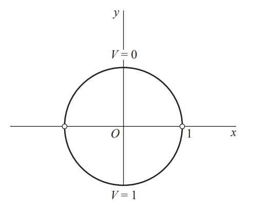
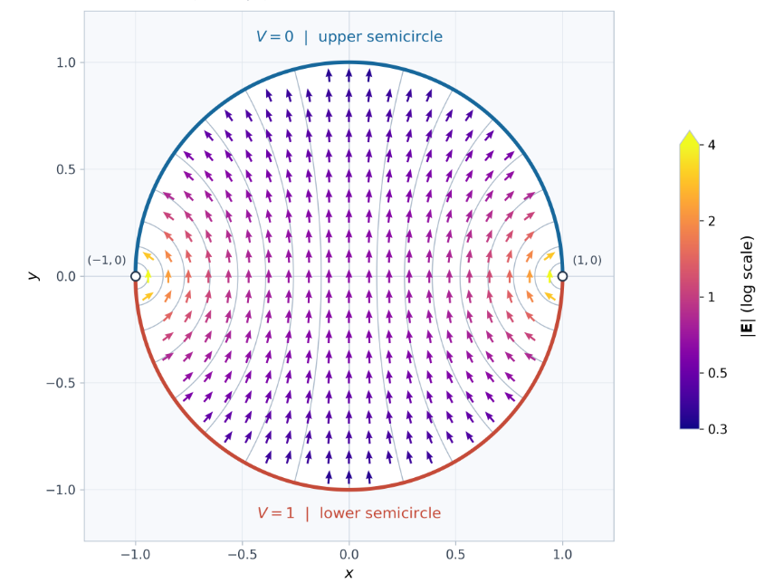

# Harmonic Function
## Definition 1
**(i)** For a domain $D \subset \mathbb{R}^2$, a function $H: D \to \mathbb{R}$ is said to be ***harmonic*** in $D$ if $H \in C^2(D)$ and it satisfies ***Laplace's equation***

$$\Delta H = H_{xx} + H_{yy} = 0$$

**(ii)** Let $u, v : D \to \mathbb{R}$ be harmonic functions in $D$ satisfying the Cauchy-Riemann equations

$$u_x = v_y \quad \text{and} \quad u_y = -v_x$$

in $D$. Then $v$ is said to be a ***harmonic conjugate*** of $u$.

쉽게 말해 라플라스 방정식의 해를 조화함수라고 부른다. 특별히 아래 정리에서 볼 수 있는 것처럼 해석함수의 실수부와 허수부 함수는 모두 조화함수이다. 한편 해석함수는 코시-리만 방정식을 항상 만족하는데, 코시-리만 방정식의 형태가 일종의 켤레 관계에 있는 것처럼 볼 수 있기에 조화함수이면서 코시-리만 방정식을 만족하는 두 함수의 관계를 ***harmonic conjugate***라고 부른다. 이때 코시-리만 방정식의 형태에 맞도록 $u$와 $v$의 순서를 정해주어야 하고, 일반적으로 harmonic conjugate은 유일하지 않음을 주의하자.

## Theorem 1
For a domain $D \subset \mathbb{C}$, let $f: D \to \mathbb{C}$ be a complex function. We denote $f(z) = u(x, y) + iv(x, y)$ for $z = x+ iy$.

**(i)** Suppose that $f(z) = u(x, y) + i v(x, y)$ is analytic in $D$. Then $u$ and $v$ are harmonic in $D$.

**(ii)** $f(z) = u(x, y) + iv(x, y)$ is analytic in $D$ $\iff$ $v$ is a harmonic conjugate of $u$.

**(iii)** If a harmonic function $u(x, y)$ is defined on a simply connected domain $D$, it always has a harmonic conjugate $v(x, y)$ in $D$.

### Proof
**(i)** Since $f$ is analytic in $D$, the all order partial derivatives of $u$ and $v$ exist and continuous. By the Cauchy-Riemann equation 

$$\begin{cases}
u_x = v_y \\
u_y = -v_x
\end{cases}$$

Then we have 

$$\begin{cases}
u_{xx} = v_{yx} \\
u_{yy} = -v_{xy}
\end{cases}$$

Since $v_{yx} = v_{xy}$, we have $\Delta u = u_{xx} + u_{yy} = 0$. Similarly, we have $\Delta v = v_{xx} + v_{yy} = 0$. Thus $u$ and $v$ are harmonic in $D$. 

**(ii)** $(\implies)$ It follows directly from **(i)**.

$(\impliedby)$ Suppose that $v$ is a harmonic conjugate of $u$. Then $u$ and $v$ are harmonic in $D$ and they satisfy the Cauchy-Riemann equation in $D$. It follows that $f(z) = u(x, y) + iv(x, y)$ is analytic in $D$. $\blacksquare$

## Example 1
**(i)** Note that $f(z) = z^2$ is entire and if we write $z = x+iy$ and $u(x, y) = x^2 - y^2, v(x, y) = 2xy$, then $f(z) = x^2 - y^2 + i(2xy)$ and $v$ is a harmonic conjugate of $u$. However, $u$ is not a harmonic conjugate of $v$, because $g(z) = 2xy + i(x^2 - y^2)$ satisfies the Cauchy-Riemann equation only at the origin, so it is not analytic anywhere.

**(ii)** Note that $u(x, y) = 2x(1-y)$ is harmonic in $\mathbb{R}^2$. To find a harmonic conjugate $v$ of $u$, we solve the Cauchy-Riemann equation:

$$\begin{cases}
v_y = u_x = 2(1-y) \\
v_x = -u_y = 2x
\end{cases}$$

Then we obtain $v(x, y) = x^2 + 2y - y^2 + C$ for an arbitrary real constant $C$.

# Transformations
어떤 라플라스 방정식 $\Delta u = 0$이 적당한 경계조건과 함께 주어졌다고 하자. 즉 $u(x, y)$는 조화함수이다. 이때 정리 1 **(iii)**에서 본 바와 같이 정의역이 단순 연결 영역으로 주어진다면 항상 조화함수 $u(x, y)$의 conjugate $v(x, y)$를 찾을 수 있고, 이를 통해 해석함수 $f(z) = u(x, y) + iv(x, y)$를 구성할 수 있다. 이를 통해 복소해석학의 여러 툴들을 사용할 수 있고, 특별히 다루기 까다로운 정의역을 등각사상과 같은 변환들을 통해 다루기 편한 영역으로 바꿀 수 있다는 점에서 복소해석학은 편미분방정식을 푸는데 좋은 도구가 될 수 있다.

## Theorem 2
**(i)** Suppose that

1. an analytic function $w = f(z) = u(x, y) + i v(x, y)$ maps a domain $D_z$ in the $z$ plane onto a domain $D_w$ in the $w$ plane.

2. $h(u, v)$ is a harmonic function defined on $D_w$.

Then the function $H(x, y) = h[u(x, y), v(x, y)]$ is harmonic in $D_z$.

**(ii)** Suppose that

1. a conformal mapping $w = f(z) = u(x, y) + i v(x, y)$ at each point of a smooth arc $C$ and that $\Gamma = f(C)$.

2. $h(u, v)$ is a function that satisfies one of the conditions

$$h = h_0 \quad \text{or} \quad \frac{dh}{dn} = 0$$

at points on $\Gamma$, where $h_0$ is a real constant and $\frac{dh}{dn}$ denotes directional derivatives of $h$ normal to $\Gamma$.

Then the function $H(x, y) = h[u(x, y), v(x, y)]$ satisfies the corresponding condition

$$H = h_0 \quad \text{or} \quad \frac{dH}{dN} = 0$$

on points on $C$, where $\frac{dH}{dN}$ denotes directional derivatives of $H$ normal to $C$.

위 두 정리를 종합하면 등각사상 $w = f(z)$는 기존 라플라스 방정식을 그대로 유지하고 경계조건 또한 그대로 보존한 채 정의역을 옮길 수 있다는 결론을 얻는다. 따라서 영역을 등각사상으로 바꿔 놓고 솔루션 $h$를 찾고 다시 원래 영역으로 돌아가는 풀이를 사용할 수 있다.

::: {.callout-note title="Proof" icon=false collapse="true"}
**(i)** We first prove the theorem for the case in which the domain $D_w$ is simply connected. By Theorem 1 **(iii)**, there is a harmonic conjugate $g(u, v)$ of $h(u, v)$. Then the function

$$\Phi(w) = h(u, v) + i g(u, v)$$

is analytic in $D_w$. Since $f(z)$ is analytic in $D_z$, $\Phi(f(z))$ is analytic in $D_z$. Thus, the real part $h[u(x, y), v(x, y)]$ of this function is harmonic in $D_z$.

Now, suppose that $D_w$ is not simply connected. Note that each point $w_0$ in $D_w$ has a neighborhood $\vert w - w_0 \vert < \varepsilon$ lying entirely in $D_w$. Since that neighbhorhood is simply connected, we can consider an analytic function of the form $\Phi(w) = h(u, v) + i g(u, v)$ in it. Furthermore, since $f$ is continuous at a point $z_0$ in $D_z$ with $f(z_0) = w_0$, there is a neighborhood $\vert z-z_0 \vert < \delta$ whose image is contained in the neighborhood $\vert w - w_0 \vert < \varepsilon$. Hence, the composition $\Phi(f(z))$ is analytic in the neighborhood $\vert z - z_0 \vert < \delta$, and $h[u(x, y), v(x, y)]$ is harmonic there. Since $w_0$ is arbitarily chosen in $D_w$ and $f$ maps $D_z$ onto $D_w$, $h[u(x, y), v(x, y)]$ is harmonic throughout $D_z$. 

**(ii)** First, we prove the case $h = h_0$. We need to show that $H(x, y) = h_0, \forall z = x+iy \in C$. Let $z = x +iy \in C$. Then $u(x, y) + iv(x, y) = f(z) = w = u+iv \in \Gamma$, so $H(x, y) = h[u(x, y), v(x, y)] = h_0$.

Next, we prove the case $\frac{dh}{dn} = 0$. To prove that $\frac{dH}{dN}(x, y) = 0, \forall z = x+iy \in C$, we will show that $\nabla H$ is tangent to the curve $C$, so $\nabla H \cdot \mathbf{N} = 0$.

We fisrt consider the case $\nabla h (u_0, v_0) = \mathbf{0}$ for some $u_0 + i v_0 = w_0 = f(z_0) \in \Gamma$ for $z_0 = x_0 + iy_0$. Since $\vert \nabla H (x_0, y_0) \vert = \vert \nabla h (u_0, v_0) \vert \vert f'(z_0) \vert$, we obtain $\nabla H (x_0, y_0) = \mathbf{0}$, so $\frac{dH}{dN}(x_0, y_0) = 0$.

Now, assume $\nabla h(u, v) \neq \mathbf{0}, \forall u + iv = w = f(z) \in \Gamma$ for $z = x+iy$. Consider a level curve $H(x, y) = h[u(x, y), v(x, y)] = c$. Note that the gradient $\nabla H$ is perpendicular to each level curve of $H$ and the level curve $H(x, y) = h[u(x, y), v(x, y)] = c$ is transformed into the level curve $h(u, v) = c$ under the transformation $w = f(z)$.

Note that the level curve $h(u, v) = c$ is orthogonal to the gradient $\nabla h$ and by assumption, $\nabla h$ is orthogonal to $\mathbf{n}$, so $\nabla h$ is tangent to the curve $\Gamma$. Since the curve $C$ is transformed into the curve $\Gamma$ and the conformal mapping $w = f(z)$ preserves the angle between the curves, we conclude that the gradient $\nabla H$ is tangent to the curve $C$, so $\nabla H \cdot \mathbf{N} = 0$. Hence, we have $\frac{dH}{dN} = \nabla H \cdot N = 0$. $\blacksquare$
:::

# Dirichlet Problem
## Theorem 3
Let $F$ be a piecewise continuous function of $\theta$ on the interval $0 \le \theta \le 2\pi$. The ***Poisson integral transform*** of $F$ is defined in terms of the [Poisson kernel](../Poisson_Integral_Formula/index.qmd#sec-theorem-2) $P(r_0, r, \phi - \theta)$ by means of the equation

$$U(r, \theta) = \frac{1}{2\pi} \int_0^{2\pi} P(r_0, r, \phi - \theta) F(\phi) d\phi \quad (r < r_0).$$

**(i)** The function $U(r, \theta)$ is harmonic inside the circle $r = r_0$.

**(ii)** $\displaystyle \lim_{r \to r_0^-} U(r, \theta) = F(\theta)$ for each fixed $\theta$ at which $F$ is continuous.

**(iii)** $\displaystyle U(0, \theta) = \frac{1}{2\pi} \int_0^{2\pi} F(\phi) d\phi$; Hence, the value of a harmonic function $U(r, \theta)$ ate the center of the circle $r = r_0$ is the average of the boundary values on the circle. 

Thus, $U$ is a solution of the Dirichlet problem for the disk $r < r_0$ in the sense that $U(r, \theta)$ is harmonic and approches the boundary value $F(\theta)$ as the point $(r, \theta)$ aproaches $(r_0, \theta)$ along a radius, except at the finite number of points $(r_0, \theta)$ where discontinuous of $F$ may occur.

::: {.callout-note title="Proof" icon=false collapse="true"}
**(i)** Since $F$ is piecewise continuous, there are the discontinuous points $0 = \phi_0 < \phi_1 < \cdots < \phi_n = 2\pi$ such that

$$\begin{align*}
U(r, \theta) &= \frac{1}{2\pi} \int_0^{2\pi} P(r_0, r, \phi - \theta) F(\phi) d\phi \\
&= \frac{1}{2\pi} \sum_{k=0}^{n-1} \int_{\phi_k}^{\phi_{k+1}} P(r_0, r, \phi - \theta) F(\phi) d\phi
\end{align*}$$

whenever $r < r_0$. Note that each integrand is continuous in $r, \theta, \phi$. Then

$$\begin{align*}
\frac{\partial^j}{\partial r^j} U(r, \theta) &= \frac{1}{2\pi} \sum_{k=0}^{n-1} \int_{\phi_k}^{\phi_{k+1}} \frac{\partial^j}{\partial r^j}P(r_0, r, \phi - \theta) F(\phi) d\phi \\
\frac{\partial^j}{\partial \theta^j} U(r, \theta) &= \frac{1}{2\pi} \sum_{k=0}^{n-1} \int_{\phi_k}^{\phi_{k+1}} \frac{\partial^j}{\partial \theta^j}P(r_0, r, \phi - \theta) F(\phi) d\phi
\end{align*}$$

for each $j = 1, 2, \dots$. Since $P$ satisfies Laplace's equation

$$\Delta_{(r, \theta)} P = r^2P_{rr} + rP_r + P_{\theta \theta} = 0,$$

we have

$$\Delta_{(r, \theta)} U = \frac{1}{2\pi} \sum_{k=0}^{n-1} \int_{\phi_k}^{\phi_{k+1}} \Delta_{(r, \theta)}P(r_0, r, \phi - \theta) F(\phi) d\phi = 0$$

whenever $r < r_0$. Hence, the function $U(r, \theta)$ is harmonic on the disk $r < r_0$.

**(ii)** Let $\theta$ be a point at which $F$ is continuous. [Note that](../Poisson_Integral_Formula/index.qmd#sec-theorem-2)

$$\begin{align*}
&1 = \frac{1}{2\pi} \int_0^{2\pi} P(r_0, r, \phi - \theta) d \phi \\
\implies &F(\theta) = \frac{1}{2\pi} \int_0^{2\pi} P(r_0, r, \phi - \theta) F(\theta) d \phi \\
\implies &U(r, \theta) - F(\theta) = \frac{1}{2\pi} \int_0^{2\pi} P(r_0, r, \phi - \theta) \left[ F(\phi) - F(\theta) \right] d \phi.
\end{align*}$$

We let $F$ be extended periodically, with period $2\pi$, so that the integrand $P(r_0, r, \phi - \theta) \left[ F(\phi) - F(\theta) \right]$ is periodic in $\phi$ with period $2\pi$.

Since $F$ is continuous at $\theta$, for a given $\varepsilon > 0$, there exists $\alpha > 0$ such that

$$| F(\phi) - F(\theta) | < \frac{\varepsilon}{2} \quad \text{whenever} \quad | \phi - \theta | \le \alpha.$$

Note that $U(r, \theta) - F(\theta)$ can be written as

$$U(r, \theta) - F(\theta) = I_1(r) + I_2(r)$$

where

$$\begin{align*}
I_1(r) &= \frac{1}{2\pi} \int_{\theta - \alpha}^{\theta + \alpha} P(r_0, r, \phi - \theta) [F(\phi) - F(\theta)] d\phi \\
I_1(r) &= \frac{1}{2\pi} \int_{\theta + \alpha}^{\theta - \alpha + 2\pi} P(r_0, r, \phi - \theta) [F(\phi) - F(\theta)] d\phi.
\end{align*}$$

[Since $P$ is a positive function](../Poisson_Integral_Formula/index.qmd#sec-theorem-2), we have 

$$\begin{align*}
| I_1(r) | &\le \frac{1}{2\pi} \int_{\theta - \alpha}^{\theta + \alpha} P(r_0, r, \phi - \theta) |F(\phi) - F(\theta)| d\phi \\
&\le \frac{\varepsilon}{4\pi} \int_0^{2\pi} P(r_0, r, \phi - \theta) d \phi \\
&= \frac{\varepsilon}{4\pi} \cdot 2 \pi \\
&= \frac{\varepsilon}{2}
\end{align*}$$

whenever $|\phi - \theta| \le \alpha$.

Note that

$$P(r_0, r, \phi - \theta) = \frac{r_0^2 - r^2}{|s-z|^2}$$

where $s = r_0e^{i\phi}$ and $z = re^{i\theta}$ for $0 < r < r_0$, and the denominator $| s - z|^2$ has a minimum value $m$ as $\phi$ varies over $\theta + \alpha \le \phi \le \theta - \alpha + 2\pi$. If we let

$$M = \sup_{\phi \in [0, 2\pi]} | F(\phi) - F(\theta) |,$$

then

$$\begin{align*}
| I_2(r) | & \le \frac{1}{2\pi} \int_{\theta + \alpha}^{\theta - \alpha + 2\pi} \frac{r_0^2 - r^2}{|s-z|^2} |F(\phi) - F(\theta)| d\phi \\
& \le \frac{r_0^2 - r^2}{2\pi} \cdot \frac{M}{m} \cdot 2\pi \\
&= \frac{M}{m}(r_0^2 - r^2).
\end{align*}$$

Note that

$$\begin{align*}
0 &< (r_0 - r)^2 \\
&= r_0^2 -2r_0r + r^2 \\
&= 2r_0^2 - 2r_0r + r^2 - r_0^2,
\end{align*}$$

so $r_0^2 - r^2 < 2r_0(r_0 - r)$. Let 

$$\delta = \frac{m \varepsilon}{4Mr_0}.$$

Then we have

$$\begin{align*}
| I_2(r) | & \le \frac{M}{m}(r_0^2 - r^2) \\
&< \frac{2Mr_0}{m}(r_0 - r) \\
&< \frac{2Mr_0}{m} \delta \\
&= \frac{\varepsilon}{2}
\end{align*}$$

whenever $0 < r_0 - r < \delta$. Hence,

$$|U(r, \theta) - F(\theta)| \le |I_1(r)| + |I_2(r)| < \frac{\varepsilon}{2} + \frac{\varepsilon}{2} = \varepsilon$$

whenever $0 < r_0 - r < \delta$, and therefore

$$\lim_{r \to r_0^-} U(r, \theta) = F(\theta). \blacksquare$$
:::

## Example 2
위 정리를 사용해서 다음과 같이 경계조건이 주어진 디리클레 문제 $\Delta V(r, \theta) = 0$을 풀어보자

즉 경계조건은 함수

$$F(\phi) = \begin{cases}
0 & 0 < \phi < \pi \\
1 & \pi < \phi < 2\pi
\end{cases}$$

로 주어진다. 위 정리에 의해 솔루션은

$$\begin{align*}
V(r, \theta) &= \frac{1}{2\pi} \int_0^{2\pi} P(1, r, \phi - \theta) F(\phi) d \phi \\
&= \frac{1}{2\pi} \int_\pi^{2\pi} \frac{1-r^2}{1+r^2 - 2r\cos(\phi - \theta)} d \phi \\
&= \frac{1}{2\pi} \int_{\pi - \theta}^{2\pi - \theta} \frac{1-r^2}{1+r^2 - 2r\cos \psi} d \psi \\
&= \frac{1}{2\pi} \cdot 2 \arctan \left( \frac{1+r}{1-r} \tan \frac{\psi}{2} \right) \Bigg_{\pi - \theta}^{2\pi - \theta} \\
&= \frac{1}{\pi} \arctan \left( \frac{1-r^2}{2r \sin \theta} \right) \quad (0 \le \arctan t \le \pi)
\end{align*}$$

으로 주어진다. 데카르트 좌표계로 바꾸면

$$V(x, y) = \frac{1}{\pi} \arctan \left( \frac{1 - x^2 - y^2}{2y} \right) \quad (0 \le \arctan t \le \pi)$$

을 얻는다. 이 솔루션을 전위로 해석하고, 이 전위를 퍼텐셜로 취하는 전기장을 그려보면 다음과 같이 그려진다.

즉 높은 전위에서 낮은 전위의 방향으로 전기력이 가해지고, 물리적 직관과도 일치함을 알 수 있다.

# Reference
- Brown, James Ward, & Churchill, Ruel V. (2017). Complex Variables and Applications (9th ed.). McGraw-Hill.