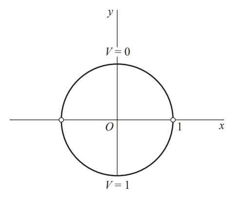
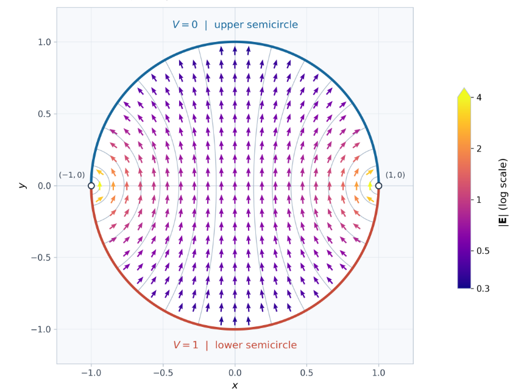

# Harmonic Function
## Definition 1
::: {.math-box}
**(i)** For a domain $D \subset \mathbb{R}^2$, a function $H: D \to \mathbb{R}$ is said to be ***harmonic*** in $D$ if $H \in C^2(D)$ and it satisfies ***Laplace's equation***

$$\Delta H = H_{xx} + H_{yy} = 0$$

**(ii)** Let $u, v : D \to \mathbb{R}$ be harmonic functions in $D$ satisfying the Cauchy-Riemann equations

$$u_x = v_y \quad \text{and} \quad u_y = -v_x$$

in $D$. Then $v$ is said to be a ***harmonic conjugate*** of $u$.
:::

쉽게 말해 라플라스 방정식의 해를 조화함수라고 부른다. 특별히 아래 정리에서 볼 수 있는 것처럼 해석함수의 실수부와 허수부 함수는 모두 조화함수이다. 한편 해석함수는 코시-리만 방정식을 항상 만족하는데, 코시-리만 방정식의 형태가 일종의 켤레 관계에 있는 것처럼 볼 수 있기에 조화함수이면서 코시-리만 방정식을 만족하는 두 함수의 관계를 ***harmonic conjugate***라고 부른다. 이때 코시-리만 방정식의 형태에 맞도록 $u$와 $v$의 순서를 정해주어야 하고, 일반적으로 harmonic conjugate은 유일하지 않음을 주의하자.

## Theorem 1
::: {.math-box}
For a domain $D \subset \mathbb{C}$, let $f: D \to \mathbb{C}$ be a complex function. We denote $f(z) = u(x, y) + iv(x, y)$ for $z = x+ iy$.

**(i)** Suppose that $f(z) = u(x, y) + i v(x, y)$ is analytic in $D$. Then $u$ and $v$ are harmonic in $D$.

**(ii)** $f(z) = u(x, y) + iv(x, y)$ is analytic in $D$ $\iff$ $v$ is a harmonic conjugate of $u$.

**(iii)** If a harmonic function $u(x, y)$ is defined on a simply connected domain $D$, it always has a harmonic conjugate $v(x, y)$ in $D$.
:::

::: {.callout-note title="Proof" icon=false collapse="true"}
**(i)** Since $f$ is analytic in $D$, the all order partial derivatives of $u$ and $v$ exist and continuous. By the Cauchy-Riemann equation 

$$\begin{cases}
u_x = v_y \\
u_y = -v_x
\end{cases}$$

Then we have 

$$\begin{cases}
u_{xx} = v_{yx} \\
u_{yy} = -v_{xy}
\end{cases}$$

Since $v_{yx} = v_{xy}$, we have $\Delta u = u_{xx} + u_{yy} = 0$. Similarly, we have $\Delta v = v_{xx} + v_{yy} = 0$. Thus $u$ and $v$ are harmonic in $D$. 

**(ii)** $(\implies)$ It follows directly from **(i)**.

$(\impliedby)$ Suppose that $v$ is a harmonic conjugate of $u$. Then $u$ and $v$ are harmonic in $D$ and they satisfy the Cauchy-Riemann equation in $D$. It follows that $f(z) = u(x, y) + iv(x, y)$ is analytic in $D$. $\blacksquare$
:::

## Example 1
::: {.math-box}
**(i)** Note that $f(z) = z^2$ is entire and if we write $z = x+iy$ and $u(x, y) = x^2 - y^2, v(x, y) = 2xy$, then $f(z) = x^2 - y^2 + i(2xy)$ and $v$ is a harmonic conjugate of $u$. However, $u$ is not a harmonic conjugate of $v$, because $g(z) = 2xy + i(x^2 - y^2)$ satisfies the Cauchy-Riemann equation only at the origin, so it is not analytic anywhere.

**(ii)** Note that $u(x, y) = 2x(1-y)$ is harmonic in $\mathbb{R}^2$. To find a harmonic conjugate $v$ of $u$, we solve the Cauchy-Riemann equation:

$$\begin{cases}
v_y = u_x = 2(1-y) \\
v_x = -u_y = 2x
\end{cases}$$

Then we obtain $v(x, y) = x^2 + 2y - y^2 + C$ for an arbitrary real constant $C$.
:::

# Transformations
어떤 라플라스 방정식 $\Delta u = 0$이 적당한 경계조건과 함께 주어졌다고 하자. 즉 $u(x, y)$는 조화함수이다. 이때 정리 1 **(iii)**에서 본 바와 같이 정의역이 단순 연결 영역으로 주어진다면 항상 조화함수 $u(x, y)$의 conjugate $v(x, y)$를 찾을 수 있고, 이를 통해 해석함수 $f(z) = u(x, y) + iv(x, y)$를 구성할 수 있다. 이를 통해 복소해석학의 여러 툴들을 사용할 수 있고, 특별히 다루기 까다로운 정의역을 등각사상과 같은 변환들을 통해 다루기 편한 영역으로 바꿀 수 있다는 점에서 복소해석학은 편미분방정식을 푸는데 좋은 도구가 될 수 있다.

## Theorem 2
::: {.math-box}
**(i)** Suppose that

1. an analytic function $w = f(z) = u(x, y) + i v(x, y)$ maps a domain $D_z$ in the $z$ plane onto a domain $D_w$ in the $w$ plane.

2. $h(u, v)$ is a harmonic function defined on $D_w$.

Then the function $H(x, y) = h[u(x, y), v(x, y)]$ is harmonic in $D_z$.

**(ii)** Suppose that

1. a conformal mapping $w = f(z) = u(x, y) + i v(x, y)$ at each point of a smooth arc $C$ and that $\Gamma = f(C)$.

2. $h(u, v)$ is a function that satisfies one of the conditions

$$h = h_0 \quad \text{or} \quad \frac{dh}{dn} = 0$$

at points on $\Gamma$, where $h_0$ is a real constant and $\frac{dh}{dn}$ denotes directional derivatives of $h$ normal to $\Gamma$.

Then the function $H(x, y) = h[u(x, y), v(x, y)]$ satisfies the corresponding condition

$$H = h_0 \quad \text{or} \quad \frac{dH}{dN} = 0$$

on points on $C$, where $\frac{dH}{dN}$ denotes directional derivatives of $H$ normal to $C$.
:::

위 두 정리를 종합하면 등각사상 $w = f(z)$는 기존 라플라스 방정식을 그대로 유지하고 경계조건 또한 그대로 보존한 채 정의역을 옮길 수 있다는 결론을 얻는다. 따라서 영역을 등각사상으로 바꿔 놓고 솔루션 $h$를 찾고 다시 원래 영역으로 돌아가는 풀이를 사용할 수 있다.

::: {.callout-note title="Proof" icon=false collapse="true"}
**(i)** We first prove the theorem for the case in which the domain $D_w$ is simply connected. By Theorem 1 **(iii)**, there is a harmonic conjugate $g(u, v)$ of $h(u, v)$. Then the function

$$\Phi(w) = h(u, v) + i g(u, v)$$

is analytic in $D_w$. Since $f(z)$ is analytic in $D_z$, $\Phi(f(z))$ is analytic in $D_z$. Thus, the real part $h[u(x, y), v(x, y)]$ of this function is harmonic in $D_z$.

Now, suppose that $D_w$ is not simply connected. Note that each point $w_0$ in $D_w$ has a neighborhood $\vert w - w_0 \vert < \varepsilon$ lying entirely in $D_w$. Since that neighbhorhood is simply connected, we can consider an analytic function of the form $\Phi(w) = h(u, v) + i g(u, v)$ in it. Furthermore, since $f$ is continuous at a point $z_0$ in $D_z$ with $f(z_0) = w_0$, there is a neighborhood $\vert z-z_0 \vert < \delta$ whose image is contained in the neighborhood $\vert w - w_0 \vert < \varepsilon$. Hence, the composition $\Phi(f(z))$ is analytic in the neighborhood $\vert z - z_0 \vert < \delta$, and $h[u(x, y), v(x, y)]$ is harmonic there. Since $w_0$ is arbitarily chosen in $D_w$ and $f$ maps $D_z$ onto $D_w$, $h[u(x, y), v(x, y)]$ is harmonic throughout $D_z$. 

**(ii)** First, we prove the case $h = h_0$. We need to show that $H(x, y) = h_0, \forall z = x+iy \in C$. Let $z = x +iy \in C$. Then $u(x, y) + iv(x, y) = f(z) = w = u+iv \in \Gamma$, so $H(x, y) = h[u(x, y), v(x, y)] = h_0$.

Next, we prove the case $\frac{dh}{dn} = 0$. To prove that $\frac{dH}{dN}(x, y) = 0, \forall z = x+iy \in C$, we will show that $\nabla H$ is tangent to the curve $C$, so $\nabla H \cdot \mathbf{N} = 0$.

We fisrt consider the case $\nabla h (u_0, v_0) = \mathbf{0}$ for some $u_0 + i v_0 = w_0 = f(z_0) \in \Gamma$ for $z_0 = x_0 + iy_0$. Since $\vert \nabla H (x_0, y_0) \vert = \vert \nabla h (u_0, v_0) \vert \vert f'(z_0) \vert$, we obtain $\nabla H (x_0, y_0) = \mathbf{0}$, so $\frac{dH}{dN}(x_0, y_0) = 0$.

Now, assume $\nabla h(u, v) \neq \mathbf{0}, \forall u + iv = w = f(z) \in \Gamma$ for $z = x+iy$. Consider a level curve $H(x, y) = h[u(x, y), v(x, y)] = c$. Note that the gradient $\nabla H$ is perpendicular to each level curve of $H$ and the level curve $H(x, y) = h[u(x, y), v(x, y)] = c$ is transformed into the level curve $h(u, v) = c$ under the transformation $w = f(z)$.

Note that the level curve $h(u, v) = c$ is orthogonal to the gradient $\nabla h$ and by assumption, $\nabla h$ is orthogonal to $\mathbf{n}$, so $\nabla h$ is tangent to the curve $\Gamma$. Since the curve $C$ is transformed into the curve $\Gamma$ and the conformal mapping $w = f(z)$ preserves the angle between the curves, we conclude that the gradient $\nabla H$ is tangent to the curve $C$, so $\nabla H \cdot \mathbf{N} = 0$. Hence, we have $\frac{dH}{dN} = \nabla H \cdot N = 0$. $\blacksquare$
:::

# Poisson Integral Transform
## Theorem 3 (Poisson Integral Formula)
::: {.math-box}
Let $f$ be an analytic function inside an on a positively oriented circle $C_0: \vert z \vert = r_0$. Then

$$f(re^{i \theta}) = \frac{1}{2\pi} \int_0^{2\pi} \frac{r_0^2 - r^2}{r_0^2 - 2r_0 r \cos (\phi - \theta) + r^2} f(r_0 e^{i \phi}) d\phi$$

for $0 < r < r_0$. 

If $u$ is the real component of $f$, then we have

$$u(r, \theta) = \frac{1}{2\pi} \int_0^{2\pi} \frac{r_0^2 - r^2}{r_0^2 - 2r_0 r \cos (\phi - \theta) + r^2} u(r_0, \phi) d\phi$$

for $0 < r < r_0$. This is called the ***Poisson integral formula***.
:::

::: {.callout-note title="Proof" icon=false collapse="true"}
For a point $z$ interior to $C_0$, we have

$$f(z) = \frac{1}{2\pi i}\int_{C_0} \frac{f(s)}{s-z} ds$$

by the Cauchy integral formula.

Suppose that $z$ is nonzero and denote $z = re^{i\theta}$. If $z_1$ is the inverse of $z$ with respect to the circle $C_0$, then $|z_1||z| = r_0^2$. Since $\frac{r_0}{r} > 1$, we have

$$\vert z_1 \vert = \frac{r_0^2}{| z |} = \frac{r_0^2}{r} = \frac{r_0}{r} \cdot r_0 > r_0,$$

which means that $z_1$ is exterior to the circle $C_0$. By the Cauchy-Goursat theorem,

$$\int_{C_0} \frac{f(s)}{s-z_1} ds = 0.$$

Hence,

$$f(z) = \frac{1}{2\pi i}\int_{C_0} f(s) \left( \frac{1}{s-z} - \frac{1}{s-z_1} \right) ds.$$

Substituting $s = r_0e^{i\phi}$, we have

$$\begin{align*}
f(re^{i\theta}) &= \frac{1}{2\pi i}\int_{0}^{2\pi} f(r_0e^{i\phi}) \left( \frac{1}{s-z} - \frac{1}{s-z_1} \right) r_0 i e^{i \phi} d \phi \\
&= \frac{1}{2\pi}\int_{0}^{2\pi} f(r_0e^{i\phi}) \left( \frac{1}{s-z} - \frac{1}{s-z_1} \right) r_0 e^{i \phi} d \phi \\
&= \frac{1}{2\pi}\int_{0}^{2\pi} f(r_0e^{i\phi}) \left( \frac{s}{s-z} - \frac{s}{s-z_1} \right) d \phi.
\end{align*}$$

Note that for $s \in C_0$,

$$z_1 = \frac{r_0^2}{r}e^{i \theta} = \frac{r_0^2}{re^{-i\theta}} = \frac{|s|^2}{\bar{z}}$$ 

and

$$\begin{align*}
|s-z|^2 &= |s|^2 + |z|^2 - 2|s||z|\cos(\phi - \theta) \\
&= r_0^2 + r^2 - 2r_0r \cos (\phi - \theta).
\end{align*}$$

Hence,

$$\begin{align*}
\frac{s}{s-z} - \frac{s}{s-z_1} &= \frac{s}{s-z} - \frac{s}{s-\frac{|s|^2}{\bar{z}}} \\
&= \frac{s}{s-z} - \frac{1}{1- \frac{\bar{s}}{\bar{z}}} \\
&= \frac{s}{s-z} + \frac{\bar{z}}{\bar{s} - \bar{z}} \\
&= \frac{s\overline{(s-z)} + \bar{z}(s-z)}{(s-z)\overline{(s - z)}} \\
&= \frac{|s|^2 - |z|^2}{|s-z|^2} \\
&= \frac{r_0^2 - r^2}{r_0^2 - 2r_0r \cos (\phi - \theta) + r^2},
\end{align*}$$

and therefore

$$\begin{align*}
f(re^{i\theta}) &= \frac{1}{2\pi}\int_{0}^{2\pi} f(r_0e^{i\phi}) \left( \frac{s}{s-z} - \frac{s}{s-z_1} \right) d \phi \\
&= \frac{1}{2\pi}\int_{0}^{2\pi} \frac{r_0^2 - r^2}{r_0^2 - 2r_0r \cos (\phi - \theta) + r^2} f(r_0e^{i\phi}) d \phi. \blacksquare
\end{align*}$$
:::

## Theorem 4 (Poisson Kernel)
::: {.math-box}
If we define the real-valued function

$$P(r_0, r, \phi - \theta) = \frac{r_0^2 - r^2}{r_0^2 - 2r_0 r \cos (\phi - \theta) + r^2}$$

which is called the ***Poisson kernel***, then the Poisson integral formula becomes

$$u(r, \theta) = \frac{1}{2\pi} \int_0^{2\pi} P(r_0, r, \phi- \theta) u(r_0, \phi) d\phi.$$

Let $r < r_0$. Then

**(i)** $P(r_0, r, \phi- \theta) > 0.$

**(ii)** $P(r_0, r, \phi- \theta) = \mathrm{Re}\left( \frac{s+z}{s-z} \right)$.

**(iii)** $P(r_0, r, \phi- \theta)$ is a harmonic function of $r$ and $\theta$ interior to the circle $C_0$ for each fixed $s$ on $C_0$.

**(iv)** $P(r_0, r, \phi- \theta)$ is an even periodic function of $\phi - \theta$ with period $2 \pi$.

**(v)** $P(r_0, 0, \phi- \theta) = 1$.

**(vi)** $\displaystyle \frac{1}{2\pi} \int_0^{2\pi} P(r_0, r, \phi- \theta) d \phi = 1$.
:::

::: {.callout-note title="Proof" icon=false collapse="true"}
**(i)** Note that

$$P(r_0, r, \phi - \theta) = \frac{r_0^2 - r^2}{r_0^2 - 2r_0 r \cos (\phi - \theta) + r^2} = \frac{|s|^2 - |z|^2}{|s-z|^2}$$

and $\vert s \vert > \vert z \vert$, so $P(r_0, r, \phi - \theta) > 0$.

**(ii)** Note that

$$\begin{align*}
\frac{s+z}{s-z} &= \frac{(s+z)\overline{(s-z)}}{(s-z)\overline{(s-z)}} \\
&= \frac{|s|^2 - |z|^2 + z\overline{s} - s \overline{z}}{|s-z|^2} \\
&= \frac{|s|^2 - |z|^2 + z\overline{s} - \overline{z \overline{s}}}{|s-z|^2} \\
&= \frac{|s|^2 - |z|^2 + 2i\mathrm{Im}(z\overline{s})}{|s-z|^2}.
\end{align*}$$

Hence,

$$\mathrm{Re}\left( \frac{s+z}{s-z} \right) = \frac{|s|^2 - |z|^2}{|s-z|^2} = P(r_0, r, \phi - \theta).$$

**(iii)** For each fixed $s$ on $C_0$, $f(z) = \frac{s+z}{s-z}$ is analytic inside the circle $C_0$. Then the real part $P(r_0, r, \phi - \theta)$ is harmonic with respect to $r$ and $\theta$.

**(iv)** Note that

$$P(r_0, r, \phi - \theta) = \frac{r_0^2 - r^2}{r_0^2 - 2r_0 r \cos (\phi - \theta) + r^2}.$$

Since $\cos(\phi - \theta)$ is even periodic function of $\phi - \theta$ with period $2\pi$, we obtain the property.

**(v)** Obvious from the expression of $P(r_0, r, \phi - \theta)$.

**(vi)** If $f(z) = 1, \forall z \in \mathbb{C}$, then we obtain

$$1 = \frac{1}{2\pi} \int_0^{2\pi} P(r_0, r, \phi - \theta) d\phi. \blacksquare$$
:::

## Theorem 5 (Poisson Integral Transform)
::: {.math-box}
Let $F$ be a piecewise continuous function of $\theta$ on the interval $0 \le \theta \le 2\pi$. The ***Poisson integral transform*** of $F$ is defined in terms of the Poisson kernel $P(r_0, r, \phi - \theta)$ by means of the equation

$$U(r, \theta) = \frac{1}{2\pi} \int_0^{2\pi} P(r_0, r, \phi - \theta) F(\phi) d\phi \quad (r < r_0).$$

**(i)** The function $U(r, \theta)$ is harmonic inside the circle $r = r_0$.

**(ii)** $\displaystyle \lim_{r \to r_0^-} U(r, \theta) = F(\theta)$ for each fixed $\theta$ at which $F$ is continuous.

**(iii)** $\displaystyle U(0, \theta) = \frac{1}{2\pi} \int_0^{2\pi} F(\phi) d\phi$; Hence, the value of a harmonic function $U(r, \theta)$ are the center of the circle $r = r_0$ is the average of the boundary values on the circle. 

Thus, $U$ is a solution of the Dirichlet problem for the disk $r < r_0$ in the sense that $U(r, \theta)$ is harmonic and approaches the boundary value $F(\theta)$ as the point $(r, \theta)$ aproaches $(r_0, \theta)$ along a radius, except at the finite number of points $(r_0, \theta)$ where discontinuous of $F$ may occur.
:::

::: {.callout-note title="Proof" icon=false collapse="true"}
**(i)** Since $F$ is piecewise continuous, there are the discontinuous points $0 = \phi_0 < \phi_1 < \cdots < \phi_n = 2\pi$ such that

$$\begin{align*}
U(r, \theta) &= \frac{1}{2\pi} \int_0^{2\pi} P(r_0, r, \phi - \theta) F(\phi) d\phi \\
&= \frac{1}{2\pi} \sum_{k=0}^{n-1} \int_{\phi_k}^{\phi_{k+1}} P(r_0, r, \phi - \theta) F(\phi) d\phi
\end{align*}$$

whenever $r < r_0$. Note that each integrand is continuous in $r, \theta, \phi$. Then

$$\begin{align*}
\frac{\partial^j}{\partial r^j} U(r, \theta) &= \frac{1}{2\pi} \sum_{k=0}^{n-1} \int_{\phi_k}^{\phi_{k+1}} \frac{\partial^j}{\partial r^j}P(r_0, r, \phi - \theta) F(\phi) d\phi \\
\frac{\partial^j}{\partial \theta^j} U(r, \theta) &= \frac{1}{2\pi} \sum_{k=0}^{n-1} \int_{\phi_k}^{\phi_{k+1}} \frac{\partial^j}{\partial \theta^j}P(r_0, r, \phi - \theta) F(\phi) d\phi
\end{align*}$$

for each $j = 1, 2, \dots$. Since $P$ satisfies Laplace's equation

$$\Delta_{(r, \theta)} P = r^2P_{rr} + rP_r + P_{\theta \theta} = 0,$$

we have

$$\Delta_{(r, \theta)} U = \frac{1}{2\pi} \sum_{k=0}^{n-1} \int_{\phi_k}^{\phi_{k+1}} \Delta_{(r, \theta)}P(r_0, r, \phi - \theta) F(\phi) d\phi = 0$$

whenever $r < r_0$. Hence, the function $U(r, \theta)$ is harmonic on the disk $r < r_0$.

**(ii)** Let $\theta$ be a point at which $F$ is continuous. Note that

$$\begin{align*}
&1 = \frac{1}{2\pi} \int_0^{2\pi} P(r_0, r, \phi - \theta) d \phi \\
\implies &F(\theta) = \frac{1}{2\pi} \int_0^{2\pi} P(r_0, r, \phi - \theta) F(\theta) d \phi \\
\implies &U(r, \theta) - F(\theta) = \frac{1}{2\pi} \int_0^{2\pi} P(r_0, r, \phi - \theta) \left[ F(\phi) - F(\theta) \right] d \phi.
\end{align*}$$

We let $F$ be extended periodically, with period $2\pi$, so that the integrand $P(r_0, r, \phi - \theta) \left[ F(\phi) - F(\theta) \right]$ is periodic in $\phi$ with period $2\pi$.

Since $F$ is continuous at $\theta$, for a given $\varepsilon > 0$, there exists $\alpha > 0$ such that

$$| F(\phi) - F(\theta) | < \frac{\varepsilon}{2} \quad \text{whenever} \quad | \phi - \theta | \le \alpha.$$

Note that $U(r, \theta) - F(\theta)$ can be written as

$$U(r, \theta) - F(\theta) = I_1(r) + I_2(r)$$

where

$$\begin{align*}
I_1(r) &= \frac{1}{2\pi} \int_{\theta - \alpha}^{\theta + \alpha} P(r_0, r, \phi - \theta) [F(\phi) - F(\theta)] d\phi \\
I_1(r) &= \frac{1}{2\pi} \int_{\theta + \alpha}^{\theta - \alpha + 2\pi} P(r_0, r, \phi - \theta) [F(\phi) - F(\theta)] d\phi.
\end{align*}$$

Since $P$ is a positive function, we have 

$$\begin{align*}
| I_1(r) | &\le \frac{1}{2\pi} \int_{\theta - \alpha}^{\theta + \alpha} P(r_0, r, \phi - \theta) |F(\phi) - F(\theta)| d\phi \\
&\le \frac{\varepsilon}{4\pi} \int_0^{2\pi} P(r_0, r, \phi - \theta) d \phi \\
&= \frac{\varepsilon}{4\pi} \cdot 2 \pi \\
&= \frac{\varepsilon}{2}
\end{align*}$$

whenever $|\phi - \theta| \le \alpha$.

Note that

$$P(r_0, r, \phi - \theta) = \frac{r_0^2 - r^2}{|s-z|^2}$$

where $s = r_0e^{i\phi}$ and $z = re^{i\theta}$ for $0 < r < r_0$, and the denominator $| s - z|^2$ has a minimum value $m$ as $\phi$ varies over $\theta + \alpha \le \phi \le \theta - \alpha + 2\pi$. If we let

$$M = \sup_{\phi \in [0, 2\pi]} | F(\phi) - F(\theta) |,$$

then

$$\begin{align*}
| I_2(r) | & \le \frac{1}{2\pi} \int_{\theta + \alpha}^{\theta - \alpha + 2\pi} \frac{r_0^2 - r^2}{|s-z|^2} |F(\phi) - F(\theta)| d\phi \\
& \le \frac{r_0^2 - r^2}{2\pi} \cdot \frac{M}{m} \cdot 2\pi \\
&= \frac{M}{m}(r_0^2 - r^2).
\end{align*}$$

Note that

$$\begin{align*}
0 &< (r_0 - r)^2 \\
&= r_0^2 -2r_0r + r^2 \\
&= 2r_0^2 - 2r_0r + r^2 - r_0^2,
\end{align*}$$

so $r_0^2 - r^2 < 2r_0(r_0 - r)$. Let 

$$\delta = \frac{m \varepsilon}{4Mr_0}.$$

Then we have

$$\begin{align*}
| I_2(r) | & \le \frac{M}{m}(r_0^2 - r^2) \\
&< \frac{2Mr_0}{m}(r_0 - r) \\
&< \frac{2Mr_0}{m} \delta \\
&= \frac{\varepsilon}{2}
\end{align*}$$

whenever $0 < r_0 - r < \delta$. Hence,

$$|U(r, \theta) - F(\theta)| \le |I_1(r)| + |I_2(r)| < \frac{\varepsilon}{2} + \frac{\varepsilon}{2} = \varepsilon$$

whenever $0 < r_0 - r < \delta$, and therefore

$$\lim_{r \to r_0^-} U(r, \theta) = F(\theta). \blacksquare$$
:::

# Schwarz Integral Transform
## Theorem 6 (Schwarz Integral Formula)
::: {.math-box}
Let $f(z)$ be an analytic function throughout the upper half plane $\mathrm{Im} z \ge 0$ such that for some positive constants $a$ and $M$, $| z^af(z) | < M$ for all $z$ with $\mathrm{Im} z \ge 0$. If $f(z) = u(x, y) = iv(x, y)$, then $u(x, y)$ and $v(x, y)$ are harmonic in the upper half plane $y > 0$ and

$$\begin{align*}
u(x, y) &= \frac{1}{\pi} \int_{-\infty}^\infty \frac{yu(t, 0)}{(t-x)^2 + y^2} dt \\
v(x, y) &= \frac{1}{\pi} \int_{-\infty}^\infty \frac{(x-t)u(t, 0)}{(t-x)^2 + y^2} dt
\end{align*}$$

whenever $y > 0$. This is called the ***Schwarz integral formula***.
:::

::: {.callout-note title="Proof" collapse="true" icon=false}
Let $C_r$ denote the upper half of a positively oriented circle of radius $R$ centered at origin. By the Cauchy integral formula, we have

$$\begin{align*}
f(z) &= \frac{1}{2\pi i} \int_{C_R \cup [-R, R]} \frac{f(s)}{s-z} ds \\
&= \frac{1}{2\pi i} \int_{C_R} \frac{f(s)}{s-z} ds + \frac{1}{2\pi i} \int_{-R}^R \frac{f(t)}{t-z} dt
\end{align*}$$

for any $z$ interior to the simple closed contour $C_R \cup [-R, R]$.

By ML Lemma, we have

$$\begin{align*}
\left \vert \int_{C_R} \frac{f(s)}{s-z} ds \right \vert &\le \frac{M}{R^a} \cdot \frac{1}{R - \vert z \vert} \cdot \pi R \\
&= \frac{\pi M}{R^a\left( 1 - \frac{|z|}{R} \right)} \to 0
\end{align*}$$

as $R \to \infty$. 

Now, we will show that the improper integral 

$$\int_{-\infty}^\infty \frac{f(t)}{t-z} dt$$

converges absolutely.

Fix $z \in \mathbb{C}$ such that $\mathrm{Im} z > 0$, and choose a positive number $A$ such that $A > 2|z|$. If $|t| \ge A$, then $\frac{|t|}{2} > |z|$, so we have

$$|t-z| \ge |t| - |z| > \frac{|t|}{2}.$$

Since $|f(t)| \le \frac{M}{|t|^a}$ by assumption, we have

$$\left \vert \frac{f(t)}{t-z} \right \vert \le \frac{2M}{|t|^{1+a}}.$$

Since $a > 0$, we have

$$\begin{align*}
\int_A^\infty |t|^{-1-a} dt &= \lim_{s \to \infty} \int_A^s t^{-1-a} dt \\
&= \lim_{s \to \infty} -\frac{1}{a} t^{-a} \Bigg \vert_{A}^s \\
&= \frac{1}{aA^a} < \infty,
\end{align*}$$

By the comparison test,

$$\int_A^\infty \left \vert \frac{f(t)}{t-z} \right \vert dt < \infty.$$

Similarly,

$$\int_{-\infty}^{-A} \left \vert \frac{f(t)}{t-z} \right \vert dt < \infty.$$

Since the function $f$ is continuous on $-A \le t \le A$ and $|t-z| > 0$, the definite integral

$$\int_{-A}^A \frac{f(t)}{t-z} dt$$

has a finite value. For a sufficiently large $R > 0$, we have

$$\int_{-R}^R \frac{f(t)}{t-z} dt = \int_{-R}^{-A} \frac{f(t)}{t-z} dt + \int_{-A}^A \frac{f(t)}{t-z} dt + \int_A^{R} \frac{f(t)}{t-z} dt,$$

so letting $R \to \infty$, we conclude that the improper integral

$$\int_{-\infty}^\infty \frac{f(t)}{t-z} dt$$

converges absolutely. Thus,

$$f(z) = \frac{1}{2\pi i} \int_{-\infty}^\infty \frac{f(t)}{t-z} dt \quad (\mathrm{Im} z > 0).$$

If the point $z$ lies below the real axis, then the integrand $\displaystyle \frac{f(s)}{s-z}$ is analytic on the simple closed contour $C_R \cup [-R, R]$, so 

$$f(z) = \frac{1}{2\pi i} \int_{C_R \cup [-R, R]} \frac{f(s)}{s-z} ds = 0$$

by the Cauchy-Goursat theorem. 

Thus, when $z$ is above the real axis, we have the following expression

$$f(z) = \frac{1}{2\pi i} \int_{-\infty}^\infty \left( \frac{1}{t-z} + \frac{c}{t-\bar{z}} \right) f(t) dt, \quad (\mathrm{Im} z > 0)$$

where $c$ is an arbitrary complex constant.

Let us denote that $z = x+iy$ and $f(z) = u(x, y) + i v(x, y)$. If we choose $c = -1$, then it reduces to

$$\begin{align*}
f(z) &= \frac{1}{2\pi i} \int_{-\infty}^\infty \left( \frac{1}{t-z} - \frac{1}{t-\bar{z}} \right) f(t) dt \\
&= \frac{1}{2\pi i} \int_{-\infty}^\infty \frac{z - \bar{z}}{|t-z|^2} f(t) dt \\
&= \frac{1}{2\pi i} \int_{-\infty}^\infty \frac{2iy}{|t-z|^2} f(t) dt \\
&= \frac{1}{\pi} \int_{-\infty}^\infty \frac{yf(t)}{|t-z|^2} dt.
\end{align*}$$

Similarly, if $c = 1$, it reduces

$$f(z) = \frac{1}{\pi i} \int_{-\infty}^\infty \frac{(t-x)f(t)}{|t-z|^2} dt.$$

Since $f(t) = u(x,0) + i v(x, 0)$, we have

$$\begin{align*}
u(x, y) &= \frac{1}{\pi} \int_{-\infty}^\infty \frac{yu(t, 0)}{(t-x)^2 + y^2} dt
v(x, y) &= \frac{1}{\pi} \int_{-\infty}^\infty \frac{(x-t)u(t, 0)}{(t-x)^2 + y^2} dt
\end{align*}$$

whenever $y > 0$. $\blacksquare$
:::

## Theorem 7 (Schwarz Kernel)
::: {.math-box}
If we define the real-valued function 

$$S(x, y, t) = \frac{y}{(t-x)^2 + y^2}$$

when $y > 0$, which is called the ***Schwarz kernel***, then the Schwarz integral formula becomes

$$u(x, y) = \frac{1}{\pi}\int_{-\infty}^\infty S(x, y, t)u(t, 0) dt.$$

Let $z = x +iy$ with $y > 0$. Then

**(i)** $S(x, y, t) > 0$.

**(ii)** $S(x, y, t) = \mathrm{Im} \left( \frac{1}{t-z} \right)$.

**(iii)** $S(x, y, t)$ is a harmonic function of $x$ and $y$ throughout the upper half plane $y > 0$.

**(iv)** $\displaystyle \frac{1}{\pi} \int_{-\infty}^\infty S(x, y, t) dt = 1$.
:::

::: {.callout-note title="Proof" collapse="true" icon=false}
**(i)** Note that 

$$S(x, y, t) = \frac{y}{(t-x)^2 + y^2} = \frac{y}{|t-z|^2}.$$

Since $y > 0$, $|z-t|> 0$ and $S(x, y, t) > 0$.

**(ii)** Note that

$$\frac{1}{t-z} = \frac{t-\bar{z}}{|t-z|^2} = \frac{t-x+iy}{|t-z|^2}.$$

Hence, 

$$\mathrm{Im}\left( \frac{1}{t-z} \right) = \frac{y}{|t-z|^2} = S(x, y, t).$$

**(iii)** Since $\frac{1}{t-z}$ is harmonic throughout the upper half plane $\mathrm{Im} z > 0$ and $S(x, y, t)$ is the imaginary part of $\frac{1}{t-z}$, it is harmonic throughout the upper half plane $y > 0$.

**(iv)** Let us substitute $\frac{t-x}{y} = \tan \tau$. Then we have

$$\begin{align*}
dt &= y\sec^2 \tau d \tau \\
&= y \frac{(t-x)^2 + y^2}{y^2} d \tau \\
&= \frac{(t-x)^2 + y^2}{y} d\tau.
\end{align*}$$

Hence,

$$\begin{align*}
\frac{1}{\pi} \int_{-\infty}^\infty S(x, y, t) dt &= \frac{1}{\pi} \int_{-\infty}^\infty \frac{y}{(x-t)^2 + y^2} dt \\
&= \frac{1}{\pi} \int_{-\frac{\pi}{2}}^\frac{\pi}{2} d \tau \\
&= 1. \blacksquare
\end{align*}$$
:::

## Theorem 8 (Schwarz Integral Transform)
::: {.math-box}
Let $F$ be a real-valued function of $x$ that is bounded for all $x$ and that is continuous except for at most a finite number of finite jumps. The ***Schwarz integral transform*** of $F$ is defined in terms of the Schwarz kernel $S(x, y, t)$ by means of the equation

$$U(x, y) = \frac{1}{\pi} \int_{-\infty}^\infty S(x, y, t)F(t) dt \quad (y > 0).$$

**(i)** The function $U(x, y)$ is bounded and harmonic throughout the upper half plane $y > 0$.

**(ii)** $\displaystyle \lim_{y \to 0^+} U(x, y) = F(x)$ for fixed $x$ at which $F$ is continuous.

Thus, $U$ is a bounded solution of the Dirichlet problem for the upper half plane in the sense that $U(x, y)$ is harmonic and approaches the boundary value $F(x)$ as the point $(x, y)$ aproaches $(x, 0), except at the finite number of points $(x, 0)$ where discontinuous of $F$ may occur.
:::

::: {.callout-note title="Proof" collapse="true" icon=false}
**(i)** First, we will show that the improper integral

$$U(x, y) = \frac{1}{\pi} \int_{-\infty}^\infty S(x, y, t)F(t) dt$$

converges absolutely whenever $y > 0$.

Since $F$ is bounded and continuous except for at most a finite number of finite jumps, $M = \sup_{t \in \mathbb{R}} |F(t)|$ exists and the definite integral $\displaystyle \int_{-A}^A S(x, y, t)F(t) dt$ exists.

By substituting $t = x+ys$, we have

$$\begin{align*}
\left \vert \frac{1}{\pi} \int_{-A}^A S(x, y, x+ys)F(x+ys) y ds \right \vert \\
&\le \frac{1}{\pi} \int_{-A}^A \left \vert \frac{y^2}{y^2s^2 + y^2} F(x+ys) \right \vert ds \\
&\le \frac{M}{\pi} \int_{-A}^A \left \vert \frac{1}{s^2 + 1} \right \vert ds \\
&= \frac{M}{\pi} \int_{-A}^A \frac{1}{s^2 + 1} ds
\end{align*}$$

and the improper integral

$$\int_{-\infty}^\infty \frac{1}{s^2 + 1} ds$$

exists. By the comparison test,

$$U(x, y) = \frac{1}{\pi} \int_{-\infty}^\infty S(x, y, t)F(t) dt$$

converges absolutely. Furthermore, $U(x, y)$ is bounded.

Let 

$$I(x, y) = \int_{-\infty}^\infty g(x, y, t) dt$$

where $g(x, y, t) = \frac{F(t)}{(t-x)^2 + y^2}$. Now, we will show that the sequences

$$\begin{align*}
I_n(x, y) = \int_{-n}^n g(x, y, t) dt \\
\frac{\partial I_n}{\partial u}(x, y) = \int_{-n}^n \frac{\partial g}{\partial u} dt \\
\frac{\partial^2 I_n}{\partial u^2}(x, y) = \int_{-n}^n \frac{\partial^2 g}{\partial u^2} dt$$

where $u = x, y$, converge uniformly to $I, \frac{\partial I}{\partial u}, \frac{\partial^2 I}{\partial u^2}$ with resepct to $x$ and $y$, respectively. 

Fix $\varepsilon > 0$, and put

$$D_\varepsilon = \left\{ (x, y) \in \mathbb{R}^2 \mid |x| \le \frac{1}{\varepsilon}, y \ge \varepsilon \right\}, \quad \text{and} \quad A = \frac{2}{\varepsilon}.$$

For every $(x, y) \in D_\varepsilon$, we have $r = |t-z| \ge \varepsilon, \forall t \in \mathbb{R}$. Moreover, if $|t| > A$, then

$$r \ge |t-x| \ge |t| - |x| \ge \frac{|t|}{2}.$$

Consequently,

$$|g(x, y, t)| \le \frac{M}{r^2} \le H(t), \quad H(t) = \begin{cases}
\frac{M}{\varepsilon^2} & |t| \le A \\
\frac{4M}{t^2} & |t| > A
\end{cases}.$$

Note that the function $H(t)$ is integrable over $\mathbb{R}$ since it is constant on $[-A, A]$ and $\displaystyle \int_A^\infty t^{-2} dt = A^{-1}$.

For every $n > A$ and every $(x, y) \in D_\varepsilon$, we have

$$\begin{align*}
|I(x, y) - I_n(x, y)| &\le \int_{|t| > n} |g(x, y, t)| dt \\
& \le \int_{|t| > n} H(t) dt = 2 \int_n^\infty \frac{4M}{t^2} dt = \frac{8M}{n}.
\end{align*}$$

Given any $\eta > 0$, choose an integer $N > \max \left\{ A, \frac{8M}{\eta} \right\}$. Then $|t| > n \ge N > A$ and $\frac{8M}{N} < \eta$, so

$$|I(x, y) - I_n(x, y)| \le \frac{8M}{n} \le \frac{8M}{N} < \eta, \forall n \ge N, \forall (x, y) \in D_\varepsilon.$$

Hence, $\{ I_n \}$ converges uniformly to $I$ throughtout the region $D_\varepsilon$.

By differentiating, we have

$$\left \vert \frac{\partial g}{\partial u} \right \vert \le \frac{2M}{r^3} \quad \text{and} \quad \left \vert \frac{\partial^2 g}{\partial u^2} \right \vert \le \frac{10M}{r^4}.$$

In the similar manner, we can show that the partial derivatives $\frac{\partial I_n}{\partial u}, \frac{\partial^2 I_n}{\partial u^2}$ converges uniformly to $\frac{\partial I}{\partial u}, \frac{\partial^2 I}{\partial u^2}$ for $u = x, y$ throughtout the region $D_\varepsilon$.

Note that the order of differentiation and integration can be interchanged by the uniform convergence. Since $U(x, y) = \frac{y}{\pi}I(x, y)$, we have

$$\Delta U = \frac{1}{\pi} \left( y \Delta I + 2\frac{\partial I}{\partial y} \right) = \frac{1}{\pi} \int_{-\infty}^\infty F(t) \Delta S(x, y, t) = 0$$

throughout the region $D_\varepsilon$ for any $\varepsilon > 0$. For any $(x, y)$ with $y > 0$, we can choose $\varepsilon > 0$ such that $(x, y) \in D_\varepsilon$. Hence, $\Delta U(x, y) = 0$ throughtout the upper half plane $y > 0$.

**(ii)** 
:::

# Dirichlet Problem
위 정리를 사용해서 다음과 같이 경계조건이 주어진 디리클레 문제 $\Delta V(r, \theta) = 0$을 풀어보자

즉 경계조건은 함수

$$F(\phi) = \begin{cases}
0 & 0 < \phi < \pi \\
1 & \pi < \phi < 2\pi
\end{cases}$$

로 주어진다. 위 정리에 의해 솔루션은

$$\begin{align*}
V(r, \theta) &= \frac{1}{2\pi} \int_0^{2\pi} P(1, r, \phi - \theta) F(\phi) d \phi \\
&= \frac{1}{2\pi} \int_\pi^{2\pi} \frac{1-r^2}{1+r^2 - 2r\cos(\phi - \theta)} d \phi \\
&= \frac{1}{2\pi} \int_{\pi - \theta}^{2\pi - \theta} \frac{1-r^2}{1+r^2 - 2r\cos \psi} d \psi \\
&= \frac{1}{2\pi} \cdot 2 \arctan \left( \frac{1+r}{1-r} \tan \frac{\psi}{2} \right) \Bigg \vert_{\pi - \theta}^{2\pi - \theta} \\
&= \frac{1}{\pi} \arctan \left( \frac{1-r^2}{2r \sin \theta} \right) \quad (0 \le \arctan t \le \pi)
\end{align*}$$

으로 주어진다. 데카르트 좌표계로 바꾸면

$$V(x, y) = \frac{1}{\pi} \arctan \left( \frac{1 - x^2 - y^2}{2y} \right) \quad (0 \le \arctan t \le \pi)$$

을 얻는다. 이 솔루션을 전위로 해석하고, 이 전위를 퍼텐셜로 취하는 전기장을 그려보면 다음과 같이 그려진다.

즉 높은 전위에서 낮은 전위의 방향으로 전기력이 가해지고, 물리적 직관과도 일치함을 알 수 있다.

# Newmann Problem

# Further Examples
::: {.math-box}
Let $F(\theta)$ be a piecewise continuous function.

**(i)** Let $f(\theta)$ be a piecewise continuous function on $0 < \theta < \pi$, and let $D^+ := \{ re^{i\theta} \in \mathbb{C} \mid 0 < r < r_0, 0 < \theta < \pi \}$ be the semicircular region. Solve the Dirichlet problem

$$\begin{cases}
\Delta U(r, \theta) = 0 & \text{in } D^+ \\
U(r, \theta) = 0 & 0 \le r < r_0, \theta \in \{ 0, \pi \} \\
\lim_{r \to r_0^-} U(r, \theta) = f(\theta) & \text{for each fixed } \theta \in (0, \pi) \text{ at which } f \text{ is continuous}
\end{cases}.$$
:::

::: {.callout-note title="Solution" icon=false collapse="true"}
문제의 정의역은 원 전체가 아닌 반원으로 주어졌다. 우리는 정의역을 원 전체로 확장해준 뒤 푸아송 적분 공식을 이용해 해를 구하고, 이를 다시 원래 정의역에서도 해가 되도록 변형해 주려고 한다.

현재 $f(\theta)$는 $0 < \theta < \pi$에서 정의되어 있는데, 푸아송 적분 공식을 사용할 수 있도록 새로운 함수 $F$를 다음과 같이 정의하자.

$$F(\theta) = \begin{cases}
f(\theta) & 0 < \theta < \pi \\
-f(2\pi - \theta) & \pi < \theta < 2\pi \\
0 & \theta \in \{ 0, \pi, 2\pi \}
\end{cases}$$

그러면 $F$는 $[0, 2\pi]$에서 $F(2\pi - \theta) = - F(\theta)$를 만족하는 piecewise continuous function이 된다. 따라서 정리 3에 의해

$$U(r, \theta) = \frac{1}{2\pi} \int_0^{2\pi} P(r_0, r, \phi - \theta) F(\phi) d\phi$$

로 주어지고, $U$는 원 $|z| < r_0$ 내부에서 라플라스 방정식 $\Delta U = 0$과 경계조건 $\displaystyle \lim_{r \to r_0^-} U(r, \theta) = F(\theta)$을 만족한다.

한편 $\phi = 2\pi - \psi$과 같이 치환하고 위 식을 정리하면 다음의 결과를 얻는다.

$$\begin{align*}
U(r, \theta) &= \frac{1}{2\pi} \int_0^{2\pi} P(r_0, r, \phi - \theta) F(\phi) d\phi \\
&= \frac{1}{2\pi} \int_0^{\pi} P(r_0, r, \phi - \theta) F(\phi) d\phi + \frac{1}{2\pi} \int_\pi^{2\pi} P(r_0, r, \phi - \theta) F(\phi) d\phi \\
&= \frac{1}{2\pi} \int_0^{\pi} P(r_0, r, \phi - \theta) F(\phi) d\phi - \frac{1}{2\pi} \int_\pi^{0} P(r_0, r, 2\pi - (\psi + \theta)) F(2\pi - \psi) d\psi \\
&= \frac{1}{2\pi} \int_0^{\pi} P(r_0, r, \phi - \theta) F(\phi) d\phi - \frac{1}{2\pi} \int_0^{\pi} P(r_0, r, \psi + \theta) F(\psi) d\psi \\
&= \frac{1}{2\pi} \int_0^{\pi} \left[ P(r_0, r, \phi - \theta) - P(r_0, r, \phi + \theta) \right] F(\phi) d\phi
\end{align*}$$

이때 $r < r_0$를 만족하는 모든 $r$에 대해서 $U(r, 0) = 0 = U(r, \pi)$를 만족하고, $0 < \theta < \pi$에서 $F(\theta) = f(\theta)$이므로 우리가 구한 $U(r, \theta)$가 원래 문제의 해가 됨을 알 수 있다.
:::

::: {.math-box}
**(ii)** Let $f(\theta)$ be a piecewise continuous function on $0 < \theta < \pi$, and let $D^+ := \{ re^{i\theta} \in \mathbb{C} \mid 0 < r < r_0, 0 < \theta < \pi \}$ be the semicircular region. Solve the boundary value problem

$$\begin{cases}
\Delta U(r, \theta) = 0 & \text{in } D^+ \\
U_{\theta}(r, \theta) = 0 & 0 \le r < r_0, \theta \in \{ 0, \pi \} \\
\lim_{r \to r_0^-} U(r, \theta) = f(\theta) & \text{for each fixed } \theta \in (0, \pi) \text{ at which } f \text{ is continuous}
\end{cases}.$$
:::

::: {.callout-note title="Solution" icon=false collapse="true"}
1번과 마찬가지의 방법으로 풀어주면 된다. 새로운 함수 $F$를 다음과 같이 정의하자.

$$F(\theta) = \begin{cases}
f(\theta) & 0 < \theta < \pi \\
f(2\pi - \theta) & \pi < \theta < 2\pi \\
0 & \theta \in \{ 0, \pi, 2\pi \}
\end{cases}$$

그러면 $F$는 $[0, 2\pi]$에서 $F(2\pi - \theta) = F(\theta)$를 만족하는 piecewise continuous function이 된다. 따라서 정리 3에 의해

$$U(r, \theta) = \frac{1}{2\pi} \int_0^{2\pi} P(r_0, r, \phi - \theta) F(\phi) d\phi$$

로 주어지고, $U$는 원 $|z| < r_0$ 내부에서 라플라스 방정식 $\Delta U = 0$과 경계조건 $\displaystyle \lim_{r \to r_0^-} U(r, \theta) = F(\theta)$을 만족한다.

한편 $\phi = 2\pi - \psi$과 같이 치환하고 위 식을 정리하면 다음의 결과를 얻는다.

$$\begin{align*}
U(r, \theta) &= \frac{1}{2\pi} \int_0^{2\pi} P(r_0, r, \phi - \theta) F(\phi) d\phi \\
&= \frac{1}{2\pi} \int_0^{\pi} P(r_0, r, \phi - \theta) F(\phi) d\phi + \frac{1}{2\pi} \int_\pi^{2\pi} P(r_0, r, \phi - \theta) F(\phi) d\phi \\
&= \frac{1}{2\pi} \int_0^{\pi} P(r_0, r, \phi - \theta) F(\phi) d\phi + \frac{1}{2\pi} \int_\pi^{0} P(r_0, r, 2\pi - (\psi + \theta)) F(2\pi - \psi) d\psi \\
&= \frac{1}{2\pi} \int_0^{\pi} P(r_0, r, \phi - \theta) F(\phi) d\phi + \frac{1}{2\pi} \int_0^{\pi} P(r_0, r, \psi + \theta) F(\psi) d\psi \\
&= \frac{1}{2\pi} \int_0^{\pi} \left[ P(r_0, r, \phi - \theta) + P(r_0, r, \phi + \theta) \right] F(\phi) d\phi
\end{align*}$$

마지막 결과를 $\theta$에 대해서 미분하면 다음과 같다.

$$U_\theta(r, \theta) = \frac{1}{2\pi} \int_0^{\pi} \left[ -P_\theta(r_0, r, \phi - \theta) + P_\theta(r_0, r, \phi + \theta) \right] F(\phi) d\phi$$

따라서 $r < r_0$를 만족하는 모든 $r$에 대해서 $U_\theta(r, 0) = 0 = U_\theta(r, \pi)$를 만족하고, $0 < \theta < \pi$에서 $F(\theta) = f(\theta)$이므로 우리가 구한 $U(r, \theta)$가 원래 문제의 해가 됨을 알 수 있다.
:::

::: {.math-box}
**(iii)** Let $f(\theta)$ be a piecewise continuous function on $0 \le \theta \le 2\pi$, and let $E := \{ z \in \mathbb{C} \mid |z| > r_0 \}$. Solve the Dirichlet problem

$$\begin{cases}
\Delta H(r, \theta) = 0 & \text{in } E \\
\lim_{r \to r_0^+} H(r, \theta) = f(\theta) & \text{for each fixed } \theta \text{ at which } f \text{ is continuous}
\end{cases}.$$
:::

::: {.callout-note title="Solution" icon=false collapse="true"}
이 문제에서는 정의역이 원판 $|z| < r_0$의 외부이므로, 원판 외부를 내부로 매핑해주는 변환을 통해 정의역을 바꿔줄 필요가 있다. 특별히 함수 $w = \frac{r_0^2}{z}$은 $|z| > r_0$를 만족하는 모든 $z$에 대해서 

$$|w| = \left \vert \frac{r_0^2}{z} \right \vert = |r_0| \frac{|r_0|}{|z|} < |r_0|$$

를 만족하므로 정의역 $E$를 원판 $D = \{ w \in \mathbb{C} \mid |w| < r_0 \}$로 매핑함을 알 수 있다. 또한 $w = \rho e^{i\psi}, z = re^{i \theta}$로 쓰면

$$\rho e^{i \psi} = w = \frac{r_0^2}{z} = \frac{r_0^2}{r}e^{-i\theta}$$

이므로 $\displaystyle \rho = \frac{r_0^2}{r}, \psi = 2\pi - \theta$를 얻는다. $\psi = -\theta$가 아닌 이유는 $\theta$의 범위가 $[0, 2\pi]$이고, $\psi$ 또한 동일한 범위로 잡아주기 위함이다. 이를 이용하여 새로운 함수 $F$를 $F(\theta) = f(2\pi - \theta)$로 정의하자.

이제 이 영역에서 정리 3을 사용하면

$$U(\rho, \psi) = \frac{1}{2\pi} \int_0^{2\pi} P(r_0, \rho, \phi - \psi) F(\phi) d\phi$$

을 얻고, $U$는 원 $|w| = \rho < r_0$ 내부에서 라플라스 방정식 $\Delta U = 0$과 경계조건 $\displaystyle \lim_{\rho \to r_0^-} U(\rho, \psi) = F(\psi)$를 만족한다.

한편 

$$\begin{align*}
U(\rho, \psi) &= U \left( \frac{r_0^2}{r}, 2\pi - \theta \right) \\
&= \frac{1}{2\pi} \int_0^{2\pi} P(r_0, \rho, \phi - \psi) F(\phi) d\phi \\
&= \frac{1}{2\pi} \int_0^{2\pi} P \left(r_0, \frac{r_0^2}{r}, \phi + \theta - 2\pi \right) F(\phi) d\phi \\
&= \frac{1}{2\pi} \int_0^{2\pi} P \left(r_0, \frac{r_0^2}{r}, \phi + \theta \right) F(\phi) d\phi
\end{align*}$$

이고, $P \left(r_0, \frac{r_0^2}{r}, \phi + \theta \right)$을 정리하면 다음과 같다.

$$\begin{align*}
P \left(r_0, \frac{r_0^2}{r}, \phi + \theta \right) &= \frac{r_0^2 - \left( \frac{r_0^2}{r} \right)^2}{r_0^2 - 2r_0 \frac{r_0^2}{r} \cos(\phi + \theta) + \left( \frac{r_0^2}{r} \right)^2} \\
&= \frac{1 - \frac{r_0^2}{r^2}}{1 - 2\frac{r_0}{r} \cos(\phi + \theta) + \frac{r_0^2}{r^2}} \\
&= \frac{r^2 - r_0^2}{r^2 - 2r_0r \cos(\phi + \theta) + r_0^2} \\
&= - P(r_0, r, \phi + \theta)
\end{align*}$$

따라서

$$U(\rho, \psi) = -\frac{1}{2\pi} \int_0^{2\pi} P(r_0, r, \phi + \theta) F(\phi) d\phi =: H(r, \theta)$$

라고 두면 함수 $H$는 $r > r_0$에서 $\Delta H = 0$을 만족하고, $\frac{r_0^2}{r} = \rho \to r_0^-$일 때 $r \to r_0^+$이므로 경계조건 $\displaystyle \lim_{r \to r_0^+} H(r, \theta) = F(\psi) = f(2\pi - \psi) = f(\theta)$를 만족한다. 따라서 $H$는 기존 문제의 해가 된다.
:::

# Reference
- Brown, James Ward, & Churchill, Ruel V. (2017). Complex Variables and Applications (9th ed.). McGraw-Hill.