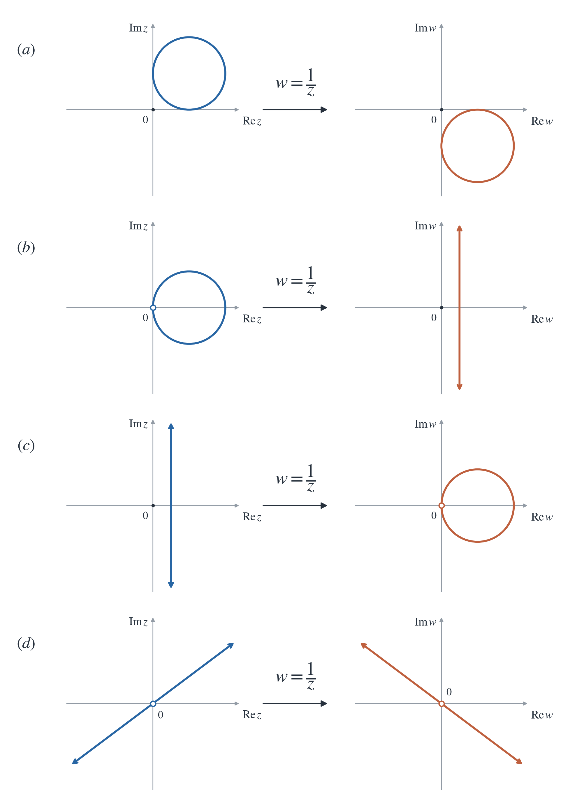

# Introduction
대부분의 PDE들은 풀기가 매우 어렵고, 그마저도 경계조건과 정의역을 어떻게 주느냐에 따라서 답이 천차만별로 달라진다. 개중에서는 우리가 그나마 다루기 편한 경계조건과 정의역도 있을테고, 그러지 않은 것들도 있기에 어떤 영역과 조건들을 우리가 다루기 편한 것들로 옮겨올 수만 있다면 문제를 풀기 한결 편해질 것이다. 이 포스트에서는 복소공간에서 작용하는 특정한 변환, 즉 함수들에 대해서 다루고 설명한다. 즉 특정한 변환들이 어떤 영역을 어떻게 바꾸는지 다룸으로써 우리가 원하는 방향으로 영역을 옮겨내는 방법을 다룬다.

# Linear Transformation
$0$이 아닌 상수 $A \in \mathbb{C}$에 대해 선형변환 $w = Az$는 복소수 $z$의 길이를 늘리거나 줄이고 회전시키는 작용을 하는데, $A = ae^{i\alpha}, z = r e^{i \theta}$라고 하면 $w = (ar)e^{i(\alpha + \theta)}$가 성립하기 때문이다. 여기에 평행이동의 역할을 하는 변환 $w = z + B$를 합하면 복소공간에서의 일반적인 선형변환(Linear Transformation)을 얻는다.

$$w = Az + B \quad (A \neq 0)$$

이 함수는 자명하게 복소평면 $\mathbb{C}$에서 연속이고 일대일 대응이다.

# $\displaystyle w = \frac{1}{z}$
다음으로 유리함수 $\displaystyle w = \frac{1}{z}$은 

$$\begin{align*}
w &= \frac{1}{z} \\
&= \frac{\bar{z}}{|z|^2} \\
&= \left( \overline{\frac{z}{\vert z \vert^2}} \right)
\end{align*}$$

이므로 $z$의 크기를 조정하고 실수축에 대해서 대칭이동시키는 변환이다. 단위원을 예로 들자면, 원 내부의 점들은 원 외부로, 원 외부의 점들은 원 내부로 옮겨진다. 원 경계의 점들은 그대로 남아있고, 원점만 적당히 대응시켜주면 이 변환은 일대일 대응임을 직관적으로 알 수 있는데, $\overline{\mathbb{C}} = \mathbb{C} \cup \{ \infty \}$로 정의되는 확장된 복소평면(Extended Complex Plane)을 고려해서 $0$을 $\infty$로, $\infty$를 $0$으로 보내주면 이 변환은 일대일 대응이 됨을 알 수 있다. 즉 변환 $T: \overline{\mathbb{C}} \to \overline{\mathbb{C}}$를

$$T(z) = \begin{cases}
\frac{1}{z} & \text{if } z \neq 0 \\
\infty & \text{if } z = 0 \\
0 & \text{if } z = \infty
\end{cases}$$

로 정의하면 $T$는 일대일 대응이 되고, 나아가 연속함수이다.

또한 특별히 $T$는 원과 직선을 다른 모양의 영역이 아닌, 원과 직선 둘 중 하나로 매핑한다. 다시 말해 $T(\text{circle}), T(\text{line}) = \text{circle or line}$이라는 뜻이다. $z = x + iy$라고 둘 때, $z$-평면에서 어떤 도형이 원 혹은 직선으로 표현된다고 하면 그 도형은 $x, y$에 대해 다음의 식을 만족해야만 한다.

$$A(x^2 + y^2) + Bx + Cy + D = 0, \quad B^2 + C^2 > 4AD$$

$A, B, C, D$는 적당한 주어진 실수 상수이다. $A = 0$이면 자명하게 직선이고, $A \neq 0$이면 완전제곱식 꼴로 나타낼 수 있고, 원의 방정식의 형태인

$$\left( x + \frac{B}{2A} \right)^2 + \left( y + \frac{C}{2A} \right)^2 = \left( \frac{\sqrt{B^2 + C^2 - 4AD}}{2A} \right)^2$$

을 얻는다.

한편 $w = \frac{1}{z}$에서 $z = \frac{1}{w}$이고 $z = x + iy, w = u + iv$라고 하면

$$x = \frac{u}{u^2 + v^2}, y = - \frac{v}{u^2 + v^2}$$

을 얻고, 이를 위 식에 대입해서 정리하면

$$D(u^2 + v^2) + Bu - Cv + A = 0$$

을 얻는다. 즉 $z$-평면의 원 혹은 직선은 $w = \frac{1}{z}$라는 변환을 통해 $w$-평면으로 옮겨져도 여전히 원 혹은 직선 중 하나이다. 정확한 대응 관계를 나열하면 다음과 같다.

# Linear Fractional Transformation
변환

$$w = \frac{az + b}{cz + d}, \quad ad - bc \neq 0$$

는 ***선형 분수 변환(Linear Fractional Transformation)*** 혹은 ***뫼비우스 변환(Möbius Transformation)***이라고 부르는 변환이다. $ad - bc \neq 0$이라는 조건은 등각사상(Conformal Mapping)이 되기 위한 조건이다. 양변에 $cz + d$를 곱해 일차식으로 표현하면

$$Azw + Bz + Cw + D = 0$$

의 꼴을 얻고, 이 식이 $z$와 $w$에 대해서 일차식이므로 이러한 변환을 ***쌍선형변환(Bilinear Transformation)***이라고 부르기도 한다.

## Theorem 1
**(i)** The linear fractional transformation

$$w = \frac{az + b}{cz + d}, \quad ad - bc \neq 0$$

is a continuous one-to-one correspondence in $\overline{\mathbb{C}}$, and it maps circles and lines to circles and lines. 

**(ii)** The inverse of the linear fractional transformation is also a linear fractional transformation. 

**(iii)** The composition of two linear fractional transformations is also a linear fractional transformation.

아래 증명 과정을 보면 알겠지만, 변환 $w = \frac{az + b}{cz + d}$은 다음과 같은 함수의 합성들로 이루어지기 때문에 위 정리들은 사실상 자명한 결과라고도 볼 수 있다.

$$Z = cz + d, \quad W = \frac{1}{Z}, \quad w = \frac{a}{c} + \frac{bc - ad}{c}W$$

### Proof
**(i)** If $c = 0$, then $ad \neq 0$. Thus, the transformation

$$w = \frac{az + b}{cz + d} = \frac{az + b}{d} = \frac{a}{d}z + \frac{b}{d}$$

is a nonconstant linear transformation because $a \neq 0$ and $d \neq 0$. Clearly, it maps circles and lines to circles and lines. 

If $c \neq 0$, then the transformation can be written as 

$$\begin{align*}
w &= \frac{\frac{a}{c}(cz + d) + b - \frac{ad}{c}}{cz + d} \\
&= \frac{a}{c} + \frac{bc - ad}{c} \cdot \frac{1}{cz + d}
\end{align*}$$

Note that it is a composition of the mappings

$$Z = cz + d, \quad W = \frac{1}{Z}, \quad w = \frac{a}{c} + \frac{bc - ad}{c}W$$

which means that it maps circles and lines to circles and lines. 

Define $T : \overline{\mathbb{C}} \to \overline{\mathbb{C}}$ as

$$T(z) = \begin{cases}
\frac{az + b}{cz + d} & \text{if } z \neq -\frac{d}{c} \\
\infty & \text{if } z = - \frac{d}{c}
\end{cases}$$

for each $z \in \mathbb{C}$, and

$$T(\infty) = \begin{cases}
\infty & \text{if } c = 0 \\
\frac{a}{c} & \text{if } c \neq 0.
\end{cases}$$

Then $T$ is a continuous one-to-one correspondence in $\overline{\mathbb{C}}$.

**(ii)** The transformation $w = \frac{az + b}{cz + d}$ can be written as

$$\begin{align*}
& w = \frac{az + b}{cz + d} \\
\implies & w(cz + d) = az + b \\
\implies & (cw - a)z = -dw + b \\
\implies & z = \frac{-dw + b}{cw - a}
\end{align*}$$

Since $(-d)(-a) - bc = ad - bc \neq 0$, it is a linear fractional transformation.

**(iii)** Let $T, S$ be two linear fractional transformations given by

$$T(z) = \frac{az + b}{cz + d} \quad \text{and} \quad S(z) = \frac{Az + B}{Cz + D}$$

with $ad - bc \neq 0$ and $AD - BC \neq 0$. Then we have

$$\begin{align*}
S(T(z)) &= \frac{A\left( \frac{az + b}{cz + d} \right) + B}{C\left( \frac{az + b}{cz + d} \right) + D}\\
&= \frac{A(az + b) + B(cz + d)}{C(az + b) + D(cz + d)}\\
&= \frac{(Aa + Bc)z + (Ab + Bd)}{(Ca + Dc)z + (Cb + Dd)}\\
\end{align*}$$

and

$$\begin{align*}
(Aa + Bc)(Cb + Dd) - (Ab + Bd)(Ca + Dc) &= (ACab + ADad + BCcb + BDcd) - (ACba + ADbc + BCda + BDdc) \\
&= (ADad - ADbc) - (BCda - BCcb) \\
&= AD(ad - bc) - BC(ad - bc) \\
&= (AD - BC)(ad - dc) \\
\neq 0
\end{align*}$$

because $ad - bc \neq 0$ and $AD - BC \neq 0$. Thus, $S \circ T$ is a linear fractional transformation. $\blacksquare$

## Uniqueness
한편 변환 $w = \frac{az + b}{cz + d}$의 구체적인 식을 결정하기 위해서는 계수가 네 개이므로 조건이 네 개가 필요한데, $ad - bc \neq 0$이 하나를 줄여주므로 세 개의 조건만 알면 충분하다. 간단하게 지나는 세 점을 알면 $w$를 유일하게 결정할 수 있다.

:::: {.callout-note title="Proof" collapse="true" icon=false}
First, we will show that every linear fractional transformation, with the exception of the identity transformation, has at most two fixed points in the extended plane.

Let $T(z) = \frac{az + b}{cz + d}$ with $ad - bc \neq 0$ be a linear fractional transformation. If $T$ has no fixed points, then we are done. If $T$ has fixed points, then

$$\begin{align*}
z = \frac{az + b}{cz + d} \\
\implies cz^2 + (d-a)z  - b = 0
\end{align*}$$

If $c \neq 0$, then this equation has at most two distinct roots in $\mathbb{C}$ by Fundamental Theorem of Algebra. If $c = 0$, then the equation $(d-a)z - b = 0$ has a unique root $z = \frac{b}{d-a}$ if $d-a \neq 0$, and $T(\infty) = \infty$. Thus, $T$ has two fixed points. If $d-a = 0$, then $b = 0$, which is the case of $T$ is the identity transformation. Hence, in any cases, $T$ has at most two fixed points. 

Clearly, there exists a linear fractional transformation passing through the given distinct points $z_1, z_2, z_3$ in $\overline{\mathbb{C}}$.

Let $T$ and $S$ be two such linear fractional transformations. Since $T(z_k) = S(z_k)$ for $k = 1, 2, 3$ and $S$ has the inverse $S^{-1}$, we have $S^{-1}(T(z_k)) = z_k$ for $k = 1, 2, 3$. Then $z_1, z_2, z_3$ is the fixed points of the linear fractional transformation $S^{-1} \circ T$. By above argument, we have $S^{-1} \circ T$ is the identity transformation. Thus $T = S$, which means that such linear fractional transformation uniquely exists. $\blacksquare$
::::

한편 평면 위 세 개의 점은 한 직선 위에 있거나 한 원 위에 있거나, 둘 중의 하나의 경우에 반드시 해당된다. $\overline{\mathbb{C}}$ 위의 서로 다른 세 점이 주어져서 변환 $T(z) = \frac{az + b}{cz + d}$를 결정했다고 했을 때, 이 서로 다른 세 점이 놓여 있던 직선 혹은 원이 변환을 거친 후에 어떤 도형으로 변환되는지를 확인한다면 $T$라는 변환이 어떤 매핑인지 특징을 파악할 수 있다.

## Implicit Form
위와 같이 변환 $w = \frac{az + b}{cz + d}$를 결정하기 위해서는 지나는 세 점이 필요한데, 세 점을 가지고 직접 계수 $a, b, c, d$를 결정하려면 연립방정식을 풀어야 하고 이는 많은 경우 귀찮은 작업이다. 때문에 지나는 세 점을 가지고 직접 함수식을 작성할 수 있다면 매우 편할 것이고, 아래의 암시적 폼(Implicit Form)은 함수가 지나는 서로 다른 세 점 $(z_1, w_1), (z_2, w_2), (z_3, w_3)$를 가지고 함수를 바로 결정할 수 있게 해준다.

$$\frac{(w - w_1)(w_2 - w_3)}{(w - w_3)(w_2 - w_1)} = \frac{(z - z_1)(z_2 - z_3)}{(z - z_3)(z_2 - z_1)}$$

실제로 이 식이 주어진 세 점을 지나는지, 다시 말해 각 점을 위 방정식에 대입했을 때 식이 성립하는지 확인해보자. $z = z_1$일 때 우변은 $0$이 되고, 좌변에서는 $w = w_1$이 아니면 결코 $0$이 되지 않으므로 $w = w_1$을 얻는다. 또한 $z = z_3$일 때 우변은 $\infty$가 되고, 좌변에서 $w = w_3$이 아니면 결코 $\infty$가 되지 않으므로 $w = w_3$을 얻는다. 마지막으로 $z = z_2$일 때 우변은 $1$이 되고,

$$\frac{(w - w_1)(w_2 - w_3)}{(w - w_3)(w_2 - w_1)} = 1$$

을 $w$에 대해 풀어서 값을 구하면 $w = w_2$를 얻는다. 따라서 위 식은 주어진 세 점을 지나고, 양변의 분모를 없애서 정리해주면 

$$Azw + Bz + Cw + D = 0$$

의 꼴, 다시 말해 선형 분수 변환의 꼴이고 $AD - BC \neq 0$을 만족하므로 선형 분수 변환이다. 이제 위에서 증명한 유일성에 의해 암시적 폼은 선형 분수 변환을 완전하게 결정한다고 말할 수 있다.

한편 지나는 점 중 하나가 $\infty$라면 다음과 같이 극한을 계산함으로써 수정된 암시적 폼 또한 얻을 수 있다. 예시로 $z_1 = \infty$인 경우 다음과 같이 계산된다.

$$\lim_{z_1 \to 0} \frac{\left( z - \frac{1}{z_1} \right)(z_2 - z_3)}{(z-z_3)\left( z_2 - \frac{1}{z_1} \right)} \cdot \frac{z_1}{z_1} = \lim_{z_1 \to 0} \frac{(z_1z - 1)(z_2-z_3)}{(z-z_3)(z_1z_2 - 1)} = \frac{z_2-z_3}{z-z_3}$$

따라서 암시적 폼은 다음과 같다.

$$\frac{(w - w_1)(w_2 - w_3)}{(w - w_3)(w_2 - w_1)} = \frac{z_2-z_3}{z-z_3}$$

형태를 자세히 보면 $z_1$이 들어있던 부분이 지워진 꼴이다. 따라서 다른 $z_k$나 $w_k$가 무한대로 주어졌다고 하면 해당하는 부분을 지우고 암시적 폼을 작성하면 된다.

## Mappings of The Upper Half Plane
### Theorem 2
Let $U := \{ z \in \mathbb{C} \mid \mathrm{Im}(z) > 0 \}$, and let $D := \{ w \in \mathbb{C} \mid \vert w \vert < 1 \}$. Let $T: \overline{C} \to \overline{C}$ be a linear fractional transformation. The following are equivalent:

**(i)** $T(U) = D, T(\partial U \cup \{\infty\}) = \partial D$.

**(ii)** $T$ is of the form

$$T(z) = e^{i \alpha} \frac{z - z_0}{z - \overline{z_0}}$$

for some $\alpha \in \mathbb{R}$ and $z_0 \in U$.

#### Proof
**(i)** $\implies$ **(ii)** Let $T = \frac{az + b}{cz + d}$ with $ad - bc \neq 0$.

First, we note that $c, d \neq 0$. Since $T(\infty) \in \partial D$, it must have the finite value, which is the case when only $c \neq 0$. If $d = 0$, then $c \neq 0$, so $T(0) = T\left( - \frac{d}{c} \right) = \infty$, which is impossible since $T(0) \in \partial D$. Hence $c, d \neq 0$.

Then we have $1 = \vert T(0) \vert = \left \vert \frac{b}{d} \right \vert$ and $1 = \vert T(\infty) \vert = \left \vert \frac{a}{c} \right \vert$, which implies that $\vert b \vert = \vert d \vert \neq 0$ and $\vert a \vert = \vert c \vert \neq 0$

Since $\vert \frac{a}{c} \vert = 1$, we let $\frac{a}{c} = e^{i \alpha}$ for some $\alpha \in \mathbb{R}$. Then we have
$$\begin{align*}
T(z) &= \frac{az + b}{cz + d} \\
&= \frac{a}{c} \cdot \frac{z + \frac{b}{a}}{z + \frac{d}{c}} \\
&= e^{i \alpha} \frac{z + \frac{b}{a}}{z + \frac{d}{c}}.
\end{align*}$$

Since $\left \vert \frac{b}{d} \right \vert = 1 = \left \vert \frac{a}{c} \right \vert$, we have $\left \vert \frac{b}{a} \right \vert = \left \vert \frac{d}{c} \right \vert$. If we let $z_0 = \frac{b}{a}$ and $z_1 = \frac{d}{c}$, then

$$T(z) = e^{i \alpha} \frac{z + z_0}{z + z_1}.$$

Since $T(1) \in \partial D$,

$$1 = \vert T(1) \vert = \left \vert e^{i \alpha} \frac{1 + z_0}{1 + z_1} \right \vert = \frac{\vert 1 + z_0 \vert}{\vert 1 + z_1 \vert},$$

which implies that $\vert 1 + z_0 \vert^2 = \vert 1 + z_1 \vert^2$. Then we obtain

$$\begin{align*}
&\vert 1 + z_0 \vert^2 = \vert 1 + z_1 \vert^2 \\
\implies &(1 + z_0)(1 + \overline{z_0}) = (1 + z_1)(1 + \overline{z_1}) \\
\implies &1 + z_0 + \overline{z_0} + \vert z_0 \vert^2 = 1 + z_1 + \overline{z_1} + \vert z_1 \vert^2 \\
\implies &\mathrm{Re}(z_0) = \mathrm{Re}(z_1).
\end{align*}$$

Because $z_0, z_1 \in \partial D$, we obtain $z_1 = \overline{z_0}$.

Since $ad \neq bc$, $z_0 = \frac{b}{a} \neq \frac{d}{c} = z_1$, which implies that $z_0, z_1$ are not real numbers, i.e., $\mathrm{Im}(z_0), \mathrm{Im}(z_1) \neq 0$.

We claim that $\mathrm{Im}(z_0) < 0$, so that

$$\begin{align*}
T(z)& = e^{i \alpha} \frac{z + z_0}{z + \overline{z_0}} \\
&= e^{i \alpha} \frac{z - z'_0}{z - \overline{z'_0}}
\end{align*}$$

where $z'_0 = - z_0$ with $\mathrm{Im}(z'_0) > 0$, and the statement **(ii)** is proved.

If $\mathrm{Im}(z_0) > 0$, then $z_0 \in U$. Then $T(z_0) \in D$, i.e., $\vert T(z_0) < 1$. However, we have

$$\begin{align*}
\vert T(z_0) \vert &= \left \vert e^{i \alpha} \frac{z_0 + z_0}{z_0 + \overline{z_0}} \right \vert \\
&= \left \vert \frac{2 z_0}{2\mathrm{Re}(z_0)} \right \vert \\
&= \frac{\vert z_0 \vert}{\vert \mathrm{Re}(z_0) \vert} < 1,
end{align*}$$

which means that $\vert z_0 \vert < \mathrm{Re}(z_0). \bigotimes$ Hence $\mathrm{Im}(z_0) < 0$, which completes the proof.

**(ii)** $\implies$ **(i)** First, we show that $T(U) = D$. Let $z \in U$. Then

$$\begin{align*}
\vert T(z) \vert &= \left \vert e^{i \alpha} \frac{z - z_0}{z - \overline{z_0}} \right \vert \\
&= \frac{\vert z - z_0 \vert}{\vert z - \overline{z_0} \vert} < 1
\end{align*}$$

because $\mathrm{Im}(z) > 0$ and $\mathrm{Im}(\overline{z_0}) < 0$, so $\vert z - z_0 \vert < \vert z - \overline{z_0} \vert$. Hence $T(U) \subset D$.

Let $w \in D$. By Theorem 1 **(i)**, $T$ is onto, so $w = T(z)$ for some $z \in \overline{\mathbb{C}}$. Then

$$\begin{align*}
1 &> \vert w \vert \\
&= \vert T(z) \vert \\
&= \left \vert e^{i \alpha} \frac{z - z_0}{z - \overline{z_0}} \right \vert \\
&= \frac{\vert z - z_0 \vert}{\vert z - \overline{z_0} \vert},
\end{align*}$$

which implies that $\vert z - z_0 \vert < \vert z - \overline{z_0} \vert$. This occurs when only $\mathrm{Im}(z) > 0$, so $z \in U$. Hence $T(U) = D$.

Next, we show that $T(\partial U \cup \{\infty\}) = \partial D$. Since

$$T(z) = e^{i \alpha} \frac{z - z_0}{z - \overline{z_0}} = \frac{e^{i\alpha} z - e^{i\alpha}z_0}{z - \overline{z_0}},$$

we have $T(\infty) = \frac{e^{i\alpha}}{1} = e^{i\alpha} \in \partial D$. In the similar manner above, we can show that $T(\partial U) = \partial D \setminus \{ e^{i \alpha} \}$. Thus, $T(\partial U \cup \{\infty\}) = \partial D. \blacksquare$

# Reference
- Brown, James Ward, & Churchill, Ruel V. (2017). Complex Variables and Applications (9th ed.). McGraw-Hill.