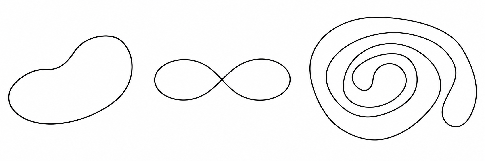

# Plane curve
## Definition 1
Let $\alpha$ be a unit speed plane curve. 

**(i)** The ***tangent vector field*** $t(s)$ to $\alpha$ is $t(s) = \alpha'(s)$.

**(ii)** The ***normal vector field*** $n(s)$ to $\alpha$ is the unique unit vector field $n(s)$ such that $\{ t(s), n(s) \}$ gives a right-handed orthonormal basis of $\mathbb{R}^2$.

**(iii)** The ***plane curvature*** $k(s)$ of $\alpha$ is defined by $k(s) = \langle t'(s), n(s) \rangle$.

기존에 노말 벡터 $N(s)$가 곡률 $\kappa(s)$가 $0$이 아닌 점에서만 정의되었던 반면, 평면 곡선의 노말 벡터 $n(s)$는 평면 곡률 $k(s)$에 관계없이 항상 정의가 가능하다. 일반성을 잃지 않고 곡선을 $xy$ 평면에 놓여있다고 하면 바이노말 벡터 $B(s)$가 $z$축의 단위 벡터 $(0,0,1)$로 고정된 상황이기 때문에 $t(s)$가 주어질 때마다 $t(s)$와 $B(s)$의 외적으로 자연스럽게 $n(s)$가 결정되기 때문이다.

또한 일반적인 곡률 $\kappa(s)$는 항상 음이 아니었지만 평면 곡률 $k(s)$는 음수가 될 수도 있다. 정확히는 $n(s)$가 곡선과 가까워지는 방향일 때 $k(s) > 0$이고 곡선과 멀어지는 방향일 때 $k(s) < 0$이 성립한다.

## Example
**(i)** Let $\alpha(s) = \left(r \cos \frac{s}{r}, r \sin \frac{s}{r} \right)$

**(ii)** Let $\beta(s) = \left(r \cos \frac{s}{r}, -r \sin \frac{s}{r} \right)$

## Theorem 1
Let $\alpha$ be a unit speed plane curve.

**(i)** $t'(s) = k(s)n(s)$ and $n'(s) = -k(s)t(s)$, so

$$\begin{bmatrix}
t' \\
n'
\end{bmatrix} = \begin{bmatrix}
0 & k \\
-k & 0
\end{bmatrix} \begin{bmatrix}
t \\
n
\end{bmatrix}$$

**(ii)** If $\alpha(s) = (x(s), y(s))$, then $t(s) = (x'(s), y'(s))$ and $n(s) = (-y'(s), x'(s))$.

**(iii)** At all points for which $N(s)$ is defined, we have 

$$\begin{align*}
t(s) &= T(s) \\
n(s) &= \pm N(s) \\
|k(s)| &= \kappa(s) 
\end{align*}$$

### Proof

# Simple Closed Curve
## Definition 2
Let $\beta$ be a regular curve.

**(i)** $\beta$ is said to be ***closed*** if $\beta$ is periodic.

**(ii)** $\beta$ is said to be ***simple*** if either $\beta$ is one-to-one or $\beta$ is a closed curve of a period $a$ with $\beta(t_1) = \beta(t_2) \iff t_1 - t_2 = na$ for some $n \in \mathbb{Z}$.

즉 폐곡선과 주기함수는 동치인 개념으로 받아들일 수 있다. 심플이란 일종의 꼬이지 않은 곡선으로 이해할 수 있는데, 다음의 예시들을 참고하자. 

위 세 예시는 모두 폐곡선이지만 2번 곡선은 중간에 꼬인 점이 있으므로 단순 곡선이 아니다.

## Theorem 2
If $\beta(t)$ is a closed curve with period $a$ and $\alpha(s)$ is $\beta$ reparametrized by arc length, then $\alpha$ is closed with period $\displaystyle L = \int_0^a \| \beta'(t) \| dt$.

즉 단위 스피드 폐곡선의 주기는 곡선의 길이와 동일하다.

### Proof

# Rotation Index
## Definition 3

**(i)** The ***rotation index*** of a closed unit speed plane curve $\alpha(s)$ is the integer 

$$i_\alpha = \frac{\theta(L) - \theta(0)}{2 \pi}$$

## Rotation Index Theorem
The rotation index of a simple closed plane curve $\alpha(s)$ is $\pm 1$.

### Proof

# Reference
- R. S. Millman and G. D. Parker, Elements of Differential Geometry, Prentice-Hall, 1977.