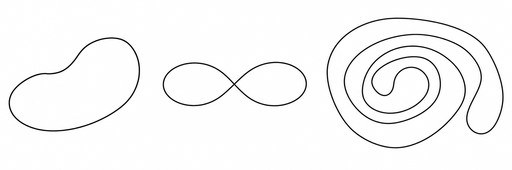
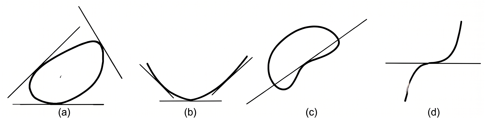

# Plane curve
## Definition 1
Let $\alpha$ be a unit speed plane curve. 

**(i)** The ***tangent vector field*** $t(s)$ to $\alpha$ is $t(s) = \alpha'(s)$.

**(ii)** The ***normal vector field*** $n(s)$ to $\alpha$ is the unique unit vector field $n(s)$ such that $\{ t(s), n(s) \}$ gives a right-handed orthonormal basis of $\mathbb{R}^2$.

**(iii)** The ***plane curvature*** $k(s)$ of $\alpha$ is defined by $k(s) = \langle t'(s), n(s) \rangle$.

기존에 노말 벡터 $N(s)$가 곡률 $\kappa(s)$가 $0$이 아닌 점에서만 정의되었던 반면, 평면 곡선의 노말 벡터 $n(s)$는 평면 곡률 $k(s)$에 관계없이 항상 정의가 가능하다. 일반성을 잃지 않고 곡선을 $xy$ 평면에 놓여있다고 하면 바이노말 벡터 $B(s)$가 $z$축의 단위 벡터 $(0,0,1)$로 고정된 상황이기 때문에 $t(s)$가 주어질 때마다 $t(s)$와 $B(s)$의 외적으로 자연스럽게 $n(s)$가 결정되기 때문이다. 즉 주어진 평면에서 $t(s)$ 벡터를 반시계방향으로 $90^\circ$ 회전한 벡터가 $n(s)$이다.

또한 일반적인 곡률 $\kappa(s)$는 항상 음이 아니었지만 평면 곡률 $k(s)$는 음수가 될 수도 있다. 정확히는 $n(s)$가 곡선과 가까워지는 방향일 때 $k(s) > 0$이고 곡선과 멀어지는 방향일 때 $k(s) < 0$이 성립한다. 이렇게 부호를 가질 수 있기 때문에 ***부호가 있는 곡률(signed curvature)***이라고도 불린다.

한편, 일반적인 곡선에서와 마찬가지로 정칙 곡선 $\beta(t)$에 대해서도 위 벡터들과 곡률을 정의할 수 있다. 정칙 곡선 $\beta(t)$와 그 arc length reparamterization $\alpha(s)$에 대해서 다음이 성립한다.

$$\begin{align*}
t_\beta(t) &= t_\alpha(s(t)) \\
n_\beta(t) &= n_\alpha(s(t)) \\
k_\beta(t) &= k_\alpha(s(t)) \\
\theta_\beta(t) &= \theta_\alpha(s(t))
\end{align*}$$

## Example
**(i)** Let $\alpha(s) = \left(r \cos \frac{s}{r}, r \sin \frac{s}{r} \right)$

**(ii)** Let $\beta(s) = \left(r \cos \frac{s}{r}, -r \sin \frac{s}{r} \right)$

## Theorem 1
Let $\alpha$ be a unit speed plane curve.

**(i)** $t'(s) = k(s)n(s)$ and $n'(s) = -k(s)t(s)$, so

$$\begin{bmatrix}
t' \\
n'
\end{bmatrix} = \begin{bmatrix}
0 & k \\
-k & 0
\end{bmatrix} \begin{bmatrix}
t \\
n
\end{bmatrix}$$

**(ii)** If $\alpha(s) = (x(s), y(s))$, then $t(s) = (x'(s), y'(s))$ and $n(s) = (-y'(s), x'(s))$.

**(iii)** At all points for which $N(s)$ is defined, we have 

$$\begin{align*}
t(s) &= T(s) \\
n(s) &= \pm N(s) \quad \text{if } N(s) \text{ is defined} \\
|k(s)| &= \kappa(s) 
\end{align*}$$

::: {.callout-note title="Proof" icon=false collapse="true"}
**(i)** Since $\langle t(s), t(s) \rangle = 1$, we have $\langle t'(s), t(s) \rangle = 0$. Hence 

$$\begin{align*}
t'(s) &= \langle t'(s), t(s) \rangle t(s) + \langle t'(s), n(s) \rangle n(s) \\
&= k(s) n(s).
\end{align*}$$

Similary, we have $\langle n'(s), n(s) \rangle = 0$. Note that $\langle t(s), n(s) \rangle = 0$, so $\langle t'(s), n(s) \rangle + \langle t(s), n'(s) \rangle = 0$. Then $\langle n'(s), t(s) \rangle = -k(s)$. Hence,

$$\begin{align*}
n'(s) &= \langle n'(s), t(s) \rangle t(s) + \langle n'(s), n(s) \rangle n(s) \\
&= -k(s) t(s).
\end{align*}$$

**(ii)** Clearly $t(s) = (x'(s), y'(s))$. Note that $m(s) = (-y'(s), x'(s))$ is a unit vector with $\langle t(s), m(s) \rangle = 0$. Then $\{ t(s), m(s) \}$ is a basis for $\mathbb{R}^2$. If we show that $\{ t(s), m(s) \}$ is a right-handed orthonormal basis for $\mathbb{R}^2$, we must obtain $m(s) = n(s)$. 

Note that 

$$\begin{vmatrix}
x'(s) & -y'(s) \\
y'(s) & x'(s)
\end{vmatrix} = (x'(s))^2 + (y'(s))^2 > 0,$$

which means that the basis $\{ t(s), m(s) \}$ is right-handed. Hence, we have $n(s) = m(s) = (-y'(s), x'(s))$.

**(iii)** It is obvious that $t(s) = T(s)$ and $n(s) = \pm N(s)$. Since $t'(s) = k(s)n(s)$ and $T'(s) = \kappa(s) N(s)$, we obtain $\vert k(s) \vert = \kappa(s)$. $\blacksquare$
:::

# Simple Closed Curve
## Definition 2
Let $\beta$ be a regular curve.

**(i)** $\beta$ is said to be ***closed*** if $\beta$ is periodic.

**(ii)** $\beta$ is said to be ***simple*** if either $\beta$ is one-to-one or $\beta$ is a closed curve of a period $a$ with $\beta(t_1) = \beta(t_2) \iff t_1 - t_2 = na$ for some $n \in \mathbb{Z}$.

즉 폐곡선과 주기함수는 동치인 개념으로 받아들일 수 있다. 심플이란 일종의 꼬이지 않은 곡선으로 이해할 수 있는데, 다음의 예시들을 참고하자. 

위 세 예시는 모두 폐곡선이지만 2번 곡선은 중간에 꼬인 점이 있으므로 단순 곡선이 아니다.

## Theorem 2
Let $\beta(t)$ be a regular curve, and let $\alpha(s)$ be $\beta$ reparametrized by arc length $s(t)$. Let $t, n$ be tangent and normal vector of $\beta(t)$, and let $k$ be the plane curvature of $\beta(t)$.

**(i)** If $\alpha$ is closed with period $a$, then $\beta$ is closed with period $\displaystyle L = \int_0^a \| \beta'(t) \| dt$.

**(ii)** Let $\displaystyle J = \begin{bmatrix}
0 & -1 \\
1 & 0
\end{bmatrix}$. Then

$$\begin{align*}
t &= \frac{\dot{\beta}}{\| \dot{\beta} \|} \\
n &= J\frac{\dot{\beta}}{\| \dot{\beta} \|} \\
k &= \frac{\langle \ddot{\beta}, J\dot{\beta} \rangle}{ \| \dot{\beta} \|^3}
\end{align*}$$

Furthermore,

$$\begin{bmatrix}
t' \\
n'
\end{bmatrix} = \| \dot{\beta} \| \begin{bmatrix} 
0 & k\| \dot{\beta} \| \\
-k\| \dot{\beta} \| & 0
\end{bmatrix}$$

::: {.callout-note title="Proof" icon=false collapse="true"}
**(i)** Let

$$s(t) = \int_0^t \| \beta'(u) \| du.$$

Then we have

$$\begin{align*}
s(t+a) &= \int_0^{t+a} \| \beta'(u) \| du \\
&= \int_0^a \| \beta'(u) \| du + \int_a^{t+a} \| \beta'(u) \| du \\
&= L + \int_0^t \| \beta'(v+a) \| dv \\
&= L + \int_0^t \| \beta'(v) \| dv \\
&= L + s(t).
\end{align*}$$

Hence, we have

$$\begin{align*}
\alpha(s + L) &= \alpha(s(t) + L) \\
&= \alpha(s(t+a)) \\
&= \beta(t+a) \\
&= \beta(t) \\
&= \alpha(s(t)) \\
&= \alpha(s).
\end{align*}$$

Since $a$ is the period of $\beta$, $L$ must be the least positive number such that $\alpha(s+L) = \alpha(s), \forall s$. $\blacksquare$
:::

# Continuous Argument
단위원 $S^1$을 나타내는 곡선 $\alpha(s) = (\cos 2\pi s, \sin 2 \pi s), \forall s \in [0, 1]$은 단순폐곡선이며, 반시계방향으로 한 번 회전하는 곡선이다. 반면 원과 같이 단순곡선이 아니라 꼬여있는 곡선의 경우 한 번이 아니라 여러번 회전할 수도 있으며 시계방향으로 회전할 수도 있다. 이처럼 우리는 단순폐곡선 $\alpha$가 평면 상에서 몇 번이나 회전하는지, 회전하면 어느 방향으로 회전하는지 계산하는 이론을 세우고 싶고, 이를 위해 주어진 곡선이 **얼만큼 회전하는지** 측정할 필요가 있다. 아래 정리는 접선 벡터의 각도를 연속적으로 측정해주는 각도 함수 $\theta$를 잘 정의할 수 있음을 보장해주며, 이로써 곡선의 **회전수(Rotation Index)**를 정의할 수 있게 해준다.

## Theorem 3
Let $\alpha: [0, L] \to \mathbb{R}^2$ be a unit speed plane $C^1$ curve. 

**(i)** Fix $\theta_0 \in \mathbb{R}$ such that $t(0) = (\cos \theta_0, \sin \theta_0)$. Then there exists a unique continuous function $\theta: [0, L] \to \mathbb{R}$, called the ***continuous argument*** of $\alpha$, such that $\theta(0) = \theta_0$ and $t(s) = (\cos \theta(s), \sin \theta(s)), \forall s \in [0, L]$. Thus, $\theta(s)$ gives the oriented angle from the positive $x$-axis to $t(s)$, with counterclockwise rotation taken as positive.

**(ii)** If $\alpha$ is $C^2$, then $\theta'(s) = k(s)$ and $\vert \theta'(s) \vert = \kappa(s)$.

**(iii)** If $\alpha$ is closed, then $\theta(L) = \theta_0 + 2n\pi$ for some $n \in \mathbb{Z}$.

::: {.callout-note title="Proof" icon=false collapse="true"}
**(i)** Since $t(s)$ is continuous on a compact set $[0, L]$, it is uniformly continuous. Then we can choose a partition $0 = s_0 < s_1 < \cdots < s_n = L$ such that $\| t(s) - t(s_j) \| < 1, \forall s \in [s_j, s_{j+1}]$ for each $j = 0, \dots, n-1$. It follows that

$$\begin{align*}
\| t(s) - t(s_j) \|^2 = 2 - 2 \langle t(s), t(s_j) \rangle \\
\implies \langle t(s), t(s_j) \rangle = 1 - \frac{1}{2} \| t(s) - t(s_j) \|^2 > \frac{1}{2}
\end{align*}$$

We now construct $\theta$ inductively on these subintervals, starting with $\theta(s_0) = \theta_0$. Let $e_0 = t(s_0)$, and let $e_0^\perp$ be the vector obtained by rotating $e_0$ counterclockwise through $\frac{\pi}{2}$. In the orthonormal basis $\{ e_0, e_0^\perp \}$ for $\mathbb{R}^2$, the first coordinate of $t(s)$ is given by 

$$\langle t(s), e_0 \rangle = \langle t(s), t(s_0) \rangle > 0.$$

Hence, the oriented angle from $e_0$ to $t(s)$ is given continuously on $[s_0, s_{1}]$ by

$$\delta_0(s) = \arctan \left( \frac{\langle t(s), e_0^\perp \rangle}{\langle t(s), e_0 \rangle} \right).$$

Define

$$\theta(s) = \theta(s_0) + \delta_0(s), \forall s \in [s_0, s_1].$$

Then we have 

$$\begin{align*}
t(s) &= \cos \delta_0(s) e_0 + \sin \delta_0(s) e_0^\perp \\
&= \cos \delta_0(s) (\cos \theta_0, \sin \theta_0) + \sin \delta_0(s) (-\sin \delta_0, \cos \delta_0) \\
&= (\cos \delta_0(s)\cos \theta_0 - \sin \delta_0(s)\sin \delta_0, \cos \delta_0(s)\sin \theta_0 + \sin \delta_0(s)\cos \delta_0) \\
&= (\cos (\delta_0(s) + \theta_0), \sin (\delta_0(s) + \theta_0)) \\
&= (\cos \theta(s), \sin \theta(s))
\end{align*}$$

for all $s \in [s_0, s_{1}]$.

Starting with $\theta(s_1) = \theta(s_0) + \delta_0(s_1)$, we can repeat the above construction, so that we obtain

$$\theta(s) = \theta(s_1) + \delta_1(s) \quad \text{and} \quad t(s) = (\cos \theta(s), \sin \theta(s))$$

for all $s \in [s_1, s_2]$.

Repeating the construction gives a continuous tangent angle function $\theta: [0, L] \to \mathbb{R}$ such that $\theta(0) = \theta_0$ and $t(s) = (\cos \theta(s), \sin \theta(s)), \forall x \in [0, L]$, 

For uniqueness, let $\tilde{\theta}$ be another continuous tangent angle function with the same initial value $\theta_0$. Since $t(s) = (\cos \theta(s), \sin \theta(s))$ and $t(s) = (\cos \tilde{\theta}(s), \sin \tilde{\theta}(s))$ represent the same unit vector, we have

$$\tilde{\theta}(s) - \theta(s) \in 2\pi \mathbb{Z}, \forall s \in [0, L].$$

Since $\tilde{\theta}(s) - \theta(s)$ is continuous, it must be a constant function on $[0, L]$. Since $\tilde{\theta}(0) - \theta(0) = \theta_0 - \theta_0 = 0$, we conclude $\tilde{\theta} = \theta$. 

**(ii)** Since $t(s) = (\cos \theta(s), \sin \theta(s))$, we have $n(s) = (- \sin \theta(s), \cos \theta(s))$. Then

$$\begin{align*}
t'(s) = \theta'(s)(-\sin \theta(s), \cos \theta(s)) = \theta'(s) n(s) \\
\implies k(s) = \langle t'(s), n(s) \rangle = \theta'(s).
\end{align*}$$

Moreover, $\vert \theta'(s) \vert = \vert k(s) \vert = \kappa(s)$.

**(iii)** Since $\alpha$ is closed, we have

$$(\cos \theta(L), \sin \theta(L)) = t(L) = t(0) = (\cos \theta(0), \sin \theta(0)),$$

so that $\theta(L) - \theta_0 \in 2\pi \mathbb{Z}$. Thus, $\theta(L) = \theta_0 + 2n\pi$ for some $n \in \mathbb{Z}$. $\blacksquare$
:::

# Rotation Index
## Definition 3
The ***rotation index*** of a closed unit speed plane curve $\alpha: [0, L] \to \mathbb{R}^2$ with the continuous argument $\theta: [a, b] \to \mathbb{R}$ is the integer 

$$i_\alpha = \frac{\theta(L) - \theta(0)}{2 \pi}$$

From Theorem 3 **(ii)**, we obtain

$$\begin{align*}
i_\alpha &= \frac{\theta(L) - \theta(0)}{2 \pi} \\
&= \frac{1}{2\pi} \int_0^L \theta'(s) ds \\
&= \frac{1}{2\pi} \int_0^L k(s) ds
\end{align*}$$

## Theorem 4
Let $\alpha: [0, L] to \mathbb{R}^2$ be a simple closed plane curve. 

**(i)** **(Rotation Index Theorem)** The rotation index of $\alpha$ is $\pm 1$.

**(ii)** The tangent circular image $t: [0, L] \to S^1$ is onto.

::: {.callout-note title="Proof" icon=false collapse="true"}
**(i)** 

**(ii)** Choose $v = (\cos \phi, \sin \phi) \in S^1$. By the rotation index theorem, $i_\alpha = \pm 1$, which means that $\theta(s_1) = \theta(s_0) \pm 2\pi$ for some $s_0, s_1 \in [0, L]$ with $s_0 < s_1$. Then we may assume that $\phi$ lies between $\theta(s_0)$ and $\theta(s_1)$. Since $\theta$ is continuous, $\phi = \theta(s)$ for some $s$ between $\theta(s_0)$ and $\theta(s_1)$. Hence, $t(s) = (\cos \theta(s), \sin \theta(s)) = v$, so $t$ is onto. $\blacksquare$ 
:::

## Definition 4
**(i)** A ***piecewise regular curve*** is a continuous function $\alpha: [a, b] \to \mathbb{R}^3$ with a partition $a = s_0 < s_1 < \cdots < s_n = b$ such that each restriction $\alpha \vert_{[s_{j-1}, s_j]}$ is regular.

**(ii)** Let $\alpha$ be a piecewise regular plane curve. Denote 

$$\begin{align*}
t^-(s_j) &= \lim_{s \to s^-_j} t(s) \\
t^+(s_j) &= \lim_{s \to s^+_j} t(s) \\
\Delta \theta_j &= \angle (t^-(s_j), t^+(s_j))
\end{align*}$$

Then the rotation index of $\alpha$ is defined by

$$i_\alpha = \frac{\sum_{j=0}^{n-1} \delta \theta_j + \sum_{j=0}^{n-1} \Delta \theta_j}{2\pi}$$

where $\delta \theta_j$ is the angle through which $t$ rotates on $\alpha \vert_{[s_{j-1}, s_j]}$.

곡선 $\alpha$가 전체 구간에서가 아닌 조각적으로 정의되었더라도 여전히 회전수를 정의할 수 있고, 단순 곡선이면 여전히 회전수가 $\pm 1$이다. $\delta \theta_j$는 각 부분 구간 $[s_{j}, s_{j+1}]$에서 $\alpha$가 회전한 각도이고, $\Delta \theta_j$는 각 꼭짓점 $s_j$에서 각도함수 $\theta$가 순간적으로 뛰어넘은 각도의 크기이다. 따라서 전체 회전수는 이 각들을 모두 더해줌으로 얻어진다.

## Corollary
If $\alpha(s)$ is a piecewise regular simple closed plane curve, then $i_\alpha = \pm 1$.

## Definition 5
Let $\alpha_0, \alpha_1: [0, 1] \to \mathbb{R}^2$ be two regular closed curves. We say that $\alpha_0$ and $\alpha_1$ are ***regularly homotopic***, denoted by $\alpha_0 \simeq \alpha_1$, if there exists a $C^2$ map $H: [0, 1] \times [0, 1] \to \mathbb{R}^2$ such that each $\alpha_u = H(\cdot, u)$ is a regular closed curve, $H(t, 0)= \alpha_0(t)$ and $H(t, 1) = \alpha_1(t)$. The map $H$ is called the ***regular homotopy*** between $\alpha_0$ and $\alpha_1$.

## Theorem 5
The rotation index is invariant under regular homotopy.

::: {.callout-note title="Proof" icon=false collapse="true"}
:::

# Convex Cuve
## Definition 6
**(i)** Let $\ell$ be a straight line in $\mathbb{R}^2$. We say that a curve $\alpha$ ***lies on one side of*** $\ell$ if the image of $\alpha$ completely contained in one of the half planes divided by $\ell$.

**(ii)** A regular curve $\alpha$ is said to be ***convex*** if it lies on one side of each tangent line.

직선은 평면을 두 개의 부분평면으로 나누는데, 곡선에서 그은 각 접선이 나누는 부분평면 중 하나에 곡선이 완전히 속하게 되면 그 곡선을 컨벡스하다고 부른다. 아래 그림에서 (a), (b)는 컨벡스이지만 (c), (d)는 컨벡스가 아니다.

## Theorem 5
A simple closed regular plane curve $\alpha(s)$ with the continuous argument $\theta(s)$ is convex $\iff$ $k(s)$ has constant sign $\iff$ $\theta(s)$ is monotone.

::: {.callout-note title="Proof" icon=false collapse="true"}
:::

# Reference
- R. S. Millman and G. D. Parker, Elements of Differential Geometry, Prentice-Hall, 1977.