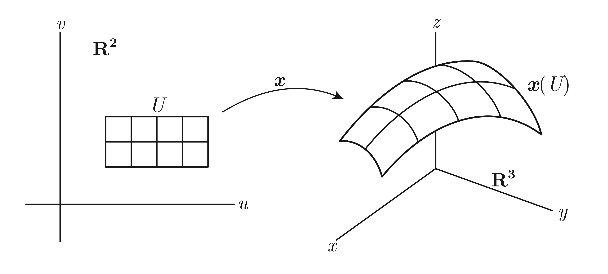

---
title: "Simple Surface"
author: "Youmin Chun"
date: "2026-11-23 00:00:01"
description: "국소 곡면 이론을 다룬다."
categories: 
  - Math > Differential Geometry > Surface Theory
---

# Simple Surface
## Definition 1
::: {.math-box}
Let $U$ be an open subset of the Euclidean space $\mathbb{R}^2$ with coordinates $u_1, u_2$. A $C^k$ ***simple surface*** (or a ***coordinate patch***) is a one-to-one $C^k$ function $\mathbf{x}: U \to \mathbb{R}^3$ for some $k \ge 1$ if

$$\frac{\partial \mathbf{x}}{\partial u_1}(p) \times \frac{\partial \mathbf{x}}{\partial u_2}(p) \neq \mathbf{0}, \forall p \in U.$$
:::

곡선이라는 기하학적 대상을 분석하기 위해서 매개변수를 사용해 함수로 나타냈고, 이 함수를 분석함으로 곡률(curvature)이나 토션(torsion)같은 여러 기하적 수치들을 계산할 수 있었다. 마찬가지의 방법을 곡면이라는 기하학적 대상을 분석할 때도 동일하게 사용하려고 한다. 즉 곡면이라는 대상을 매개변수를 사용해 함수로 나타내길 원하는데, 곡선은 선이라는 1차원 대상이기 때문에 하나의 매개변수로 충분했지만 곡면은 2차원 대상이기에 두 개의 매개변수가 필요하다. 즉 $f: D (\subset \mathbb{R}^2) \to \mathbb{R}^3$와 같은 함수를 찾아야 한다. 기하적으로 상상해보면 2차원의 어떤 "조각"(patch)들을 부드럽게 휘어서 3차원 공간 상으로 보내는 이미지를 생각할 수 있다.

또한 곡선을 공부할 때 편의를 위해 속력이 $0$이 되지 않는 정칙 곡선(regular curve)을 항상 가정했듯이, 곡면의 경우에도 이와 대응되는 이른바 "정칙 곡면"을 정의할 필요가 생기고 이를 위와 같이 ***단순 곡면(simple surface)*** 혹은 ***좌표조각사상(coordinate patch)***이라고 부른다. 때에 따라 함수 $\mathbf{x}$가 아니라 이미지 $\mathbf{x}(U)$를 단순 곡면이라고 부르기도 한다.

한편 위에서 "조각"이라고 표현한 이유는 한번에 전체 곡면을 표현하는 매개변수화를 찾는 일이 무척이나 어렵기 때문이다. 당장 $S^2$만 해도 하나의 매개변수화가 $S^2$ 전체를 표현할 수 없는데, 단순 곡면 $\mathbf{x}: U \to \mathbb{R}^3$가 $S^2$를 이미지로 갖는다면 역함수가 존재해서 $\mathbf{x}^{-1}(S^2) = U$가 성립한다. 이때 $\mathbf{x}$는 연속함수이고 $S^2$는 컴팩트여서 $U$ 역시 컴팩트해야 하지만 일반적으로 $U$는 컴팩트하지 않기 때문에 모순이다. 따라서 아래 예시와 같이 북반구와 남반구를 나누는 방법과 같이 매개변수화를 해야 한다. 이와 같이 곡면을 조각 조각 잘라서 매개변수화로 표현하는 일이 왕왕 생기고, 이때 겹치는 부분에서 "잘 정의"할 필요가 생긴다.

## Example 1
::: {.math-box}
**(i)** **(Identity)** Define $\mathbf{x}: \mathbb{R}^2 \to \mathbb{R}^3$ by 

$$x(u_1, u_2) = (u_1, u_2, 0), \forall (u_1, u_2) \in \mathbb{R}^2.$$

Then $\mathbf{x}$ is clearly a simple surface.

**(ii)** **(Monge Patch)** Let $U$ be an open subset of $\mathbb{R}^2$, and let $f: U \to \mathbb{R}$ be a $C^k$ map. Define 

$$\mathbf{x}: U \to \mathbb{R}^3$ by $\mathbf{x}(u_1,u_2) = (u_1, u_2, f(u_1, u_2)), \forall (u_1, u_2) \in U.$$ 

Note that this is the graph of a function $f$. Clearly $\mathbf{x}$ is a one-to-one and $C^k$. Since

$$\begin{align*}
\frac{\partial \mathbf{x}}{\partial u_1} = \left( 1, 0, \frac{\partial f}{\partial u_1} \right) \quad \text{and} \quad \frac{\partial \mathbf{x}}{\partial u_2} = \left( 0, 1, \frac{\partial f}{\partial u_2} \right) \\
\implies \frac{\partial \mathbf{x}}{\partial u_1} \times \frac{\partial \mathbf{x}}{\partial u_1} = (- \frac{\partial \mathbf{x}}{\partial u_1}, - \frac{\partial \mathbf{x}}{\partial u_2}, 1) \neq \mathbf{0},
\end{align*}$$

$\mathbf{x}$ is a simple surface, which is called a ***Monge patch***.

**(iii)** For $U = \{ (u_1, u_2) \in \mathbb{R}^2 \mid u_1^2 + u_2^2 < 1 \}$, define $\mathbf{x}: U \to \mathbb{R}^3$ by

$$\mathbf{x}(u_1, u_2) = \left(u_1, u_2, \sqrt{1 - u_1^2 - u_2^2} \right), \forall (u_1, u_2) \in U.$$

This is a Monge patch, so it is a simple surface. Note that the image is the upper half of $S^2$.

**(iv)** For $U = (0, 2\pi) \times (0, \pi)$, define $\mathbf{x} : U \to \mathbb{R}^3$ by

$$$\mathbf{x}(\theta, \phi) = \left( \sin \phi \cos \theta, \sin \phi \sin \theta, \cos \phi \right)$$

for all $0 < \theta < 2\pi, 0 < \phi < \pi$.

1. If $\mathbf{x}(\theta_1, \phi_1) = \mathbf{x}(\theta_2, \phi_2)$ for some $\theta_1, \theta_2 \in (0, 2\pi), \phi_1, \phi_2 \in (0, \pi)$, then we have

$$\begin{cases}
\sin \phi_1 \cos \theta_1 = \sin \phi_2 \cos \theta_2 \\
\sin \phi_1 \sin \theta_1 = \sin \phi_2 \sin \theta_2 \\
\cos \phi_1 = \cos \phi_2.
\end{cases}$$

It gives us $\theta_1 = \theta_2$ and $\phi_1 = \phi_2$, so $\mathbf{x}$ is one-to-one.

2. Since each component is $C^\infty$, $\mathbf{x}$ is $C^\infty$.

3. Note that

$$\begin{align*}
\frac{\partial \mathbf{x}}{\partial \theta} = (-\sin \phi \sin \theta, \sin \phi \cos \theta, 0) \quad \text{and} \quad \frac{\partial \mathbf{x}}{\partial \phi} = (\cos \phi \cos \theta, \cos \phi \sin \theta, - \sin \phi) \\
\implies \frac{\partial \mathbf{x}}{\partial \theta} \times \frac{\partial \mathbf{x}}{\partial \phi} = (-\sin^2\phi \cos \theta, - \sin^2 \phi \sin \theta, -\sin \phi \cos \phi).
\end{align*}$$

Since $(-\sin^2\phi \cos \theta)^2 + (-\sin^2\phi \sin \theta)^2 = \sin^4 \phi \neq 0$ when $\phi \in (0, \pi)$, $\frac{\partial \mathbf{x}}{\partial \theta} \times \frac{\partial \mathbf{x}}{\partial \phi} \neq \mathbf{0}$. Hence, $\mathbf{x}$ is a simple surface.
:::

## Definition 2
::: {.math-box}
Let $V, U$ be open subsets of $\mathbb{R}^n$. A $C^k$ ***coordinate transformation*** is a $C^k$ bijection $f: V \to U$ whose inverse $f^{-1}: U \to V$ is $C^k$.
:::

# Reference
- R. S. Millman and G. D. Parker, Elements of Differential Geometry, Prentice-Hall, 1977.