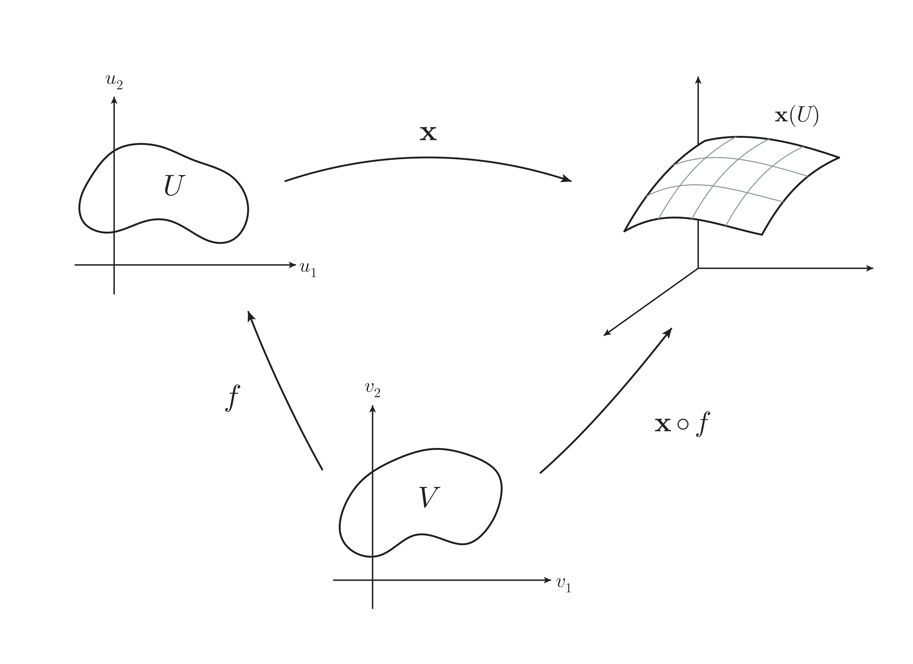

# Simple Surface
## Definition 1
::: {.math-box}
Let $U$ be an open subset of the Euclidean space $\mathbb{R}^2$ with coordinates $u_1, u_2$. A ***simple surface*** (or a ***coordinate patch***) is a one-to-one $C^\infty$ function $\mathbf{x}: U \to \mathbb{R}^3$ if

$$\frac{\partial \mathbf{x}}{\partial u_1}(p) \times \frac{\partial \mathbf{x}}{\partial u_2}(p) \neq \mathbf{0}, \forall p \in U.$$
:::

곡선이라는 기하학적 대상을 분석하기 위해서 매개변수를 사용해 함수로 나타냈고, 이 함수를 분석함으로 곡률(curvature)이나 토션(torsion)같은 여러 기하적 수치들을 계산할 수 있었다. 마찬가지의 방법을 곡면이라는 기하학적 대상을 분석할 때도 동일하게 사용하려고 한다. 즉 곡면이라는 대상을 매개변수를 사용해 함수로 나타내길 원하는데, 곡선은 선이라는 1차원 대상이기 때문에 하나의 매개변수로 충분했지만 곡면은 2차원 대상이기에 두 개의 매개변수가 필요하다. 즉 $f: D (\subset \mathbb{R}^2) \to \mathbb{R}^3$와 같은 함수를 찾아야 한다. 기하적으로 상상해보면 2차원의 어떤 "조각"(patch)들을 부드럽게 휘어서 3차원 공간 상으로 보내는 이미지를 생각할 수 있다.

또한 곡선을 공부할 때 편의를 위해 속력이 $0$이 되지 않는 정칙 곡선(regular curve)을 항상 가정했듯이, 곡면의 경우에도 이와 대응되는 이른바 "정칙 곡면"을 정의할 필요가 생기고 이를 위와 같이 ***단순 곡면(simple surface)*** 혹은 ***좌표조각사상(coordinate patch)***이라고 부른다. 때에 따라 함수 $\mathbf{x}$가 아니라 이미지 $\mathbf{x}(U)$를 단순 곡면이라고 부르기도 한다.

한편 위에서 "조각"이라고 표현한 이유는 한번에 전체 곡면을 표현하는 매개변수화를 찾는 일이 무척이나 어렵고, 때로는 불가능하기 때문이다. 당장 $S^2$만 해도 하나의 매개변수화가 $S^2$ 전체를 표현할 수 없는데, 단순 곡면 $\mathbf{x}: U \to \mathbb{R}^3$가 $S^2$를 이미지로 갖는다면 역함수가 존재해서 $\mathbf{x}^{-1}(S^2) = U$가 성립한다. 이때 $\mathbf{x}$는 연속함수이고 $S^2$는 컴팩트여서 $U$ 역시 컴팩트해야 하지만 일반적으로 $U$는 컴팩트하지 않기 때문에 모순이다. 따라서 아래 예시와 같이 구를 여러 부분으로 나누는 방법과 같이 매개변수화를 해야 한다. 이와 같이 곡면을 조각 조각 잘라서 매개변수화로 표현하는 일이 왕왕 생기고, 이때 겹치는 부분에서 매개변수화가 "잘 정의"될 필요가 생긴다. 이는 아래에서 소개할 좌표 변환(coordinate transformation)으로 해결된다.

## Example 1
::: {.math-box}
**(i)** **(Identity)** Define $\mathbf{x}: \mathbb{R}^2 \to \mathbb{R}^3$ by 

$$x(u_1, u_2) = (u_1, u_2, 0), \forall (u_1, u_2) \in \mathbb{R}^2.$$

Then $\mathbf{x}$ is clearly a simple surface.

**(ii)** **(Monge Patch)** Let $U$ be an open subset of $\mathbb{R}^2$, and let $f: U \to \mathbb{R}$ be a $C^\infty$ map. Define 

$$\mathbf{x}: U \to \mathbb{R}^3$ by $\mathbf{x}(u_1,u_2) = (u_1, u_2, f(u_1, u_2)), \forall (u_1, u_2) \in U.$$ 

Note that this is the graph of a function $f$. Clearly $\mathbf{x}$ is a one-to-one and $C^\infty$. Since

$$\begin{align*}
\frac{\partial \mathbf{x}}{\partial u_1} = \left( 1, 0, \frac{\partial f}{\partial u_1} \right) \quad \text{and} \quad \frac{\partial \mathbf{x}}{\partial u_2} = \left( 0, 1, \frac{\partial f}{\partial u_2} \right) \\
\implies \frac{\partial \mathbf{x}}{\partial u_1} \times \frac{\partial \mathbf{x}}{\partial u_1} = (- \frac{\partial \mathbf{x}}{\partial u_1}, - \frac{\partial \mathbf{x}}{\partial u_2}, 1) \neq \mathbf{0},
\end{align*}$$

$\mathbf{x}$ is a simple surface, which is called a ***Monge patch***.

**(iii)** For the disk $D = \{ (u_1, u_2) \in \mathbb{R}^2 \mid u_1^2 + u_2^2 < 1 \}$, define $\mathbf{x}: D \to \mathbb{R}^3$ by

$$\mathbf{x}(u_1, u_2) = \left(u_1, u_2, \sqrt{1 - u_1^2 - u_2^2} \right), \forall (u_1, u_2) \in D.$$

This is a Monge patch, so it is a simple surface. Note that the image is the upper half of $S^2$.

**(iv)** For $U = (0, 2\pi) \times (0, \pi)$, define $\mathbf{x} : U \to \mathbb{R}^3$ by

$$$\mathbf{x}(\theta, \phi) = \left( \sin \phi \cos \theta, \sin \phi \sin \theta, \cos \phi \right)$$

for all $0 < \theta < 2\pi, 0 < \phi < \pi$.

1. If $\mathbf{x}(\theta_1, \phi_1) = \mathbf{x}(\theta_2, \phi_2)$ for some $\theta_1, \theta_2 \in (0, 2\pi), \phi_1, \phi_2 \in (0, \pi)$, then we have

$$\begin{cases}
\sin \phi_1 \cos \theta_1 = \sin \phi_2 \cos \theta_2 \\
\sin \phi_1 \sin \theta_1 = \sin \phi_2 \sin \theta_2 \\
\cos \phi_1 = \cos \phi_2.
\end{cases}$$

It gives us $\theta_1 = \theta_2$ and $\phi_1 = \phi_2$, so $\mathbf{x}$ is one-to-one.

2. Since each component is $C^\infty$, $\mathbf{x}$ is $C^\infty$.

3. Note that

$$\begin{align*}
\frac{\partial \mathbf{x}}{\partial \theta} = (-\sin \phi \sin \theta, \sin \phi \cos \theta, 0) \quad \text{and} \quad \frac{\partial \mathbf{x}}{\partial \phi} = (\cos \phi \cos \theta, \cos \phi \sin \theta, - \sin \phi) \\
\implies \frac{\partial \mathbf{x}}{\partial \theta} \times \frac{\partial \mathbf{x}}{\partial \phi} = (-\sin^2\phi \cos \theta, - \sin^2 \phi \sin \theta, -\sin \phi \cos \phi).
\end{align*}$$

Since $(-\sin^2\phi \cos \theta)^2 + (-\sin^2\phi \sin \theta)^2 = \sin^4 \phi \neq 0$ when $\phi \in (0, \pi)$, $\frac{\partial \mathbf{x}}{\partial \theta} \times \frac{\partial \mathbf{x}}{\partial \phi} \neq \mathbf{0}$. Hence, $\mathbf{x}$ is a simple surface.
:::

# Coordiante Transformation
## Definition 2
::: {.math-box}
Let $V, U$ be open subsets of $\mathbb{R}^2$. A ***coordinate transformation*** is a bijective function $f: V \to U$ such that $f, f^{-1} \in C^\infty$.
:::

정의를 보면 곡선에서 다뤘던 재매개변수화(reparametrization)과 정의가 동일하고, 위 그림에서도 볼 수 있듯이 $f$는 기존의 단순 곡면의 정의역을 $U$에서 $V$로 바꿔주는 역할을 한다. 아래 정리는 이렇게 $f$만큼 정의역을 바꿔도 여전히 단순 곡면임을 보장해준다.

## Theorem 1
::: {.math-box}
Let $V, U$ be open subsets of $\mathbb{R}^2$, and let $f: V \to U$ be a coordinate transformation. Let $\mathbf{x} : U \to \mathbb{R}^3$ is a simple surface.

**(i)** $The Jacobian $Jf$ of $f$ is invertible, so $\det(Jf) \neq 0$.

**(ii)** The function $\mathbf{y} = \mathbf{x} \circ f : V \to \mathbb{R}^3$ is a simple surface with the same image as $\mathbf{x}$.

**(iii)** The inverse $f^{-1}$ of $f$ is also a coordinate transformation.

**(iv)** A composition of coordinate transformations is also a coordinate transformation.
:::

::: {.callout-note title="Proof" collapse="true" icon=false}
**(i)** Let $g = f^{-1}$. We denote $f = (f_1, f_2)$ and $g = (g_1, g_2)$. Then $(f \circ g)(u_1, u_2) = (u_1, u_2)$. By the chain rule, we have

$$(Jf \circ g)Jg = I_{2 \times 2},$$

that is,

$$\begin{bmatrix}
\frac{\partial f_1}{\partial v_1} \circ g & \frac{\partial f_1}{\partial v_2} \circ g \\
\frac{\partial f_2}{\partial v_1} \circ g & \frac{\partial f_2}{\partial v_2} \circ g \\
\end{bmatrix} \begin{bmatrix}
\frac{\partial g_1}{\partial u_1} & \frac{\partial g_1}{\partial u_2} \\
\frac{\partial g_2}{\partial u_1} & \frac{\partial g_2}{\partial v_2} \\
\end{bmatrix} = \begin{bmatrix}
1 & 0 \\
0 & 1
\end{bmatrix}.$$

Then we have $\det(Jf \circ g) \det(Jg) = 1$, so $\deg(Jf) \neq 0$ for all points in $U$.

**(ii)** Since $\mathbf{x}$ and $f$ are one-to-one and $C^\infty$, so is $\mathbf{y}$. 

By the chain rule, we have

$$\frac{\partial \mathbf{y}}{\partial v_i} = \frac{\partial \mathbf{x}}{\partial u_1} \circ f \frac{\partial f_1}{\partial v_i} + \frac{\partial \mathbf{x}}{\partial u_2} \circ f \frac{\partial f_2}{\partial v_i}$$

for $i = 1, 2$. Then we have

$$\begin{align*}
\frac{\partial \mathbf{y}}{\partial v_1} \times \frac{\partial \mathbf{y}}{\partial v_2} &= \frac{\partial f_1}{\partial v_1} \frac{\partial f_2}{\partial v_2} \left[ \frac{\partial \mathbf{x}}{\partial u_1} \circ f \times \frac{\partial \mathbf{x}}{\partial u_2} \circ f \right] + \frac{\partial f_2}{\partial v_1} \frac{\partial f_1}{\partial v_2} \left[ \frac{\partial \mathbf{x}}{\partial u_2} \circ f \times \frac{\partial \mathbf{x}}{\partial u_1} \circ f \right] \\
&= \left[ \frac{\partial f_1}{\partial v_1} \frac{\partial f_2}{\partial v_2} - \frac{\partial f_2}{\partial v_1} \frac{\partial f_1}{\partial v_2} \right] \left[ \frac{\partial \mathbf{x}}{\partial u_1} \circ f \times \frac{\partial \mathbf{x}}{\partial u_2} \circ f \right] \\
&= \det(Jf) \left[ \frac{\partial \mathbf{x}}{\partial u_1} \times \frac{\partial \mathbf{x}}{\partial u_2} \right] \circ f.
\end{align*}$$

Since $\det(Jf) \neq 0$ and $\frac{\partial \mathbf{x}}{\partial u_1} \times \frac{\partial \mathbf{x}}{\partial u_2} \neq 0$, we conclude that

$$\frac{\partial \mathbf{y}}{\partial v_1} \times \frac{\partial \mathbf{y}}{\partial v_2} \neq 0$$

for all points in $V$. $\blacksquare$
:::

## Example 2
이제 $S^2$를 여러 개의 "조각"으로 덮어보자. 예시 1 **(iii)**에서는 좌표공간상의 $xy$ 평면 위의 디스크 $D_1$에 대해서

$$\mathbf{x}(u_1, u_2) = \left(u_1, u_2, \sqrt{1 - u_1^2 - u_1^2} \right)$$

으로 정의하면 북반구를 표현할 수 있었다. 즉 정사영의 역함수라고 생각해도 좋다. 이때 이미지가 북극점 $(0,0,1)$을 포함한다는 의미에서 $\mathbf{x}_{(0,0,1)}$이라고 표기하자. 우리는 하나의 매개변수화 $\mathbf{x}_{(0, 0, 1)}$을 가지고 좌표 변환을 통해 $S^2$의 다 덮지 못한 부분들까지 잘 표현해내고자 한다.

$\mathbf{x}_{(0, 0, 1)}$과 같은 센스에서 함수 $\mathbf{x}_{(0, 1, 0)}$은 좌표공간상의 $xz$ 평면 위의 디스크 $D_2$에 대해서

$$\mathbf{x}_{(0, 1, 0)}(v_1, v_2) = \left( v_1, \sqrt{1 - v_1^2 - v_2^2}, v_2 \right)$$

와 같이 정의되고, 그 이미지는 우반구가 된다. 이제 우리는 $D_1$과 $D_2$ 사이에서 정의되는 좌표 변환 $f : D_2 \to D_1$를 찾고자 한다. 만약 그러한 $f$가 존재한다면 $f = \mathbf{x}^{-1}_{(0, 0, 1)} \circ \mathbf{x}_{(0, 1, 0)}$을 만족하겠고, 구체적으로 계산해보면 다음과 같다.

$$\begin{align*}
f(v_1, v_2) &= (\mathbf{x}^{-1}_{(0, 0, 1)} \circ \mathbf{x}_{(0, 1, 0)})(v_1, v_2) \\
&= \mathbf{x}^{-1}_{(0, 0, 1)}(v_1, \sqrt{1 - v_1^2 - v^2}, v_2) \\
&= (v_1, \sqrt{1 - v_1^2 - v_2^2})
\end{align*}$$

또한 $f = \mathbf{x}^{-1}_{(0, 0, 1)} \circ \mathbf{x}_{(0, 1, 0)}$이므로 자연스럽게 좌표 변환의 모든 정의를 만족하고, 따라서 좌표 변환이 된다.

이제 $\mathbf{x}_{(0, 0, 1)}$에 좌표 변환 $f$를 적용해 우반구를 표현해 낼 수 있고, 구를 4등분한 부분에서는 좌표 변환 $f$를 통해 $\mathbf{x}_{(0, 0, 1)}$과 $\mathbf{x}_{(0, 1, 0)}$ 사이에 관계가 잘 정의되므로 문제가 없다. 이와 같은 방법을 반복적으로 적용하면 6개의 반구를 통해 구를 완전히 덮을 수 있다.

# Tangent Plane
## Definition 3
::: {.math-box}
Let $\mathbf{x}: U \to \mathbb{R}^3$ be a simple surface. We denote

$$\mathbf{x}_1(a, b) = \frac{\partial \mathbf{x}}{\partial u_1}(a, b) \quad \text{and} \quad \mathbf{x}_2(a, b) = \frac{\partial \mathbf{x}}{\partial u_2}(a, b).$$

**(i)** The ***tangent plane*** to a simple surface $\mathbf{x}$ at the point $p = \mathbf{x}(a, b)$, denoted by $T_p \mathbf{x}$, is the plane through $p$ perpendicular to $\mathbf{x}_1(a, b) \times \mathbf{x}_2(a, b)$.

**(ii)** The ***unit normal vector*** to the surface at $P$ is 

$$\mathbf{n}(a, b) = \frac{\mathbf{x}_1(a, b) \times \mathbf{x}_2(a, b)}{\| \mathbf{x}_1(a, b) \times \mathbf{x}_2(a, b) \|}.$$
:::

조금씩 곡면에 걸맞는 기하적인 개념이 등장하기 시작한다. 특정한 점에서 편미분한 벡터 $\mathbf{x}_1, \mathbf{x}_2$로 생성되는 평면을 접평면이라고 부르고, 단순 곡면의 정의에 의해 이러한 접평면의 노말 벡터는 항상 영벡터가 아니다. 한편 곡면도 그렇고 접평면도 매개변수화에 의해 달라지는 성질이 아닌 곡면 그 자체의 성질이다. 즉 매개변수화에 의해 달라지지 않음을 아래 정리가 보장해준다.

## Theorem 2
::: {.math-box}
Let $f: V \to U$ be a coordinate transformation, and let $\mathbf{x} : U \to \mathbb{R}^3$ is a simple surface. Let $\mathbf{y} = \mathbf{x} \circ f$. Then 

**(i)** the tangent plane to $\mathbf{x}$ at $\mathbf{x}(a, b)$ is equal to the tangent plane to $\mathbf{y}$ at $\mathbf{y}(a, b) = \mathbf{x}(f(a, b))$ for any $(a, b) \in U$.

**(ii)** the unit normal vector to $\mathbf{x}$ at $\mathbf{x}(a, b)$ is the same as the unit normal vector to $\mathbf{y}$ at $\mathbf{y}(a, b) = \mathbf{x}(f(a, b))$, except possibly it may have the opposite sign.
:::

::: {.callout-note title="Proof" collapse="true" icon=false}
**(i)** By the chain rule,

$$\mathbf{y}_i = \frac{\partial \mathbf{y}}{\partial v_i} = \frac{\partial \mathbf{x}}{\partial u_1} \circ f \frac{\partial f_1}{\partial v_i} + \frac{\partial \mathbf{x}}{\partial u_2} \circ f \frac{\partial f_2}{\partial v_i}$$

for $i = 1, 2$. This means that each $\mathbf{y}_i$ is spanned by $\{ \mathbf{x}_1, \mathbf{x}_2 \}$.

On the other hands, $\mathbf{x} = y \circ f^{-1}$, so each $\mathbf{x}_i$ is spanned by $\{ \mathbf{y}_1, \mathbf{y}_2 \}$. Hence, $T_p \mathbf{x} = T_p\mathbf{y}$ for any $p$.

**(ii)** It directly comes from **(i)**. $\blacksquare$
:::

# Reference
- R. S. Millman and G. D. Parker, Elements of Differential Geometry, Prentice-Hall, 1977.