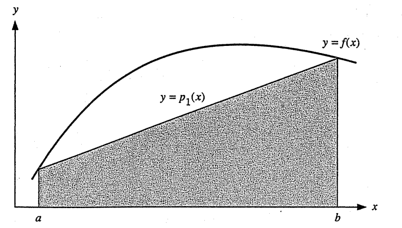
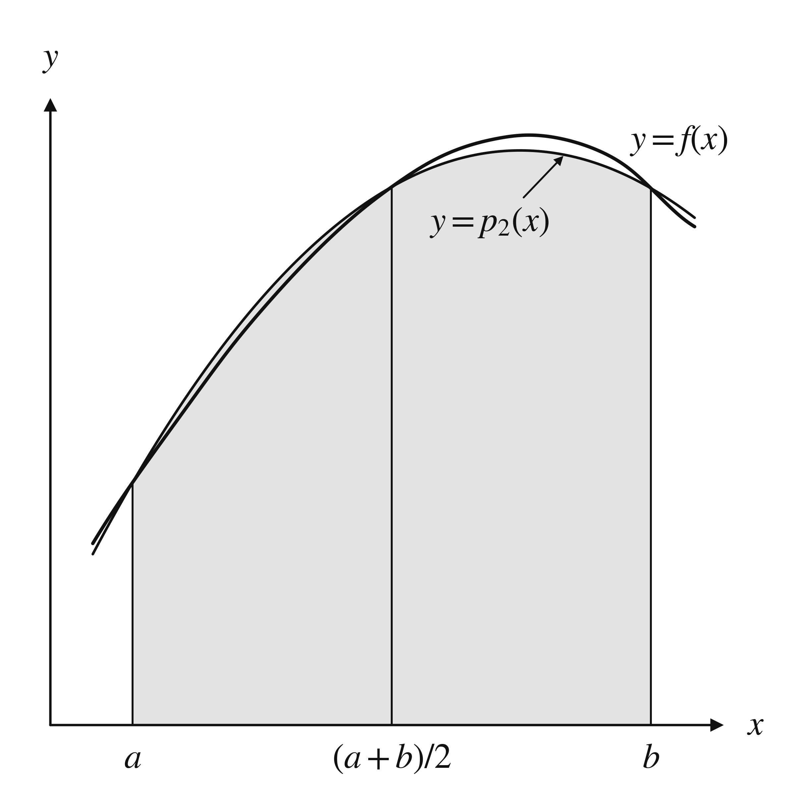

# Introduction
이 포스트에서는 정적분

$$I(f) = \int_a^b f(x) dx$$

를 수치적으로 계산하는 여러 방법에 대해서 다룬다. 적분값을 계산하는 일은 적분이라는 테마 그 자체만으로도 충분히 가치가 있지만, 함수를 근사할 때 $L^2$ 놈을 사용하는 일에 있어서도 적분을 계산해야 하는 일이 생기는 등 다양한 상황에서 복잡한 함수의 적분을 계산하는 일을 필요로 한다. 특별히 우리는 정적분을 리만합 $\sum_{i=1}^n f(x_i^*)\Delta x$의 극한으로 취급하고 함수 $f$를 다항식으로 근사하여 구체적인 값을 계산하고, 오차를 추정하는 방법을 다룬다.

# Trapezoidal Rule
함수 $f$가 구간 $[a, b]$에서 주어졌다고 하자. 이때 $[a, b]$에서 $f$를 근사하는 일차식을 $p_1(x)$라고 두면 적분값은

$$T(f) = \int_a^b p_1(x) dx = \frac{b-a}{2}(f(a) + f(b))$$

으로 주어지고, 보다시피 사다리꼴의 넓이다. 이와 같이 함수의 일차근사를 사용해서 적분값을 근사하는 방법을 ***사다리꼴 규칙(Trapezoidal Rule)***이라고 부른다.

한편 뉴턴 계차상 정리에 의해 $f(x) - p_1(x) = (x-a)(x-b)f[a, b, x]$가 성립하고, 따라서 적분값의 오차는 다음과 같이 주어진다.

:::: {.callout-note icon=false}
## Lemma
Let $f: [a, b] \to \mathbb{R}$ be a continuous function, and let $g: [a, b] \to \mathbb{R}$ be an integrable function with $g(x) \ge 0, \forall x \in [a, b]$. Then there exists $c \in [a, b]$ such that

$$\int_a^b f(x) g(x) dx = f(c) \int_a^b g(x) dx$$
::::

$$\begin{align*}
E(f) &= I(f) - T(f) \\
&= \int_a^b (f(x) - p_1(x)) dx \\
&= \int_a^b (x-a)(x-b)f[a, b, x] dx \\
&= f[a, b, c] \int_a^b (x-a)(x-b) dx \\
&= \frac{f''(\xi)}{2} \cdot \left( - \frac{(b-a)^3}{6} \right) \\
&= -\frac{f''(\xi)}{12}(b-a)^3 \\
\end{align*}$$

정리하면 근사하고자 하는 적분값 $I(f)$는 사다리꼴 규칙을 사용한 근사값 $T(f)$와 오차 $E(f)$의 합으로 나타낼 수 있다. 

위와 같이 한 구간에서의 적분값을 근사할 수 있으므로, 구간 $[a, b]$를 등간격으로 분할한 뒤 각 부분구간에서의 값을 모두 더하면 전체 구간에서의 우리가 원하는 공식이 나오리라 예상할 수 있다. $a = x_0 < x_1 < \dots < x_n = b$이고 점들 사이의 간격을 $h = \frac{b-a}{n}$으로 두면 $I(f)$를 다음과 같이 계산할 수 있다.

$$\begin{align*}
I(f) &= \sum_{i=0}^{n-1} \int_{x_i}^{x_{i+1}} f(x) dx \\
&= \sum_{i=0}^{n-1} \left[ \frac{f(x_i) + f(x_{i+1})}{2} h - \frac{f''(\xi_i)}{12} h^3 \right] \\
&= h \left[\frac{1}{2}f(x_0) + f(x_1) + \dots + f(x_{n-1}) + \frac{1}{2}f(x_n)\right] - \frac{h^3}{12} \sum_{i=0}^{n-1} f''(\xi_i) \\
&= T_n(f) + E^T_n(f)
\end{align*}$$

이때 $\xi_i \in [x_i, x_{i+1}]$로 주어지고,

$$\begin{align*}
T_n(f) &:= h\left[\frac{1}{2}f(x_0) + f(x_1) + \dots + f(x_{n-1}) + \frac{1}{2}f(x_n)\right] \\
E^T_n(f) &:= - \frac{h^3}{12} \sum_{i=0}^{n-1} f''(\xi_i)
\end{align*}$$

로 정의한다. 특별히 $T_n(f)$를 ***trapezoidal numerical integration rule*** 혹은 ***composite trapezoid rule***이라고 부른다.

한편 오차 $E^T_n(f)$는 다음과 같이 개선할 수 있다.

$$\begin{align*}
E^T_n(f) &= - \frac{h^3}{12} \sum_{i=0}^{n-1} f''(\xi_i) \\
&= - \frac{nh^3}{12} \left[ \frac{1}{n} \sum_{i=0}^{n-1} f''(\xi_i) \right] \\
&= - \frac{nh^3}{12} f''(c) \\
&= - h^2 \frac{b-a}{12} f''(c)
\end{align*}$$

이때 $c \in [a, b]$인 상수이고, 사잇값 정리로부터 그 존재성이 보장된다. 또한

$$\begin{align*}
\lim_{h \to 0} \frac{E^T_n(f)}{h^2} &= \lim_{h \to 0} \left( - \frac{b-a}{12} f''(c) \right) \\
&= \lim_{n \to \infty} \left( - \frac{b-a}{12n} \sum_{i=1}^n f''(\xi_i) \right) \\
&= - \frac{1}{12} \int_a^b f''(x) dx \\
&= - \frac{1}{12} (f'(b) - f'(a)) =: \frac{\tilde{E}^T_n(f)}{h^2}
\end{align*}$$

임을 알 수 있고, $\tilde{E}^T_n(f)$을 오차 $E^T_n(f)$의 ***asymptotic estimate***이라고 부른다. 따라서 충분히 작은 $h$, 혹은 충분히 큰 $n$에 대해서 $I(f) \approx T_n(f) + \tilde{E}^T_n(f)$가 성립하고, 이때의 $I_f$를 특별히 $CT_n(f)$라고 두면

$$\begin{align*}
CT_n(f) &= T_n(f) + \tilde{E}^T_n(f)
\end{align*}$$

이 성립한다. $CT_n(f)$를 ***corrected trapezoidal rule***이라고 부르고, 이 값이 우리가 원하는 정적분값의 근사값이 된다.

# Simpson's Rule
사다리꼴 규칙이 함수 $f$의 일차근사 $p_1$을 사용해서 값을 계산했다면, 심프슨 규칙(Simpson's Rule)은 함수의 이차근사 $p_2$를 사용해서 정적분의 값을 근사하는 방법이다. 

위와 같이 구간 $[a, b]$에서 함수가 정의되어 있을 때 $c = \frac{a+b}{2}$로 두자. 그러면

$$p_2(x) = f(a)\ell_1(x) + f(c) \ell_2(x) + f(b) \ell_3(x)$$

로 주어지고, 각각의 $\ell_k(x)$는

$$\begin{align*}
\ell_1(x) &= \frac{(x-b)(x-c)}{(a-b)(a-c)} \\
\ell_2(x) &= \frac{(x-a)(x-c)}{(b-a)(b-c)} \\
\ell_3(x) &= \frac{(x-a)(x-b)}{(c-a)(c-b)}
\end{align*}$$

이다. 이 근사다항식의 적분값을 $S(f)$라고 두자.

$$\begin{align*}
S(f) &= \int_a^b p_2(x) dx \\
&= f(a) \int_a^b \ell_1(x) dx + f(c) \int_a^b \ell_2(x) dx + f(b) \int_a^b \ell_3(x) dx
\end{align*}$$

점 사이의 간격을 $h = \frac{b-a}{2}$라고 두면 위 식에서 각 $\ell_k$의 적분은 다음과 같이 계산된다.

$$\begin{align*}
\int_a^b \ell_1(x) dx &= \int_a^b \frac{(x-b)(x-c)}{(a-b)(a-c)} dx \\
&= \frac{1}{2h^2} \int_0^{2h} (u-h)(u-2h) du \quad (u = x - a) \\
&= \frac{1}{2h^2} \left[ \frac{1}{3}u^3 - \frac{3}{2}hu^2 + 2h^2u \right]_0^{2h} \\
&= \frac{h}{3}
\end{align*}$$

비슷하게

$$\begin{align*}
\int_a^b \ell_2(x) dx &= \frac{4h}{3} \\
\int_a^b \ell_3(x) dx &= \frac{h}{3}
\end{align*}$$

를 얻는다. 따라서 전체 적분은 다음과 같이 주어진다.

$$\begin{align*}
S(f) &= f(a) \int_a^b \ell_1(x) dx + f(c) \int_a^b \ell_2(x) dx + f(b) \int_a^b \ell_3(x) dx \\
&= f(a)\frac{h}{3} + f(c)\frac{4h}{3} + f(b)\frac{h}{3} \\
&= \frac{h}{3}(f(a) + 4f(c) + f(b))
\end{align*}$$

또한 뉴턴 계차상 정리에 의해 $f(x) - p_2(x) = (x-a)(x-c)(x-b)f[a, c, b, x]$로 주어지고, 오차 $E(f)$는 다음과 같다.

$$\begin{align*}
E(f) &= I(f) - S(f) \\
&= \int_a^b (f(x) - p_2(x)) dx \\
&= \int_a^b (x-a)(x-c)(x-b)f[a, c, b, x] dx
\end{align*}$$

위 값을 간단히 표현하기 위해 다음과 같이 함수 $w$를 정의하자.

$$w(x) := \int_a^x (t-a)(t-c)(t-b) dt$$

그러면 $w(a) = 0$이고, $(t-a)(t-c)(t-b)$는 $c$에 대해서 점대칭함수이므로 $w(b) = 0$이다. 또한 $w'(x) = (x-a)(x-c)(x-b)$이고 $w(x) \ge 0$이 성립한다. 또한

$$\begin{align*}
w(x) &= \int_a^x (t-a)(t-c)(t-b) dt \\
&= \int_0^{x-a} u(u-h)(u-2h) du \quad (u = t-a) \\
&= \frac{1}{4}(x-a)^4 - h(x-a)^3 + h^2(x-a)^2 
\end{align*}$$

$$\begin{align*}
\int_a^b w(x) dx &= \int_a^b \left[ \frac{1}{4}(x-a)^4 - h(x-a)^3 + h^2(x-a)^2 \right] dx \\
&= \frac{4}{15}h^5
\end{align*}$$

이다. 따라서 부분적분법과 평균값 정리, 에르미트-제노키 공식에 의해 다음의 계산이 성립한다.

$$\begin{align*}
E(f) &= \int_a^b (x-a)(x-c)(x-b)f[a, c, b, x] dx \\
&= \int_a^b w'(x) f[a, c, b, x] dx \\
&= w(x) f[a, c, b, x] \big \vert_a^b - \int_a^b w(x) f'[a, c, b, x] dx \\
&= - \int_a^b w(x) f[a, c, b, x, x] dx \\
&= - f[a, c, b, \eta, \eta] \int_a^b w(x) dx \\
&= - \frac{f^{(4)}(\mu)}{24} \cdot \frac{4}{15}h^5 \\
&= - \frac{f^{(4)}(\mu)}{90}h^5
\end{align*}$$

이때 $\eta, \mu \in [a, b]$인 상수이다. 마찬가지로 $I(f) = S(f) + E(f)$로 쓸 수 있다.

이제 사다리꼴 규칙에서와 동일하게, 전체 구간 $[a, b]$를 $n$등분하고 각 부분구간에서 위 계산을 적용하면 다음과 같다. 이때 $n$은 짝수로 가정한다.

$$\begin{align*}
I(f) &= \sum_{i=0}^{\frac{n}{2}-1} \int_{x_{2i}}^{x_{2i+2}} f(x) dx \\
&= \sum_{i=0}^{\frac{n}{2}-1} \left[ \frac{h}{3}(f(x_{2i}) + 4f(x_{2i+1}) + f(x_{2i+2})) - \frac{f^{(4)}(\mu_i)}{90} h^5 \right] \\
&= \frac{h}{3} \left[ f(x_0) + 4f(x_1) + 2f(x_2) + 4f(x_3) + \dots + 2f(x_{n-2}) + 4f(x_{n-1}) + f(x_n) \right] - \frac{h^5}{90}\sum_{i=0}^{\frac{n}{2}-1} f^{(4)}(\mu_i) \\
&= S_n(f) + E^S_n(f)
\end{align*}$$

이때 $\mu_i \in [x_{2i}, x_{2i+2}]$로 주어지고, 

$$\begin{align*}
S_n(f) &:= \frac{h}{3} \left[ f(x_0) + 4f(x_1) + 2f(x_2) + 4f(x_3) + \dots + 2f(x_{n-2}) + 4f(x_{n-1}) + f(x_n) \right] \\
E^S_n(f) &= - \frac{h^5}{90}\sum_{i=0}^{\frac{n}{2}-1} f^{(4)}(\mu_i)
\end{align*}$$

로 정의한다. 특별히 $S_n(f)$를 ***simpson's numerical integration rule*** 혹은 ***composite simpson's rule***이라고 부른다. 

한편 오차 $E^S_n(f)$는 다음과 같이 계산할 수 있다.

$$\begin{align*}
E^S_n(f) &= - \frac{h^5}{90}\sum_{i=0}^{\frac{n}{2}-1} f^{(4)}(\mu_i) \\
&= - \frac{n h^5}{180} \left[ \frac{1}{n} \sum_{i=0}^{\frac{n}{2}-1} f^{(4)}(\mu_i) \right] \\
&= - \frac{n h^5}{180} f^{(4)}(c) \\
&= - h^4 \frac{b-a}{180} f^{(4)}(c)
\end{align*}$$

이때 $c \in [a, b]$인 상수이고, 사잇값 정리로부터 그 존재성이 보장된다. 또한

$$\begin{align*}
\lim_{h \to 0} \frac{E^S_n(f)}{h^4} &= \lim_{h \to 0} \left( - \frac{b-a}{180} f^{(4)}(c) \right) \\
&= \lim_{n \to \infty} \left( - \frac{b-a}{180n} \sum_{i=1}^n f^{(4)}(\xi_i) \right) \\
&= - \frac{1}{180} \int_a^b f^{(4)}(x) dx \\
&= - \frac{1}{180} (f'''(b) - f'''(a)) =: \frac{\tilde{E}^S_n(f)}{h^4}
\end{align*}$$

임을 알 수 있고, $\tilde{E}^S_n(f)$를 오차 $E^S_n(f)$의 ***asymptotic estimate***이라고 부른다. 따라서 충분히 작은 $h$, 혹은 충분히 큰 $n$에 대해서 $I(f) \approx S_n(f) + \tilde{E}^S_n(f)$가 성립하고, 이때의 $I_f$를 특별히 $CS_n(f)$라고 두면

$$\begin{align*}
CS_n(f) &= S_n(f) + \tilde{E}^S_n(f)
\end{align*}$$

이 성립한다. $CS_n(f)$를 ***corrected Simpson's rule***이라고 부르고, 이는 우리가 원하는 정적분값의 근사값이 된다.

# Richardson's Extrapolation
사다리꼴 규칙과 심프슨 규칙은 모두

$$I(f) - I_n(f) \approx \frac{c}{n^p}$$

꼴의 형태를 가졌다. $c$와 $p$는 사용한 규칙에 의존하는 값들이고, 사다리꼴의 경우 $p = 2$, 심프슨의 경우 $p = 4$였다. $I_n(f)$는 각 규칙의 방법에 의해 구간을 $n$등분하여 얻은 근사값인데, $n$등분이 아닌 $2n$등분을 하게 되면 더 정확한 근사값을 얻게 되고 구체적으로는 다음과 같이 주어진다.

$$\begin{align*}
I(f) - I_{2n}(f) &\approx \frac{c}{(2n)^p} \\
&= \frac{c}{2^p n^p} \\
&= \frac{1}{2^p} (I(f) - I_n(f))
\end{align*}$$

이 값을 $I(f)$에 대해서 정리하면 다음과 같다.

$$I(f) \approx \frac{1}{2^p}(2^pI_{2n}(f) - I_n(f)) =: R_{2n}$$

위 수식으로 정의되는 $R_{2n}$을 ***Richardson's extrapolation***이라고 부른다. 기존의 $n$등분보다 더 많은 점들을 추가해서 적분값을 더 정확하게 근사했으므로 extrapolation이라고 부르고, 일반적으로 $I_{2n}$보다 더 정확한 근사값을 준다. $I_{2n}$과의 오차는 다음과 같이 주어지고, 이 오차를 ***Richardson's error estimate***이라고 부른다.

$$\begin{align*}
R_{2n} - I_{2n} &= \frac{1}{2^p}(2^pI_{2n}(f) - I_n(f)) - I_{2n} \\
&= \frac{1}{2^p} (I_{2n}(f) - I_n(f))
\end{align*}$$

# Reference
- K. E. Atkinson and W. Han, Elementary Numerical Analysis, 3rd ed., John Wiley & Sons, 2004.