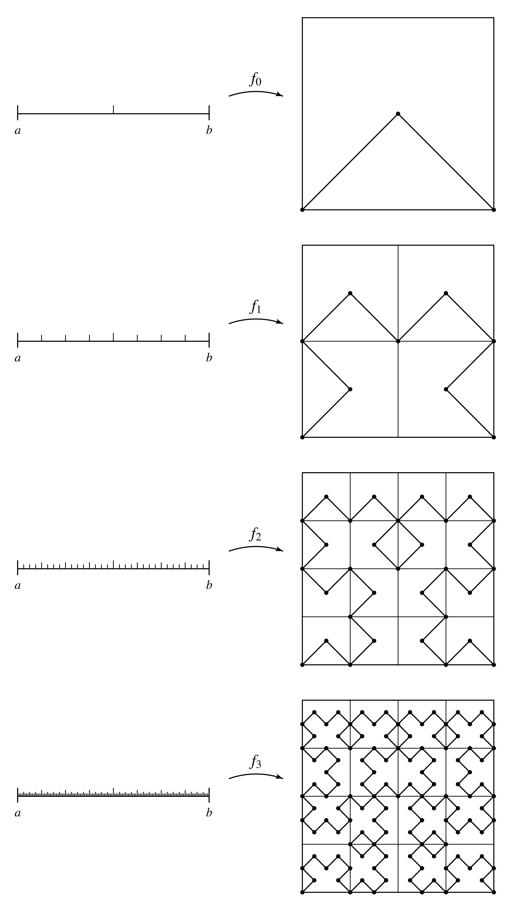

# Complete Space
## Definition 1
Let $(X, d)$ be a metric space.

**(i)** A sequence $\{ x_n \}$ in $X$ is called a ***Cauchy sequence*** in $(X, d)$ if $\forall \varepsilon > 0, \exists N \in \mathbb{N}$ such that $d(x_n, x_m) < \varepsilon, \forall n, m \ge N$.

**(ii)** $(X, d)$ is said to be ***complete*** if every Cauchy sequence in $X$ converges.

수렴하면 코시 수열이지만, 역은 항상 성립하지는 않는다. 즉 어떤 공간 안에서 코시 수열일지라도 수렴값이 항상 그 공간에 속하리란 보장은 없다. 이를 허용해주어서 코시 수열과 수렴성이 동치가 되는 공간을 ***완비 공간(Complete Space)***이라고 부른다.

## Remark
**(i)** Every convergent sequence in $X$ is a Cauchy sequence. However, the converse does not hold in general.

::: {.callout-note title="Example" collapse="true" icon=false}
1. The sequence $x_n = \left( 1 + \frac{1}{n} \right)^n$ is a Cauchy sequence in $(\mathbb{Q}, d_{\text{Euclidean}})$ but it does not converge in $(\mathbb{Q}, d_{\text{Euclidean}})$.

2. The sequence $x_n = \frac{1}{n}$ is a Cauchy sequence in $((0, 2), d_{\text{Euclidean}})$ but it does not converge in $((0, 2), d_{\text{Euclidean}})$.
:::

**(ii)** If $(X, d)$ is complete, then a sequence $\{ x_n \}$ is Cauchy $\iff$ $\{ x_n \}$ is convergent.

**(iii)** $(\mathbb{R}, d)$ is not always complete.

::: {.callout-note title="Example" collapse="true" icon=false}
First, we note that $\lim_{n \to \infty} \arctan n = \frac{\pi}{2}$ in $(\mathbb{R}, d_{\text{Euclidean}})$.

Define $d_t: \mathbb{R} \times \mathbb{R} \to \mathbb{R}$ by the equation

$$d_t(x, y) = | \arctan x - \arctan y |.$$

Clearly, $d_t$ is a metric on $\mathbb{R}$. 

Consider the sequence $\{ n \}_{n=1}^\infty$ in $(\mathbb{R}, d_t)$. Let $\varepsilon > 0$. Since $\lim_{n \to \infty} \arctan n = \frac{\pi}{2}$, there exists $N \in \mathbb{N}$ such that $\left|\arctan n - \frac{\pi}{2} \right| < \frac{\varepsilon}{2}, \forall n \ge N$. Then we have

$$\begin{align*}
d_t(n, m) &= | \arctan n - \arctan m | \\
&\le \left| \arctan n - \frac{\pi}{2} \right| + \left| \arctan m - \frac{\pi}{2} \right| \\
& < \frac{\pi}{2} + \frac{\pi}{2} \\
& < \varepsilon, \forall n, m \ge N.
\end{align*}$$

Hence, $\{ n \}_{n=1}^\infty$ is a Cauchy sequence in $(\mathbb{R}, d_t)$. However, it is not convergent in $(\mathbb{R}, d_t)$. If it converges to some point $x \in \mathbb{R}$, then for any $\varepsilon > 0$, there exists $N \in \mathbb{N}$ such that 

$$\vert \arctan n - \arctan x \vert < \varepsilon, \forall n \ge N.$$

It also implies that $\lim_{n \to \infty} \arctan n = \arctan x$ in $(\mathbb{R}, d_{\text{Euclidean}})$. Hence, we obtain that $\arctan x = \frac{\pi}{2}$, which is impossible. Hence, $\{ n \}_{n=1}^\infty$ is not convergent in $(\mathbb{R}, d_t)$.
:::

## Theorem 1
Let $(X, d)$ be a metric space.

**(i)** Every closed subset of a complete metric space if complete.

**(ii)** $(X, d)$ is complete if every Cauchy sequence in $X$ has a convergent subsequence.

::: {.callout-note collapse="true" icon=false}
### Proof
**(i)** Let $C$ be a closed subset of a complete metric space $X$, and let $\{ x_n \}$ be a Cauchy sequence in $C$. Since $X$ is complete, $\{ x_n \}$ converges to $x \in X$. Thus, $x \in \overline{C} = C$, and therefore $C$ is complete.

**(ii)** Suppose that a Cauchy sequence $\{ x_n \}$ in $X$ has a convergent subsequence $\{ x_{n_k} \}$ with $x_{n_k} \to x$. Let $\varepsilon > 0$. Then there exists $N \in \mathbb{N}$ such that $d(x_n, x_m) < \frac{\varepsilon}{2}$ and $d(x_n, x) < \frac{\varepsilon}{2}$ for all $n, m \ge N$. Then we have 

$$d(x_n, x) \le d(x_n, x_{n_k}) + d(x_{n_k}, x) < \frac{\varepsilon}{2} + \frac{\varepsilon}{2} = \varepsilon, \forall n \ge N.$$

Thus, $\lim_{n \to \infty} x_n = x$, and therefore $(X, d)$ is complete. $\blacksquare$
:::

## Theorem 2
**(i)** $(\mathbb{R}^n, d_{\text{Euclidean}}), (\mathbb{R}^n, d_{\text{square}}), (\mathbb{R}^n, d_{\text{taxicab}})$ are complete.

**(ii)** Define $D: \mathbb{R}^\omega \times \mathbb{R}^\omega \to \mathbb{R}$ by the equation

$$D(\mathbf{x}, \mathbf{y}) = \sup_{n \in \mathbb{N}} \left\{ \frac{\overline{d}(x_n, y_n)}{n} \right\}$$

where $\overline{d}$ is the standard bounded metric on $\mathbb{R}$. Then $D$ is a metric that induces the product topology on $\mathbb{R}^\omega$.

**(iii)** $(\mathbb{R}^\omega, D)$ is complete.

::: {.callout-note collapse="true" icon=false}
### Proof
**(i)** Let $\{ x_n \}$ be a Cauchy sequence of $(\mathbb{R}^n, d_{\text{Euclidean}})$. Then there exists $N \in \mathbb{N}$ such that $\vert x_n, x_m \vert < 1, \forall n, m \ge N$. Let $M := \max \{ \vert x_1 \vert, \dots, \vert x_N \vert \}$, and let $C := \{ x \in \mathbb{R}^n \mid \vert x \vert \le M + 1 \}$. Since $1 > \vert x_n, x_N \vert \ge \vert x_n \vert - \vert x_N \vert, \forall n \ge N$, we have $\vert x_n \vert < \vert x_N \vert + 1, \forall n \ge N$. Thus, $x_n \in C, \forall n \in \mathbb{N}$. Since $C$ is closed and bounded, $C$ is compact, which means that $\{ x_n \}$ has a convergent subsequence. By Theorem 1 **(ii)**, $(\mathbb{R}^n, d_{\text{Euclidean}})$ is complete. 

**(ii)** First, we show that $D$ is a metric. Let $\mathbf{x}, \mathbf{y}, \mathbf{z} \in \mathbb{R}^\omega$. Clearly $D(\mathbf{x}, \mathbf{y}) \ge 0$. Note that

1. 

$$\begin{align*}
D(\mathbf{x}, \mathbf{y}) = 0 &\iff \frac{\overline{d}(x_n, y_n)}{n} = 0, \forall n \in \mathbb{N} \quad (\because) \quad \overline{d}(a, b) \ge 0 \\
&\iff x_n = y_n, \forall n \in \mathbb{N} \\
&\iff \mathbf{x} = \mathbf{y}.
\end{align*}$$

2. Clearly, $D(\mathbf{x}, \mathbf{y}) = D(\mathbf{y}, \mathbf{x})$.

3. 

$$\begin{align*}
D(\mathbf{x}, \mathbf{y}) &= \sup_{n \in \mathbb{N}} \left\{ \frac{\overline{d}(x_n, y_n)}{n} \right\} \\
&= \sup_{n \in \mathbb{N}} \left\{ \frac{\overline{d}(x_n, z_n) + \overline{d}(z_n, y_n)}{n} \right\} \\
&= \sup_{n \in \mathbb{N}} \left\{ \frac{\overline{d}(x_n, z_n)}{n} \right\} + \sup_{n \in \mathbb{N}} \left\{ \frac{\overline{d}(z_n, y_n)}{n} \right\} \\
&= D(\mathbf{x}, \mathbf{z}) + D(\mathbf{z}, \mathbf{y}).
\end{align*}$$

Hence, $D$ is a metric.

Next, we show that the metric space $(\mathbb{R}^\omega, D)$ is the same topology as the product topology $\mathbb{R}^\omega$.

Let $\mathbf{x} \in \mathbb{R}^\omega$, and let $U = \prod_{n \in \mathbb{N}} U_n$ be a basis element of $\mathbb{R}^\omega$. Then $x_n \in U_n$ where $U_n$ is open in $\mathbb{R}$ if $n = n_1, \dots, n_N$ and $U_n = \mathbb{R}$ for all other indices. Then $x_n \in (x_n - \varepsilon_n, x_n + \varepsilon_n) \subset U_n$ for some $\varepsilon_n \le 1$ for $n = n_1, \dots, n_N$. Let $\varepsilon := \min \left\{ \frac{\varepsilon_n}{n} \mid n = n_1, \dots, n_N \right\}$. We claim that $\mathbf{x} \in B_D(\mathbf{x}, \varepsilon) \subset U$.

Let $\mathbf{y} \in B_D(\mathbf{x}, \varepsilon)$. Then 

$$\sup_{n \in \mathbb{N}}\left\{ \frac{\overline{d}(x_n, y_n)}{n} \right\} = D(\mathbf{x}, \mathbf{y}) < \varepsilon,$$

and for $n = n_1, \dots, n_N$, we have

$$\begin{align*}
& \frac{\overline{d}(x_n, y_n)}{n} < \varepsilon \le \frac{\varepsilon_n}{n} \\
\implies & \overline{d}(x_n, y_n) < \varepsilon_n \le 1 \\
\implies & d(x_n, y_n) < \varepsilon_n \\
\implies & y_n \in (x_n - \varepsilon_n, x_n + \varepsilon) \subset U_n.
\end{align*}$$

Hence, $\mathbf{y} \in U$, and therefore the metric space $(\mathbb{R}^\omega, D)$ is finer than the product topology $\mathbb{R}^\omega$.

Next, let $\mathbf{x} \in \mathbb{R}^\omega$, and let $U$ be an open set in $(\mathbb{R}^\omega, D)$. Then we can choose an open ball $\mathbf{x} \in B_D(\mathbf{x}, \varepsilon) \subset U$ for some $\varepsilon > 0$.

Choose a positive integer $N$ such that $\frac{1}{N} < \frac{\varepsilon}{2}$, and define

$$V := \left(x_1 - \frac{\varepsilon}{2}, x_1 + \frac{\varepsilon}{2} \right) \times \cdots \times \left(x_N - \frac{\varepsilon}{2}, x_N + \frac{\varepsilon}{2} \right) \times \mathbb{R} \times \cdots.$$

Then $V$ is an open set in $\mathbb{R}^\omega$. We claim that $\mathbf{x} \in V \subset B_D(\mathbf{x}, \varepsilon)$.

Let $\mathbf{y} \in V$. Then $y_n \in \left(x_n - \frac{\varepsilon}{2}, x_n + \frac{\varepsilon}{2} \right)$, so $d(x_n, y_n) < \frac{\varepsilon}{2}$ for each $n = 1, \dots, N$. Hence, we obtain

$$\begin{align*}
& \overline{d}(x_n, y_n) \le d(x_n, y_n) < \frac{\varepsilon}{2} \\
\implies & \frac{\overline{d}(x_n, y_n)}{n} < \frac{\varepsilon}{2n} \le \frac{\varepsilon}{2}, \forall n \in \{ 1, \dots, N \}.
\end{align*}$$

On the other hands, note that

$$\begin{align*}
& \overline{d}(x_n, y_n) \le 1 \\
\implies & \frac{\overline{d}(x_n, y_n)}{n} \le \frac{1}{N} < \frac{\varepsilon}{2}
\end{align*}$$

for $n \ge N$. Hence, we obtain

$$\begin{align*}
& \frac{\overline{d}(x_n, y_n)}{n} < \frac{\varepsilon}{2}, \forall n \in \mathbb{N} \\
\implies & D(\mathbf{x}, \mathbf{y}) \le \frac{\varepsilon}{2} < \varepsilon,
\end{align*}$$

and therefore $\mathbf{y} \in B_D(\mathbf{x}, \varepsilon)$. Thus, the metric space $(\mathbb{R}^\omega, D)$ is the same topology as the product topology $\mathbb{R}^\omega$.

**(iii)** Let $\{ \mathbf{x}_n \}$ be a Cauchy sequence in $(\mathbb{R}^\omega, D)$. Consider the sequence $\{ \pi_{n_0}(\mathbf{x}_n) \}_{n=1}^\infty$ in $(\mathbb{R}, \bar{d})$ for some fixed $n_0 \in \mathbb{N}$. Let $\varepsilon > 0$. Since $\{ \mathbf{x}_n \}$ is a Cauchy sequence, there exists $N \in \mathbb{N}$ such that $D(\mathbf{x}_n, \mathbf{x}_m) < \frac{\varepsilon}{n_0}, \forall n, m \ge N$. Then for all $n, m \ge N$, we have

$$\bar{d}(\pi_{n_0}(\mathbf{x}_n), \pi_{n_0}(\mathbf{x}_m)) \le D(\mathbf{x}_n, \mathbf{x}_m) \cdot n_0 < \frac{\varepsilon}{n_0} \cdot n_0 = \varepsilon,$$

which means that the sequence $\{ \pi_{n_0}(\mathbf{x}_n) \}_{n=1}^\infty$ is a Cauchy sequence in $(\mathbb{R}, \bar{d})$.

Since $(\mathbb{R}, \bar{d})$ is complete, $\{ \pi_{n_0}(\mathbf{x}_n) \}_{n=1}^\infty$ converges.

Suppose that $\{ \pi_{i}(\mathbf{x}_n) \}_{n=1}^\infty$ converges to $a_i \in \mathbb{R}$ for each $i \in \mathbb{N}$, and let $\mathbf{a} = (a_1, a_2, a_3, \dots) \in \mathbb{R}^\omega$.

Let $U = \prod_{i \in \mathbb{N}} U_i$ be a basis element of $(\mathbb{R}^\omega, D)$ containing $\mathbf{a}$, where each $U_i$ is an open subset of $\mathbb{R}$ containing $\pi_i(\mathbf{a})$. Then there exist finitely many indices $i_1, \dots, i_k$ such that $U_{i_j} \subsetneq \mathbb{R}$. For each $j = 1, \dots, k$, there exists $N_{i_j} \in \mathbb{N}$ such that $\pi_{i_j}(\mathbf{x}_n) \in U_{i_j}, \forall n \ge N_{i_j}$. Let $N = \max \{ N_{i_1}, \dots, N_{i_k} \}$. Then 

$$\mathbf{x}_n \in U, \forall n \ge N,$$

which means that $\mathbf{x}_n \to \mathbf{a}$. Hence, $(\mathbb{R}^\omega, D)$ is complete. $\blacksquare$
:::

# Rleated Metrics
## Theorem 3
**(i)** Let $(X, d)$ be a metric space. Define $\overline{d}: X \times X \to \mathbb{R}$ by the equation

$$\overline{d}(x, y) = \min \{ d(x, y), 1\}.$$

Then $\overline{d}$ is a metric that induces the same topology as $d$, and we call $\overline{d}$ the ***standard bounded metric*** corresponding to $d$.

**(ii)** Every subset of $(X, \overline{d})$ is bounded.

**(iii)** A sequence $\{ x_n \}$ is a Cauchy sequence under $(X, d)$ $\iff$ $\{ x_n \}$ is a Cauchy sequence under $(X, \overline{d})$.

**(iv)** A sequence $\{ x_n \}$ converges under $(X, d)$ $\iff $ $\{ x_n \}$ converges under $(X, \overline{d})$.

**(v)** $(X, d)$ is complete $\iff$ $(X, \overline{d})$ is complete.

::: {.callout-note collapse="true" icon=false}
### Proof
**(i)** Let $x, y, z \in \mathbb{R}$. Clearly, $\overline{d}(x, y) \ge 0$. Note that

1. 

$$\begin{align*}
\overline{d}(x, y) = 0 & \iff d(x, y) = 0 \\
& \iff x = y.
\end{align*}$$

2. Clearly, $\overline{d}(x, y) = \overline{d}(y, x)$.

3. If either $d(x, z) \ge 1$ or $d(z, y) \ge 1$, then we have

$$\begin{align*}
\overline{d}(x, y) &\le 1 \\
& \le 2 \\
&= \overline{d}(x, z) + \overline{d}(z, y).
\end{align*}$$

If $d(x, z), d(z, y) < 1$, then we have

$$\begin{align*}
\overline{d}(x, y) &\le d(x, y) \\
&\le d(x, z) + d(z, y) \\
&= \overline{d}(x, z) + \overline{d}(z, y).
\end{align*}$$

Hence, $\overline{d}$ is a metric.

Next, we show that $\overline{d}$ induces the same topology as $d$. Let $x \in X$ and let $x \in U$ for some open set $U$ in $(X, d)$. Then $x \in B_d(x, \varepsilon) \subset U$ for some $\varepsilon > 0$. Clearly, $x \in B_{\overline{d}}(x, \varepsilon) \subset B_d(x, \varepsilon) \subset U$. 

Conversely, let $x \in X$ and let $x \in V$ for some open set $V$ in $(X, \overline{d})$. Then $x \in B_{\overline{d}}(x, \varepsilon) \subset V$ for some $0 < \varepsilon < 1$. Then $x \in B_d(x, \varepsilon) = B_{\overline{d}}(x, \varepsilon) \subset V$. Hence, $(X, \overline{d})$ and $(X, d)$ are the same topoogy.

**(ii)** Let $A$ be a subset of $(X, \overline{d})$. For any $x, y \in A$, we have $\overline{d}(x, y) \le 1$, which means that $A$ is bounded.

**(iii)** If a sequence $\{ x_n \}$ is a Cauchy sequence in $(X, d)$, then for $\varepsilon > 0$, there exists $N \in \mathbb{N}$ such that 

$$\overline{d}(x_n, x_m) \le d(x_n, x_m) < \varepsilon, \forall n, m \ge N,$$

which means that $\{ x_n \}$ is a Cauchy sequence in $(X, \overline{d})$.

Conversely, suppose that a sequence $\{ x_n \}$ is a Cauchy sequence in $(X, \overline{d})$. For $\varepsilon > 0$, we let $\delta := \min \left\{ \varepsilon, \frac{1}{2} \right\}$. Then there exists $N \in \mathbb{N}$ such that

$$\overline{d}(x_n, x_m) < \delta \le \frac{1}{2} < 1, \forall n, m \ge N.$$

Since $\overline{d}(x_n, x_m) < 1$, we obtain that $d(x_n, x_m) = \overline{d}(x_n, x_m) < \varepsilon, \forall n, m \ge N$, which means that $\{ x_n \}$ is a Cauchy sequence in $(X, d)$.

**(iv)** By **(i)**, $(X, d)$ and $(X, \overline{d})$ are the same topology. Hence, the convergence of a sequence $\{ x_n \}$ in $(X, d)$ is equivalnet to the convergence in $(X, \overline{d})$.

**(v)** Suppose that $(X, d)$ is complete. Let $\{ x_n \}$ be a Cauchy sequence in $(X, \overline{d})$. Then $\{ x_n \}$ is Cauchy in $(X, d)$, so it converges in $(X, d)$. Hence, it converges in $(X, \overline{d})$. The similar argument can be applied conversely. $\blacksquare$
:::

## Theorem 4
**(i)** Let $(X, d)$ be a metric space, and let $J$ be an index set. Let $\overline{d}$ be the standard bounded metric corresponding to $d$. Define define $\overline{\rho}: X^J \times X^J \to \mathbb{R}$ by the equation

$$\overline{\rho}(f, g) = \sup_{\alpha \in J} \overline{d}(f(\alpha), g(\alpha)),$$

for all $f, g \in X^J$. Then $\overline{\rho}$ is a metric on $X^J$, which is called the ***uniform metric*** on $X^J$, and the topology it induces is called the ***uniform topology***.

**(ii)** If $(X, d)$ is complete, then $(X^J, \overline{\rho})$ is complete. 

**(iii)** Let $X$ be a space and let $(Y, d)$ be a metric space. Then $C(X, Y)$ and $B(X, Y)$ are closed in $(Y^X, \overline{\rho})$. If $(Y, d)$ is complete, then $C(X, Y)$ and $B(X, Y)$ are complete in $(Y^X, \overline{\rho})$.

::: {.callout-note collapse="true" icon=false}
### Proof
**(i)** Let $f, g, h \in X^J$. Clearly, $\overline{\rho}(f, g) \ge 0$. Note that

1. 

$$\begin{align*}
\overline{rho}(f, g) = 0 & \iff \overline{d}(f(\alpha), g(\alpha)) = 0, \forall \alpha \in J \\
&\iff f(\alpha) = g(\alpha), \forall \alpha \in J \\
&\iff f = g.
\end{align*}$$

2. Clearly, $\overline{rho}(f, g) = \overline{rho}(g, f)$.

3. Note that for any $\alpha \in J$, we have

$$\begin{align*}
\overline{d}(f(\alpha), g(\alpha)) &\le \overline{d}(f(\alpha), h(\alpha)) + \overline{d}(h(\alpha), g(\alpha)) \\
&\le \sup_{\alpha \in J} \overline{d}(f(\alpha), h(\alpha)) + \sup_{\alpha \in J} \overline{d}(h(\alpha), g(\alpha)) \\
&= \overline{\rho}(f, h) + \overline{\rho}(h, g),
\end{align*}$$

which implies

$$\begin{align*}
\overline{\rho}(f, g) &= \sup_{\alpha \in J} \overline{d}(f(\alpha), g(\alpha)) \\
&\le \overline{\rho}(f, h) + \overline{\rho}(h, g).
\end{align*}$$

Hence, $\overline{\rho}$ is a metric.

**(ii)** Suppose that $(X, d)$ is complete. Let $\{f_n\}_{n=1}^\infty$ be a Cauchy sequence in $(X^J, \overline{\rho})$. Given $\varepsilon > 0$, there exists $N \in \mathbb{N}$ such that

$$\overline{\rho}(f_n, f_m) < \varepsilon, \forall n, m \ge N.$$

Then for given $\alpha \in J$, we have 

$$\overline{d}(f_n(\alpha), f_m(\alpha)) \le \overline{\rho}(f_n, f_m) < \varepsilon, \forall n, m \ge N,$$

which means that for each $\alpha \in J$, $\{ f_n(\alpha) \}_{n=1}^\infty$ is a Cauchy sequence in $(X, \overline{d})$. Hence, $\{ f_n(\alpha) \}_{n=1}^\infty$ it converges to some points $x_\alpha \in X$.

Define the map $f: J \to X$ by $f(\alpha) = x_\alpha$. Then we show that $\lim_{n \to \infty} f_n = f$.

Let $\varepsilon > 0$. Then there exists $N_1 \in \mathbb{N}$ such that

$$\overline{\rho}(f_n, f_m) < \frac{\varepsilon}{2}, \forall n, m \ge N_1.$$

Then for $n, m \ge N_1$ and $\alpha \in J$, we have

$$\overline{d}(f_n(\alpha), f_m(\alpha)) < \frac{\varepsilon}{2}.$$

On the other hands, for each $\alpha \in J$, there exists $N_\alpha \in \mathbb{N}$ such that

$$\overline{d}(f_n(\alpha), f(\alpha)) < \frac{\varepsilon}{2}, \forall n \ge N_\alpha.$$

Let $N := \max \{ N_1, N_\alpha \}$. Then we have

$$\overline{\rho}(f_n, f) = \sup_{\alpha \in J} \overline{d}(f_n(\alpha), f(\alpha)) \le \frac{\varepsilon}{2} < \varepsilon, \forall n \ge N.$$

Hence, $\lim_{n \to \infty} f_n = f$.

**(iii)** First, we show that $C(X, Y)$ is closed in $(Y^X, \overline{\rho})$. Let $f \in \overline{C(X, Y)}$. Then there exists a sequence $\{ f_n \}$ in $C(X, Y)$ such that $\lim_{n \to \infty} f_n = f$ in $(Y^X, \overline{\rho})$. For $\varepsilon > 0$, there exists $N \in \mathbb{N}$ such that 

$$\overline{\rho}(f_n, f) < \varepsilon, \forall n \ge N.$$

Then for any $x \in X$ and $n \ge N$, we have

$$\overline{d}(f_n(x), f(x)) \le \overline{\rho}(f_n, f) < \varepsilon,$$

which means that $\{ f_n \}$ converges to $f$ uniformly in $Y^X$ relative to the metric $\overline{d}$ on $Y$. By the uniform limit theorem, $f$ is continuous in $(Y, \overline{d})$, so is continuous in $(Y, d)$. Thus, $f \in C(X, Y)$, and therefore $C(X, Y)$ is closed in $(Y^X, \overline{\rho})$.

Next, we show that $B(X, Y)$ is closed in $(Y^X, \overline{\rho})$. Let $g \in \overline{B(X, Y)}$. Then there exists a sequence $\{ g_n \}$ in $B(X, Y)$ such that $\lim_{n \to \infty} g_n = g$ in $(Y^X, \overline{\rho})$. For $\varepsilon = \frac{1}{2}$, we choose $N \in \mathbb{N}$ such that 

$$\overline{\rho}(g_n, g) < \frac{1}{2}, \forall n \ge N.$$

In particular, we have $\overline{\rho}(g_N, g) < \frac{1}{2}$. Then we have

$$d(g_N(x), g(x)) = \overline{d}(g_N(x), g(x)) < \frac{1}{2}, \forall x \in X.$$

Since $g_N \in B(X, Y)$, $g_N(X)$ is bounded in $(Y, d)$, so $d(g_N(x), g_N(y)) < M, \forall x, y \in X$ for some $M > 0$.

Thus, we have

$$\begin{align*}
d(g(x), g(y)) &\le d(g(x), g_N(x)) + d(g_N(x), g(y)) \\
&\le d(g(x), g_N(x)) + d(g_N(x), g_N(y)) + d(g_N(y), g(y)) \\
&< \frac{1}{2} + M + \frac{1}{2} \\
&= M+1, \forall x, y \in X,
\end{align*}$$

which means that $g(X)$ is bounded in $(Y, d)$, so $g \in B(X, Y)$. Hence, $B(X, Y)$ is closed in $(Y^X, \overline{\rho})$.

If $(Y, d)$ is complete, then so is $(Y^X, \overline{\rho})$ by **(ii)**. Hence, by Theorem 1 **(i)**, $C(X, Y)$ and $B(X, Y)$ are complete in $(Y^X, \overline{\rho})$. $\blacksquare$
:::

# Space-Filling Curve
Let $I = [0, 1]$.

**(i)** There exists a continuous surjective map $f: I \to I^2$.

**(ii)** For each $n \in \mathbb{N}$, there exists a continuous surjective map $g: I \to I^n$.

**(iii)** There exists a countinuous surjective map $f: \mathbb{R} \to \mathbb{R}^n$.

## Proof
**(i)** Consider the sequence of functions $f_n: I \to I^2$ given by

and so on. For each $n = 0, 1, 2, \dots,$ $f_n$ is a path made up of $4^n$ triangular paths, each lying in a square of edge length $\frac{1}{2^n}$.

Let $d$ be the square metric on $\mathbb{R}^2$, i.e., 

$$d((x_1, y_1), (x_2, y_2)) = \max \{ | x_1 - x_2|, |y_1 - y_2| \}.$$

Consider the corresponding sup metric $\rho$ on $C(I, I^2)$, that is,

$$\rho(f, g) = \sup_{t \in I} d(f(t), g(t)).$$

Because $I^2$ is closed in $\mathbb{R}^2$ and $(\mathbb{R}^2, d)$ is complete, $(I^2, d \vert_{I^2 \times I^2})$ is complete.

We claim that $\{ f_n \}$ is a Cauchy sequence in $(C(I, I^2), \rho)$. Note that each of the small triangular paths that make up $f_n$ lies in a square of edge length $\frac{1}{2^n}$. Since the operation by which we obtain $f_{n+1}$ replaces each such triangular path by four triangular paths that lie in the same square, we have that for each $n = 0, 1, 2, \dots$, $d(f_n(t), f_{n+1}(t)) \le \frac{1}{2^n}, \forall t \in I$, which implies that $\rho(f_n, f_{n+1}) \le \frac{1}{2^n}, \forall n \in \mathbb{N}_0$. Then we have

$$\begin{align*}
\rho(f_n, f_m) &\le \rho(f_n, f_{n+1}) + \rho(f_{n+1}, f_{n+2}) + \cdots + \rho(f_{m-1}, f_m) \\
&< \frac{1}{2^n} + \frac{1}{2^{n+1}} + \cdots + \frac{1}{2^{m-1}} \\
&= \frac{1}{2^n} \frac{1 - \frac{1}{2^{m-n}}}{1 - \frac{1}{2}} \\
&= \frac{2}{2^n} \\
&= \frac{1}{2^{n-1}}
\end{align*}$$

for all $n, m \in \mathbb{N}_0$ with $n \le m$. Let $\varepsilon > 0$. Choosing $N \in \mathbb{N}$ such that $\frac{1}{2^{N-1}} < \varepsilon$, we have

$$\rho(f_n, f_m) < \frac{1}{2^{n-1}} < \frac{1}{2^{N-1}} < \varepsilon, \forall m \ge n \ge N,$$

which means that $\{ f_n \}$ is a Cauchy sequence in $(C(I, I^2), \rho)$. Since $(C(I, I^2), \rho)$ is complete, $\{ f_n \}$ converges to a continuous function $f: I \to I^2$. We prove that $f$ is surjective.

Let $\mathbf{x} \in I^2$. Note that, for given $n \in \mathbb{N}_0$, the path $f_n$ comes within a distance of $\frac{1}{2^n}$ of the point $\mathbf{x}$. 

Let $\varepsilon > 0$. Choose $N \in \mathbb{N}$ large enough that 

$$\rho(f_N, f) < \frac{\varepsilon}{2} \quad \text{and} \quad \frac{1}{2^N} < \frac{\varepsilon}{2}.$$

As we noted above, there exists $t_0 \in I$ such that $d(\mathbf{x}, f_N(t_0)) \le \frac{1}{2^N}$. Since

$$d(f_N(t), f(t)) \le \rho(f_N, f) < \frac{\varepsilon}{2}, \forall t \in I,$$

we have

$$\begin{align*}
d(\mathbf{x}, f(t_0)) &\le d(\mathbf{x}, f_N(t_0)) + d(f_N(t_0), f(t)) \\
&< \frac{1}{2^N} + \frac{\varepsilon}{2} \\
&< \frac{\varepsilon}{2} + \frac{\varepsilon}{2} \\
&= \varepsilon,
\end{align*}$$

which implies that $f(I) \cap B_d(\mathbf{x}, \varepsilon) \neq \emptyset, \forall \varepsilon > 0$. Thus, $\mathbf{x} \in \overline{f(I)}$. Since $I$ is compact and $f$ is continuous, $f(I)$ is compact and it is closed because $I^2$ is Hausdorff. Hence, $\mathbf{x} \in \overline{f(I)} = f(I)$, so $f(I) = I^2$. $\blacksquare$

# Reference
- James R. Munkres. (2000). Topology (2nd ed.). Pearson.