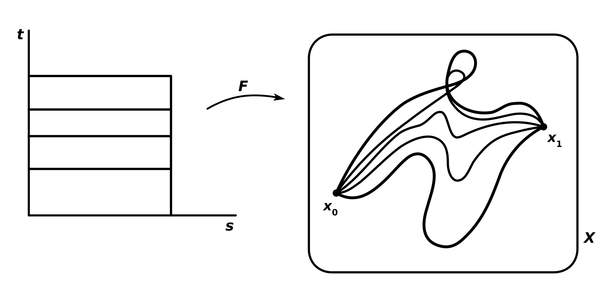

# Motivation
위상수학의 목표 중 하나는 공간을 분류하는 일이다. 다시 말해 두 위상공간이 위상동형인지, 아닌지 체크해서 가능한 한 세밀하게 공간들을 각 특징에 따라 분류하는 일인데, 예컨대 구간 $(0, 1)$과 $[0, 1]$은 컴팩트성에서 차이가 있으므로 서로 위상동형이 아니라고 말할 수 있으며, $\mathbb{R}$과 $\mathbb{R}^2$는 한 점을 제거했을 때 연결성에 차이가 생기므로 위상동형이 아니다. 이와 같이 서로 위상동형인 공간들끼리 공유하는 성질을 위상적 성질(topological property), 혹은 위상 불변량(topological invarinat)이라고 부르고 다음과 같이 정의한다.

> A ***topological invariant*** is a property of a topological space which is invariant under homeomorphisms. For example:
> 
> **(i)** **Separation**: $T_0, T_1, T_2, T_3, T_4$, regular, normal
> 
> **(ii)** **Countability**: separable, first, second countable
>
> **(iii)** **Connectedness**: (locally) connected, (locally) path-connected
>
> **(iv)** **Compactness**: compact, Lindelöf
>
> **(v)** **Metrizability**: metrizable

한편 위상 불변량이 위의 것들만 있는 건 아닌데, 달리 말하면 위의 성질들로는 구분할 수 없는 공간들도 있다는 뜻이다. 예컨대 $\mathbb{R}^2$와 $\mathbb{R}^3$는 위에 나열된 위상 불변량들로는 구별할 수 없다. 즉, 두 공간 모두 위 위상 불변량들에 대해서 같은 성질을 가진다. 마찬가지로 구 $S^2$와 토러스 $T$도 위 성질들로는 구별할 수 없다. 때문에 새로운 위상 불변량을 도입해야 할 필요가 있고, 결론부터 말하면 우리는 위 공간들을 ***기본군(Fundamental Group)***이라는 위상 불변량으로 구별할 것이다.

# Homotopy
## Definition 1
Let $f, f': X \to Y$ be continuous maps.

**(i)** $f$ is said to be ***homotopic*** to $f'$, denoted by $f \simeq f'$ or $f \overset{F}{\simeq} f'$, if there exists a continuous map $F: X \times [0, 1] \to Y$ such that $F(x, 0) = f(x)$ and $F(x, 1) = f'(x)$ for all $x \in X$. The map $F$ is called a ***homotopy*** between $f$ and $f'$.

**(ii)** The map $f$ is said to be ***nullhomotopic*** if $f \simeq f'$ and $f'$ is a constant map.

쉽게 말해 함수 $f$에서 $f'$으로 함수를 연속적으로 변화시킬 수 있으면 두 함수를 호모토픽 관계에 있다고 말하며, "연속적으로 변화시킨다"라는 말을 수학적으로는 호모토피라 부르는 연속함수 $F(x, t)$가 주어졌다고 말할 수 있다. 정의가 좀 헷갈릴 수도 있는데, $F(x, t)$는 $[0, 1]$ 사이에서 움직이는 변수 $t$ ($0$초에서 $1$초로 흐르는 시간 파라미터라고 이해해도 좋다)가 주어질 때마다 새로운 연속함수 $g_t: X \to Y$를 주는 함수이다. 시작할 때, 즉 $t=0$일 때 처음 함수 $f$를 줬다면 시간이 흐를수록, 즉 $t$가 $0$에서 $1$로 증가할수록 연속적으로 함수가 변해서 마침내 끝날 때, 즉 $t=1$일 때 함수 $f'$을 주는 식이다. 특별히 널호모토픽은 함수 $f$가 한 점으로 연속적으로 수축될 수 있음을 의미한다.

### Example 1

## Definition 2
**(i)** A continuous map $f: [0, 1] \to X$ is called a path in $X$ from $x_0$ to $x_1$ if $f(0) = x_0$ and $f(1) = x_1$.

**(ii)** Let $f, f' : [0, 1] \to X$ be two paths from $x_0$ to $x_1$. We say that $f$ and $f'$ are ***path homotopic***, denoted by $f \simeq_p f'$ or $f \overset{F}{\simeq_p} f'$, if there exists a continuous map $F: [0, 1] \times [0, 1] \to X$ such that 

$$\begin{align*}
F(s, 0) = f(s) \quad &\text{and} \quad F(s, 1) = f'(s) \\
F(0, t) = x_0 \quad &\text{and} \quad F(1, t) = x_1
\end{align*}$$

for all $s, t \in [0, 1]$. The map $F$ is called a **path homotopy*** between $f$ and $f'$.

이번엔 연속함수 $f, f'$의 정의역을 $[0, 1]$로 제한하고 시작점과 끝점을 $x_0, x_1$로 고정시킨 경로를 다룬다. 즉 앞서 다룬 정의 1의 특수 케이스라고 볼 수 있다. 마찬가지로 두 경로 사이를 연속적으로 변화시킬 수 있는 연속함수 $F(t, s)$가 존재할 때 두 경로를 경로 호모토픽 관계에 있다고 말한다. 여기서는 시작점과 끝점이 고정되어 있으므로 좀 더 직관적인 이해가 편할 것이다. 

한편 여기서도 호모토피 $F(s, t)$를 각 시점 $t$에서마다 $x_0$에서 $x_1$로 가는 경로 $g_t: [0, 1] \to X$를 주는 함수로 이해할 수 있는데, 조금만 깊게 생각해보면 이는 다름아닌 경로의 경로를 의미한다고 이해할 수 있다. 일반적인 경로 $f$가 고정된 점 $x_0$에서 고정된 점 $x_1$로 시간이 흐름에 따라 이동하는 연속함수라면, 호모토피 $F(s, t)$는 고정된 **함수** $f$에서 고정된 **함수** $f'$으로 시간이 흐름에 따라 변하는 연속함수이기 때문이다. 집합을 바꿔서 바라보자면, 경로들을 모아놓은 함수공간에서 정의된 경로가 바로 호모토피 $F(s, t)$이다.

### Example 2

## Theorem 1
The relations $\simeq$ and $\simeq_p$ are equivalence relations.

이제 함수공간 $C(X, Y)$ 혹은 $x_0$부터 $x_1$까지의 경로들의 공간 $C([0, 1], X)$에서 정의된 동치관계 $\simeq, \simeq_p$에 대한 동치류 $[f]$를 생각할 수 있고, 우리는 이 동치류 사이의 연산을 정의해줌으로써 군 $\langle C(X, Y) / \simeq, \ast \rangle$을 정의하려고 한다.

### Proof

## Theorem 2
Let $f, g: [0, 1] \to X$ be two paths from $x_0$ to $x_1$ and from $x_1$ to $x_2$, respectively. The ***product*** $f \ast g$ of $f$ and $g$ is the path defined by

$$(f \ast g)(s) = \begin{cases}
f(2s) & s \in \left[ 0, \frac{1}{2} \right] \\
g(2s - 1) & s \in \left[ \frac{1}{2}, 1 \right].
\end{cases}$$

By the pasting lemma and the fact that $f(1) = g(0)$, $f \ast g$ is well-defined and continuous, so it is a path from $x_0$ to $x_2$. This induces the well-defined operation $\ast$ on path homotopy classes, defined by 

$$[f] \ast [g] = [f \ast g].$$

### Proof
Suppose that $f(1) = x_1 = g(0)$, $f \overset{F}{\simeq_p} f'$ and $g \overset{G}{\simeq_p} g'$. We will show that $[f' \ast g'] = [f \ast g]$. Note that $f'(1) = x_1 = g'(0)$, so $f' \ast g'$ is also a path from $x_0$ to $x_2$. Define $H: [0, 1] \times [0, 1] \to X$ by

$$H(s, t) = \begin{cases}
F(2s, t) & s \in \left[ 0, \frac{1}{2} \right] \\
G(2s-1, t) & s \in \left[ \frac{1}{2}, 1 \right].
\end{cases}$$

Since $F(1, t) = f(1) = x_1 = g(0) = G(0, t), \forall t \in [0, 1]$, $H$ is well-defined and continuous by the pasting lemma. 

Note that for all $s, t \in [0, 1]$,

1.

$$\begin{align*}
H(s, 0) &= \begin{cases}
F(2s, 0) & s \in \left[ 0, \frac{1}{2} \right] \\
G(2s-1, 0) & s \in \left[ \frac{1}{2}, 1 \right].
\end{cases} \\
&= \begin{cases}
f(2s) & s \in \left[ 0, \frac{1}{2} \right] \\
g(2s-1) & s \in \left[ \frac{1}{2}, 1 \right]
\end{cases} \\
&= (f \ast g)(s).
\end{align*}$$

2. 

$$\begin{align*}
H(s, 1) &= \begin{cases}
F(2s, 1) & s \in \left[ 0, \frac{1}{2} \right] \\
G(2s-1, 1) & s \in \left[ \frac{1}{2}, 1 \right].
\end{cases} \\
&= \begin{cases}
f'(2s) & s \in \left[ 0, \frac{1}{2} \right] \\
g'(2s-1) & s \in \left[ \frac{1}{2}, 1 \right]
\end{cases} \\
&= (f' \ast g')(s).
\end{align*}$$

3.

$$H(0, t) = F(0, t) = f(0) = x_0.$$

4.

$$H(1, t) = G(1, t) = g(1) = x_2.$$

Hence, $H$ is a path homotopy between $f \ast g$ and $f' \ast g'$, and therefore $[f \ast g] = [f' \ast g']$. $\blacksquare$

# Reference
- James R. Munkres. (2000). Topology (2nd ed.). Pearson.