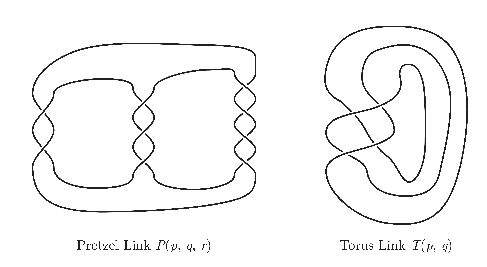
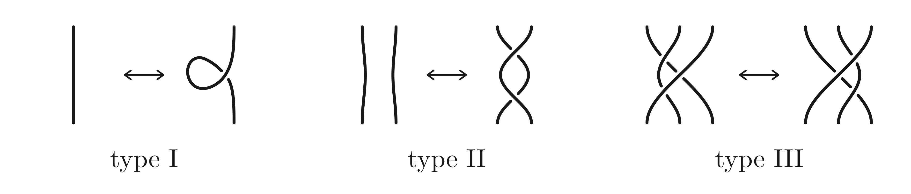

# Knot
## Definition 1
**(i)** An injective continuous map $K: S^1 \to \mathbb{R}^3$ (or $S^3$) such that $S^1 \cong K(S^1)$ is called a ***knot***. We also call $K(S^1)$ a ***knot***.

**(ii)** Two knots $K_1$ and $K_2$ are said to be ***equivalent*** or ***ambient isotopic*** if there exists a continuous map $F: \mathbb{R}^3 \times [0, 1] \to \mathbb{R}^3$ such that

1. For each $t \in [0, 1]$, $F(x, t): \mathbb{R}^3 \to \mathbb{R}^3$ is a homeomorphism

2. $F(x, 0) = x = \mathrm{id}_{\mathbb{R}^3}(x)$

3. $F(K_1, 1) = K_2$.

**(iii)** Let $K$ be a knot in $\mathbb{R}^3$. A ***regular projection*** of $K$ onto $\mathbb{R}^2$ is a projection which is injective at all but finitely many points, that are the projections of only two points. 

**(iv)** A regular projection with crossing information is called a ***knot diagram***.

**(v)** A ***link*** is a collection of knots which do not intersect each other.

수학적으로 표현하면 매듭은 $S^1$에서 $\mathbb{R}^3$로 가는 임베딩(embedding)이다. 즉 원과 위상 동형인 공간 상의 꼬인 곡선들을 의미한다. 

두 경로 사이의 연속적인 변형, 즉 호모토피가 존재하면 사실상 같은 대상으로 봤듯이, 서로 다른 두 매듭도 연속적으로 변형시킬 수 있으면 같은 매듭으로 취급한다. 위 사진의 세 매듭은 모두 연속적으로 변형될 수 없고 따라서 같은 매듭이 아니다.

링크란 매듭들이 서로 겹치지 않은 채 얽혀있는 그림을 의미한다. 가장 간단하게는 원 $S^1$ 두 개가 두 개의 고리로 얽혀있는 경우이고, 아래 예시들 또한 링크가 됨을 쉽게 확인 할 수 있다.

한편, 매듭은 공간 상에 그려지는 대상이기 때문에 조금만 복잡해져도 머릿속으로 상상하기 굉장히 힘들다. 때문에 많은 경우 평면에 사영시켜서 바라보면 편해지는데, 그냥 사영시킬 경우 꼬인 부분들의 위치 관계가 제대로 반영되지 않는다는 문제점이 있다. 단적으로 아래 예시와 같은 경우 서로 다른 매듭이지만 같은 사영을 가진다. 때문에 위치 관계를 반영해서 사영시킬 필요가 있고, 이러한 그림을 ***knot diagram***이라고 부른다. 쭉 연결된 선이 위에 있는 선이고 끊긴 선이 아래에 있는 선이다.

놀랍게도 이렇게 사영시켜 놓고 아래 정리에서 말하는 변환들을 몇 차례 적용시켜서 같아지는 매듭들은 모두 동치가 된다.

## Theorem 1 (Reidemeister)
Let $K_1$ and $K_2$ be knots, and let $D_1$ and $D_2$ be knot diagrams of $K_1$ and $K_2$, respectively. Then $K_1$ and $K_2$ are ambient isotopic if $D_1$ can be deformed to $D_2$ by using the following moves, called ***Reidemeister moves***, finitely many times.

# Classification
## Definition 2
**(i)** A ***Seifert surface*** of a knot or link $K$ is a connected, oreitable, compact $2$-manifold $M$ such that $\partial M = K$.

**(ii)** Let $M$ be a connected orientable surface. The ***genus*** of $M$ is the maximum number of non-intersecting simple closed curves that can be drawn on $M$ without separating it.

**(iii)** The ***genus*** of a knot or link is the least genus of all possible Seifert surfaces.

***자이페르트 곡면(Seifert Surface)***은 쉽게 말해 주어진 매듭이나 링크를 둘레로 하는 곡면을 일반화한 개념이라고 이해할 수 있고, 일반적으로 자이페르트 곡면은 유일하지는 않다. 전혀 꼬이지 않은 unknot의 자이페르트 곡면은 자명하게 디스크 $D^1$이다. Trefoil kont의 자이페르트 곡면은 아래와 같이 knot diagram을 통해 구할 수 있다.

즉 매듭의 진행 방향을 고려하여 꼬인 부분을 꼬이지 않았다고 가정한채 하나로 이으면 곡선의 집합들을 얻으며, 이 곡선들을 다시 꼬인 부분들의 상하 위치 관계를 고려해 곡면으로 그려주면 자이페르트 곡면을 얻는다. 또 다른 예로 매듭 $4_1$의 자이페르트 곡면은 다음과 같이 구할 수 있다.

이와 같이 우리는 각 매듭들의 자이페르트 곡면을 구할 수 있는데, 이러한 곡면들을 일반적으로 분류해서 "본질적으로" 어떤 곡면들과 같은지 알아낼 수 있을까? 이와 같은 분류의 문제는 수학에서 중요한 토픽이며, 아래 정리에 의해 완벽하게 분류됨을 알 수 있다.

한편 아래 정리는 ***종수(genus)***라는 개념의 도입을 필요로 하는데, $S^2$의 경우 조르당 곡선 정리에 의해 $0$의 종수를 갖는다.

반면 토러스 $T^2$의 경우 아래 그림과 같이 토러스를 분리시키지 않는 단순폐곡선이 존재하고, 따라서 $1$의 종수를 갖는다. 마찬가지의 방식으로 $T^2$ # $T^2$ 또한 종수를 계산할 수 있고, 이를 정리하면 아래 표와 같다.

한편, 이러한 복잡한 정의와는 다르게 직관적으로는 "구멍의 개수"정도로 퉁쳐서 이해할 수 있다. 위 표를 참고할 때 종수와 ***오일러 지표(Euler Characteristic)*** $\chi$가 모종의 관계를 가짐을 알 수 있고, 이러한 논의를 요약하면 아래 정리와 같다.

## Theorem 2 (The Classification Theorem of Closed Surfaces)
Every connected, orientable, closed (compact without boundary) surface is homeomorphic to

**(i)** the sphere $S^2$,

**(ii)** the connected sum of $g$ tori for $g \ge 1$, $T^2$ # $\cdots$ # $T^2$.

## Corollary
Let $M$ be a connected, orientable, compact surface with genus $g$ and $b$ boundary components. Then 

$$\chi(M) = 2 - 2g - b.$$

어떤 곡면의 오일러 지표를 찾는 일은 종수를 찾는 것보다 상대적으로 쉬운 일이다. 따라서 먼저 오일러 지표를 구하고 위 공식을 이용해 종수를 알면 주어진 곡면을 쉽게 분류할 수 있다.

## Example
We compute the genus of trefoil kont $3_1$. Note that

$$\begin{align*}
\chi(M_{3_1}) &= 12 - 18 + 5 = -1, \\
b &= 1.
\end{align*}$$

Thus, the genus of $M_{3_1}$ is $1$, i.e., $g(3_1) \le 1$. 

Since $3_1$ is not equivalent to an unknot and unknot has the genus $g = 0$, $g(3_1) > 0$. Hence, $g(3_1) = 1$.

토러스가 $g = 1, b = 0$이라는 사실과 비교할 때 $M_{3_1}$은 $g = 1, b = 1$이므로 구멍 하나 뚫린 토러스와 위상동형이라는 사실 또한 알 수 있다.

# Reference
- https://en.wikipedia.org/wiki/Knot_(mathematics)