# Knot
## Definition 1
::: {.math-box}
**(i)** An injective continuous map $K: S^1 \to \mathbb{R}^3$ (or $S^3$) such that $S^1 \cong K(S^1)$ is called a ***knot***. We also call $K(S^1)$ a ***knot***.

**(ii)** Two knots $K_1$ and $K_2$ are said to be ***equivalent*** or ***ambient isotopic***, denoted by $K_1 \simeq K_2$, if there exists a continuous map $F: \mathbb{R}^3 \times [0, 1] \to \mathbb{R}^3$ such that

1. For each $t \in [0, 1]$, $F(x, t): \mathbb{R}^3 \to \mathbb{R}^3$ is a homeomorphism

2. $F(x, 0) = x = \mathrm{id}_{\mathbb{R}^3}(x)$

3. $F(K_1, 1) = K_2$.

**(iii)** A ***knot invariant*** is a quantity assigned to a knot that remains unchanged under ambient isotopy. That is, for a function $f$ defined on knots, $f$ is called a ***knot invariant*** if $K_1 \simeq K_2$, then $f(K_1) = f(K_2)$.

**(iv)** Let $K$ be a knot in $\mathbb{R}^3$. A ***regular projection*** of $K$ onto $\mathbb{R}^2$ is a projection which is injective at all but finitely many points, that are the projections of only two points. 

**(v)** A regular projection with crossing information is called a ***knot diagram***.

**(vi)** A ***link*** is a collection of knots which do not intersect each other.
:::

수학적으로 표현하면 매듭은 $S^1$에서 $\mathbb{R}^3$로 가는 임베딩(embedding)이다. 즉 원과 위상 동형인 공간 상의 꼬인 곡선들을 의미한다. 

두 경로 사이의 연속적인 변형, 즉 호모토피가 존재하면 사실상 같은 대상으로 봤듯이, 서로 다른 두 매듭도 연속적으로 변형시킬 수 있으면 같은 매듭으로 취급한다. 위 사진의 세 매듭은 모두 연속적으로 변형될 수 없고 따라서 같은 매듭이 아니다. 또한 이렇게 사실상 같은 매듭들 사이에서 보존되는, 즉 불변인 양들을 ***매듭 불변량(knot invariant)***이라고 부른다. 대표적으로 종수(genus)와 $n$-coloring 등이 있다.

링크란 매듭들이 서로 겹치지 않은 채 얽혀있는 그림을 의미한다. 가장 간단하게는 원 $S^1$ 두 개가 두 개의 고리로 얽혀있는 경우이고, 아래 예시들 또한 링크가 됨을 쉽게 확인 할 수 있다.

한편, 매듭은 공간 상에 그려지는 대상이기 때문에 조금만 복잡해져도 머릿속으로 상상하기 굉장히 힘들다. 때문에 많은 경우 평면에 사영시켜서 바라보면 편해지는데, 그냥 사영시킬 경우 꼬인 부분들의 위치 관계가 제대로 반영되지 않는다는 문제점이 있다. 단적으로 아래 예시와 같은 경우 서로 다른 매듭이지만 같은 사영을 가진다. 때문에 위치 관계를 반영해서 사영시킬 필요가 있고, 이러한 그림을 ***knot diagram***이라고 부른다. 쭉 연결된 선이 위에 있는 선이고 끊긴 선이 아래에 있는 선이다.

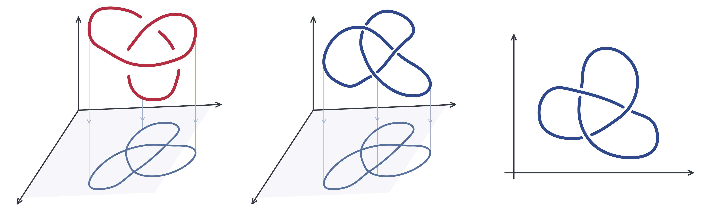

놀랍게도 이렇게 사영시켜 놓고 아래 정리에서 말하는 변환들을 몇 차례 적용시켜서 같아지는 매듭들은 모두 동치가 된다.

## Theorem 1 (Reidemeister)
::: {.math-box}
Let $K_1$ and $K_2$ be knots, and let $D_1$ and $D_2$ be knot diagrams of $K_1$ and $K_2$, respectively. Then $K_1$ and $K_2$ are ambient isotopic $\iff$ $D_1$ can be deformed to $D_2$ by using the following moves, called ***Reidemeister moves***, finitely many times.

:::

# Classification
## Definition 2
::: {.math-box}
**(i)** A ***Seifert surface*** of a knot or link $K$ is a connected, oreitable, compact $2$-manifold $M$ such that $\partial M = K$.

**(ii)** Let $M$ be a connected orientable surface. The ***genus*** of $M$ is the maximum number of non-intersecting simple closed curves that can be drawn on $M$ without separating it.

**(iii)** The ***genus*** of a knot or link is the least genus of all possible Seifert surfaces. (Note that $g(K) = 0 \iff K$ is an unknot.)
:::

***자이페르트 곡면(Seifert Surface)***은 쉽게 말해 주어진 매듭이나 링크를 둘레로 하는 곡면을 일반화한 개념이라고 이해할 수 있고, 일반적으로 자이페르트 곡면은 유일하지는 않다. 전혀 꼬이지 않은 unknot의 자이페르트 곡면은 자명하게 디스크 $D^1$이다. Trefoil kont의 자이페르트 곡면은 아래와 같이 knot diagram을 통해 구할 수 있다.

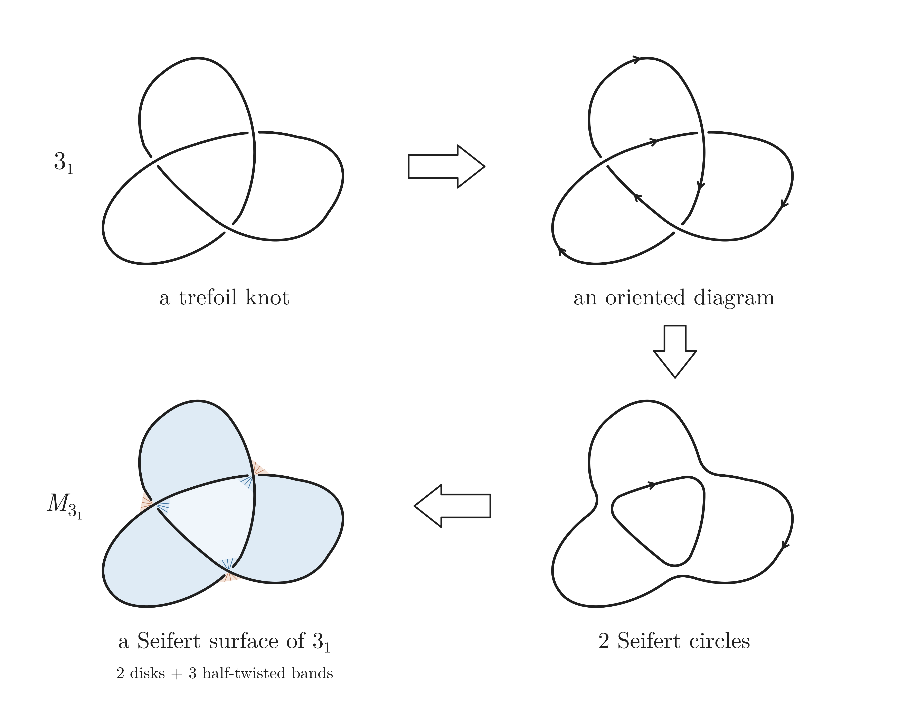

즉 매듭의 진행 방향을 고려하여 꼬인 부분을 꼬이지 않았다고 가정한채 하나로 이으면 곡선의 집합들을 얻으며, 이 곡선들을 다시 꼬인 부분들의 상하 위치 관계를 고려해 곡면으로 그려주면 자이페르트 곡면을 얻는다. 또 다른 예로 매듭 $4_1$의 자이페르트 곡면은 다음과 같이 구할 수 있다.

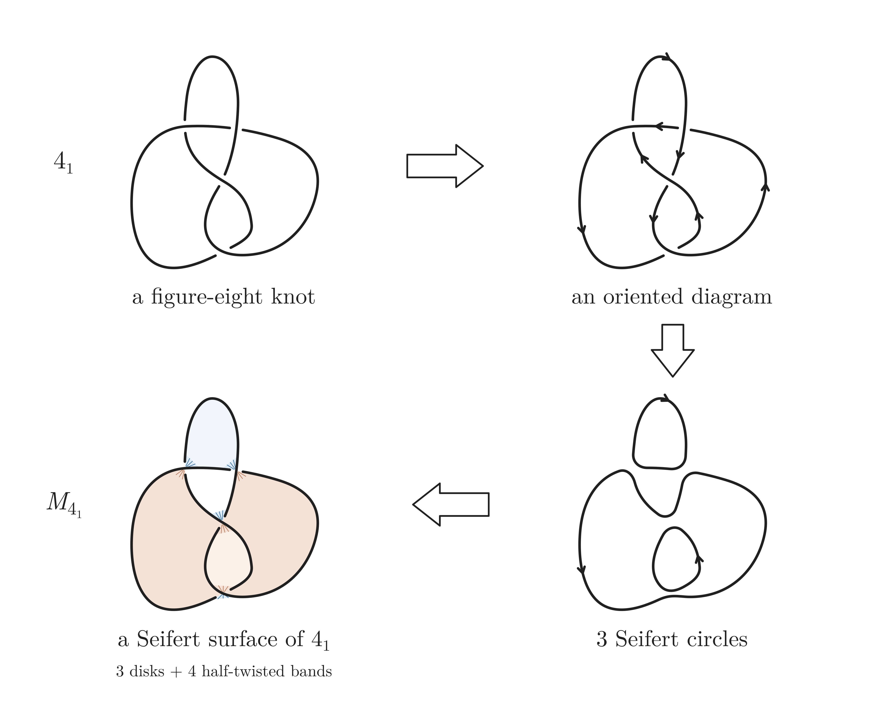

이와 같이 우리는 각 매듭들의 자이페르트 곡면을 구할 수 있는데, 이러한 곡면들을 일반적으로 분류해서 "본질적으로" 어떤 곡면들과 같은지 알아낼 수 있을까? 이와 같은 분류의 문제는 수학에서 중요한 토픽이며, 아래 정리에 의해 완벽하게 분류됨을 알 수 있다.

한편 아래 정리는 ***종수(genus)***라는 개념의 도입을 필요로 하는데, $S^2$의 경우 조르당 곡선 정리에 의해 $0$의 종수를 갖는다.

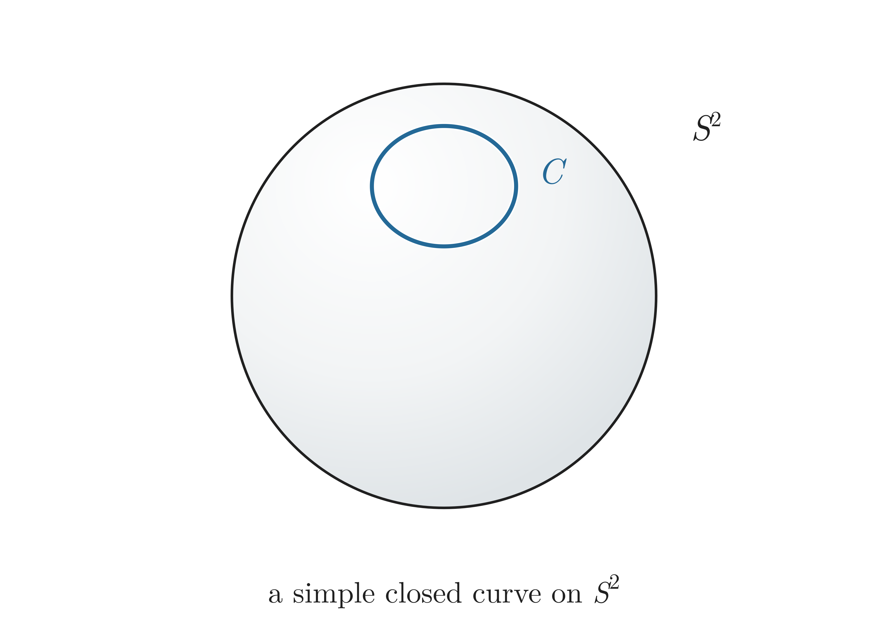

반면 토러스 $T^2$의 경우 아래 그림과 같이 토러스를 분리시키지 않는 단순폐곡선이 존재하고, 따라서 $1$의 종수를 갖는다. 

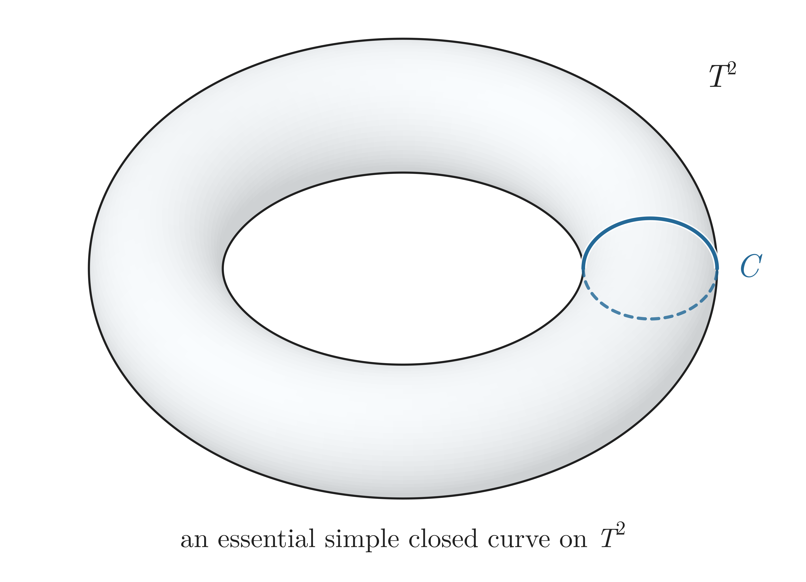

마찬가지의 방식으로 $T^2$ # $T^2$ 또한 종수를 계산할 수 있고, 이를 정리하면 아래 표와 같다.

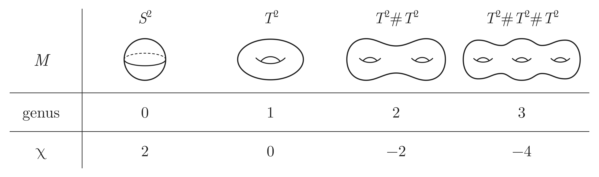

한편, 이러한 복잡한 정의와는 다르게 직관적으로는 "구멍의 개수"정도로 퉁쳐서 이해할 수 있다. 위 표를 참고할 때 종수와 ***오일러 지표(Euler Characteristic)*** $\chi$가 모종의 관계를 가짐을 알 수 있고, 이러한 논의를 요약하면 아래 정리와 같다.

## Theorem 2 (The Classification Theorem of Closed Surfaces)
::: {.math-box}
Every connected, orientable, closed (compact without boundary) surface is homeomorphic to

**(i)** the sphere $S^2$,

**(ii)** the connected sum of $g$ tori for $g \ge 1$, $T^2$ # $\cdots$ # $T^2$.
:::

## Corollary
::: {.math-box}
Let $M$ be a connected, orientable, compact surface with genus $g$ and $b$ boundary components. Then 

$$\chi(M) = 2 - 2g - b.$$
:::

어떤 곡면의 오일러 지표를 찾는 일은 종수를 찾는 것보다 상대적으로 쉬운 일이다. 따라서 먼저 오일러 지표를 구하고 위 공식을 이용해 종수를 알면 주어진 곡면을 쉽게 분류할 수 있다.

## Example 1
이제 위 정리를 사용해서 구체적으로 곡면을 분류해보자.

**(i)** 첫 번째로 trefoil knot $3_1$을 경계로 가지는 곡면을 분류해보자. $3_1$의 자이페르트 곡면은 위에서 구한 것처럼 다음과 같다.

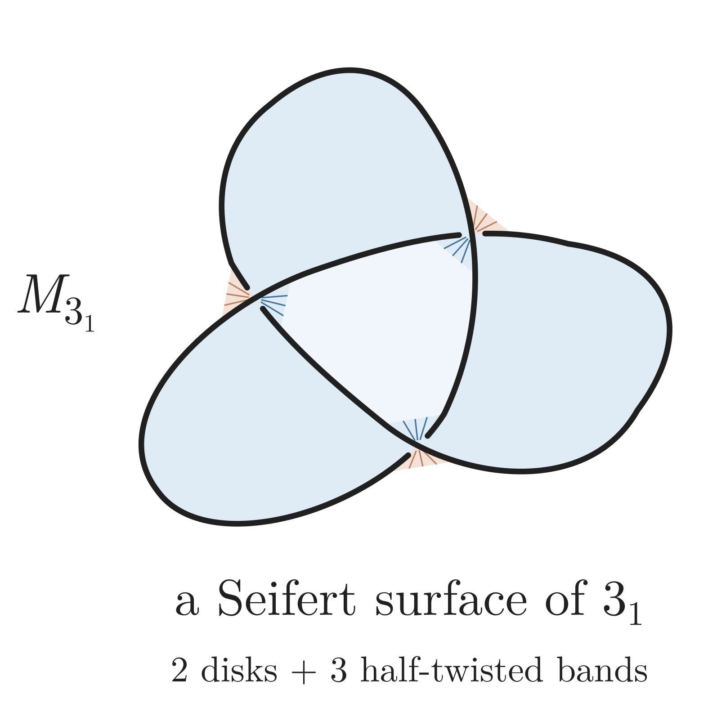

이 곡면의 오일러 지표는 다음과 같이 계산된다.

$$\begin{align*}
\chi(M_{3_1}) &= 12 - 18 + 5 = -1
\end{align*}$$

곡면의 생김새가 머릿속에서 직관적으로 그려지지 않아서 점, 선, 면의 개수를 파악하는 게 난해할 수 있는데 방법을 한번 익혀두면 쉽다.

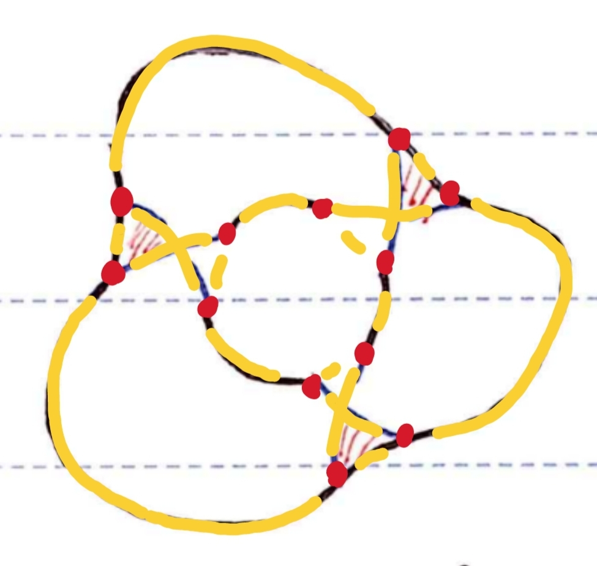

위 그림은 자이페르트 곡면의 점과 선을 파악하기 쉽게 그려둔 것이다. 자이페르트 곡면을 그렸던 과정을 살펴보면 두 개의 곡선으로 분리한 뒤 원래 매듭의 상하관계를 유지해서 위아래로 꼬인 곡면을 그려주었었다. 즉 직사각형 모양의 띠를 한번 꼬와서 곡선에 가져다가 "붙였다"고 생각하면 직사각형의 네 꼭짓점이 새로 생기게 된다. 그래서 곡면이 새로 생긴 세 부분에 각각 네 개의 점이 생기고, 이를 빨간색으로 표시했다. 선은 더 쉬운데, 각 점 사이에 연결된 선을 구분해서 그어주면 되고, 이를 노란색으로 표시했다. 그러면 총 $12$개의 점과 $18$개의 선이 생긴다. 마지막으로 면은 새롭게 붙여진 띠의 개수와 자이페르트 곡면을 그리기 위해 분리했던 곡선의 개수를 더하면 되고, 따라서 $5$개의 면이 생긴다. 이와 같은 방식으로 오일러 지표를 계산할 수 있다.

이제 boundary component $b$를 찾아야 하는데, 모든 매듭은 $S^1$과 동형이고 $S^1$은 하나의 경계만을 가지므로 $b=1$이다. 즉 $3_1$의 자이페르트 곡면 $M_{3_1}$의 종수는 $1$이고, 매듭의 종수의 정의에 의해 $1$은 $g(3_1)$의 상한으로 주어진다.

한편 $3_1$은 unknot과 같은 매듭이 아니고, 따라서 $g(3_1) > 0$이고 따라서 $g(3_1) = 1$이라는 결론을 얻는다. 즉 $3_1$을 경계로 하는 곡면 $M_{3_1}$은 $g = 1, b = 1$의 값을 가짐을 알 수 있고, 토러스가 $g = 1, b = 0$이라는 사실과 비교할 때 $M_{3_1}$은 구멍 하나 뚫린 토러스로 분류될 수 있음을 알 수 있다.

**(ii)** 다음으로 매듭 $3_1 \# 3_1^\ast$을 경계로 하는 곡면을 분류해보자. 

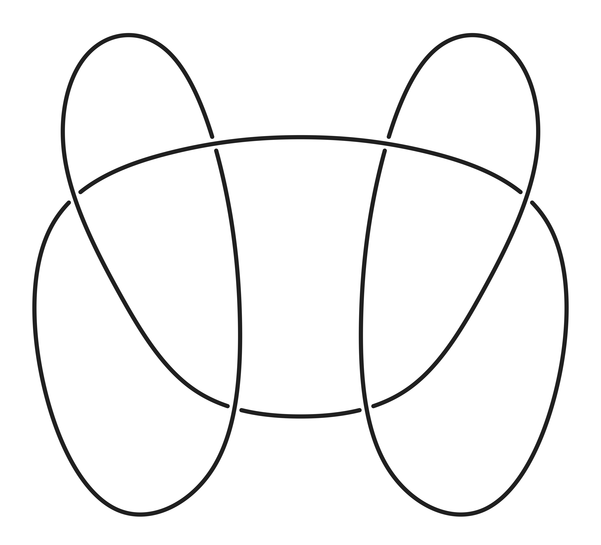

이 매듭의 자이페르트 곡면은 다음과 같이 구할 수 있다.

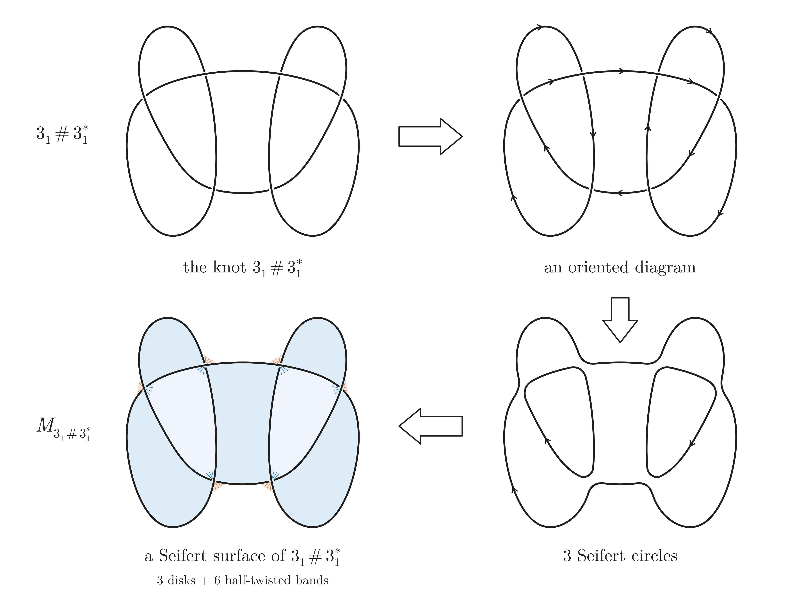

같은 방법으로 오일러 지표를 계산하면 다음과 같다.

$$\chi(M_{3_1 \# 3_1^\ast}) = 24 - 36 + 9 = -3$$

또한 한 점에서 시작해 선을 쭉 따라가면 출발점으로 다시 돌아오므로 $S^1$과 동형인 매듭이고, 따라서 $b = 1$이다. 이제 정리를 적용하면 $g(M_{3_1 \# 3_1^\ast}) = 2$를 얻는다. 즉 $g(3_1 \# 3_1^\ast) \le 2$이고, $g(3_1 \# 3_1^\ast) > 1$이라는 사실이 잘 알려져 있으므로 $g(3_1 \# 3_1^\ast) = 2$라는 결론을 얻는다. 즉 $3_1 \# 3_1^\ast$을 경계로 하는 곡면 $M_{3_1 \# 3_1^\ast}$은 $g = 2, b = 1$의 값을 가짐을 알 수 있고, 이중 토러스 $T^2 \# T^2$가 $g = 2, b = 0$이라는 사실과 비교할 때 $M_{3_1 \# 3_1^\ast}$은 구멍 하나 뚫린 이중 토러스로 분류될 수 있음을 알 수 있다.

# Coloring
위에서 곡면을 분류했던 것처럼 매듭 또한 여러 복잡한 구조를 가질 수 있는 만큼 불변량을 통해 분류하는 작업은 매우 중요하다. 예컨대 직관적으로는 원 $S^1$과 $3_1$이 서로 다른 매듭임은 자명한 사실이다. 즉 $3_1$ 매듭을 아무리 풀려고 해봤자 원으로 풀리지는 않을 것이다. 아래에서 소개하는 coloring 개념은 이러한 사실을 수학적으로 증명하기 위한 유용한 도구가 된다.

## Definition 3
::: {.math-box}
**(i)** A knot is ***tricolorable*** if each strand of the knot diagram can be colored one of three colors, subject to the following rules:

1. At least two colors must be used.

2. At each crossing, the three incident strands are either all the same color or all different colors.

:::

이름에서 볼 수 있듯이 매듭이 세 가지 색깔로 칠해지면 tricolorable하다고 부르고, $3_1$은 tricolorable한 대표적인 예시이다.

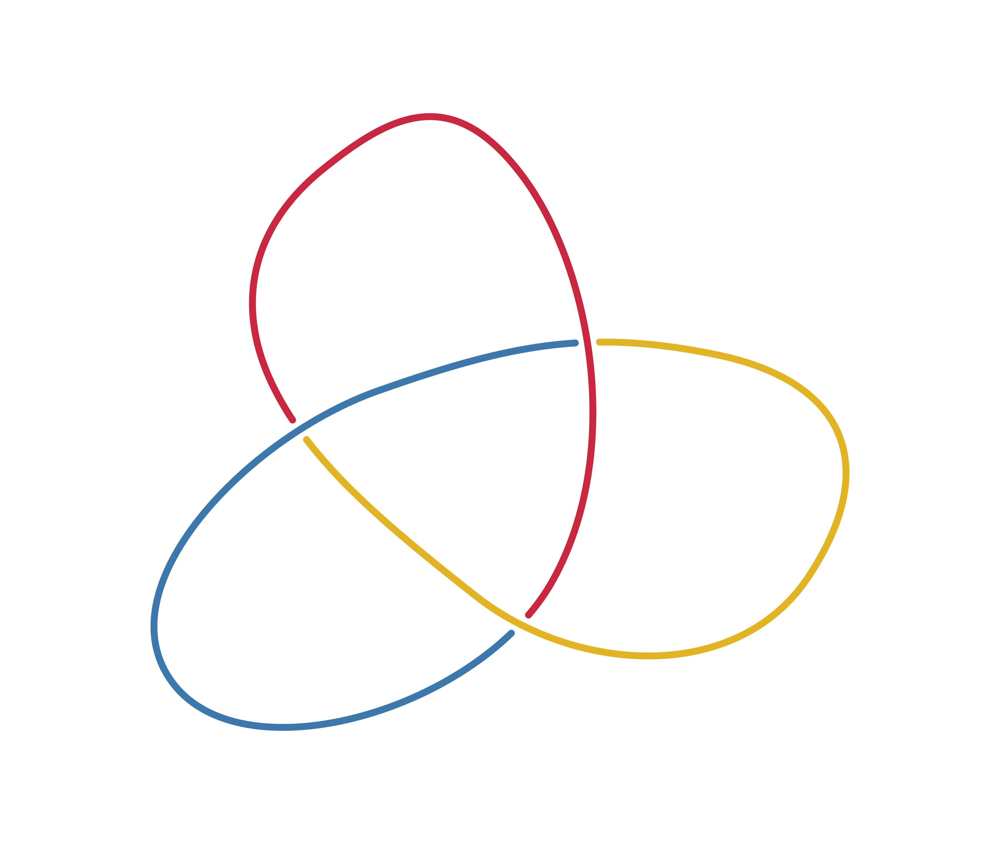

반면 $S^1$이나 $4_1$은 tricolorable하지 않고, 위에서 언급했듯이 tricolorable은 매듭 불변량이므로 $3_1$과 $S^1$, $4_1$은 같은 매듭이 아님을 알 수 있다. 즉 연속적으로 변형해서 같은 모양으로 바꿀 수 없다.

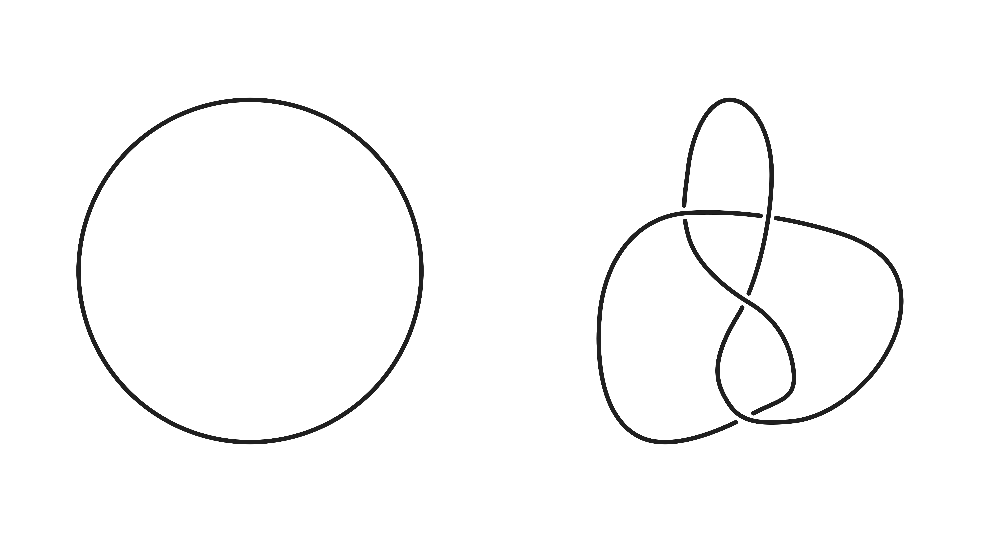

이제 같은 질문을 $S^1$과 $4_1$에게도 던질 수 있는데, 두 매듭은 모두 tricolorable하지 않으므로 이 불변량을 가지고는 두 매듭을 구분할 수 없다. 한편 tricolorable과 같이 굳이 세 가지 색깔로 한정할 이유는 없는데, 따라서 아래와 같이 임의의 $n$개의 색깔로 일반화할 수 있고, 이러한 $n$-coloring도 매듭 불변량이 되므로 이 값을 가지고 여러 매듭들을 분류할 수 있게 된다.

::: {.math-box}
**(ii)** Let $D$ be a knot diagram of a knot $K$, and let $n \ge 2$ be an integer. A ***Fox $n$-coloring*** of $D$ is an assignment of elements of $\mathbb{Z}_n$ to the arcs of $D$ such that at every crossing

$$2b \equiv a + c \mod{n},$$

where $b$ is the color of the overpassing arc, and $a$ and $c$ are the colors of the two underpassing arcs.

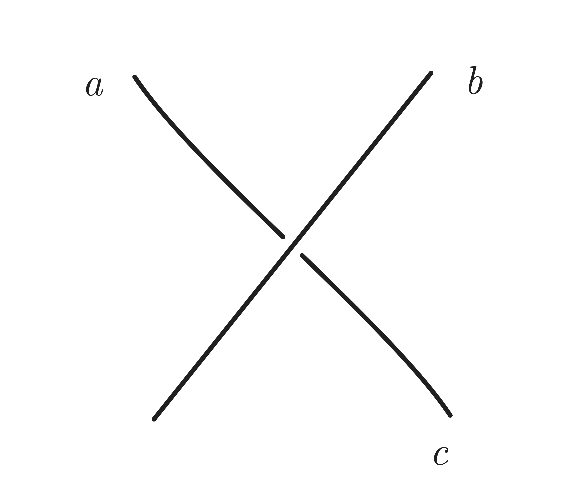

The set of all Fox $n$-colorings of $D$ is denoted by $\mathrm{Col}_n(D)$.

**(iii)** A Fox $n$-coloring is called ***trivial*** if every arc receives the same color, otherwise, it is called ***nontrivial***.

**(iv)** A knot $K$ is said to be $n$-***colorable*** if a diagram of $K$ admits a nontrivial Fox $n$-coloring.
:::

수학자 랄프 폭스(Ralph Fox)가 발견한 개념이라고 해서 Fox $n$-coloring이라고 부른다. 여기서부터는 색깔의 종류가 많아질 수 있으므로 $\mathbb{Z}_n$의 원소 하나씩 대응시켜서 구분한다. 이 원소들을 매듭의 다이어그램에 하나씩 부여할텐데, 모든 원소들이 동일하게 부여되지 않은 비자명한 coloring이 존재하면 그 매듭을 $n$-colorable하다고 부른다.

예시로 $4_1$이 colorable한지, 가능하다면 얼마의 $n$으로 가능한지 계산해보자. 우선 $n$-colorable하다고 가정하고, 임의의 두 아크에 $a, b \in \mathbb{Z}_n$을 부여하고, 나머지 두 아크에 미지수 $x, y$를 부여하자.

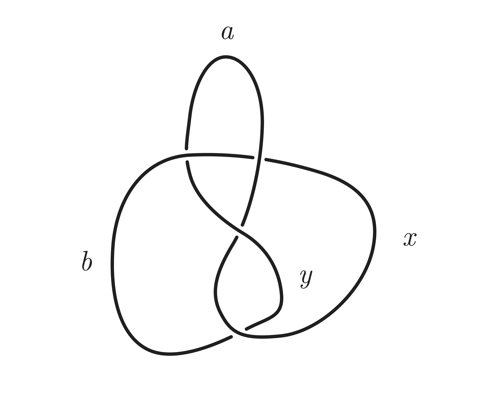

그러면 위 정의에 의해 $2b \equiv a+ x \mod{n}$이 성립해야 하므로 $x \equiv 2b - a \mod{n}$이다. 같은 방식으로 $2(2b-a) \equiv b + y \mod{n}$이 성립해야 하므로 $y \equiv 3b - 2a \mod{n}$이다. 마지막으로 $2(3b-2a) \equiv a+ b \mod{n}$이 성립해야 하므로 $5a \equiv 5b \mod{n}$이다. 만약 $n$이 $5$와 서로소라면 합동식의 양변을 $5$로 나눠서 $a \equiv b \mod{n}$이 성립하므로 $a = b$를 얻고, 결국 $a = b = x = y$로 주어진다. 이는 colorable하다는 가정에 모순이므로 $n$은 $5$와 서로소가 아니어야 한다. 즉 $n = 5, 10, 15, \dots$ 등이 가능하고 $n=5$로 선택해서 매듭 $4_1$은 $5$-colorable하다는 결론을 얻는다. 따라서 $4_1$과 $S^1$은 같은 매듭이 아니다.

## Theorem 3
**(i)** The number of Fox $n$-colorings is a knot invariant.

**(ii)** The existence of non-trivial Fox $n$-coloring is a knot invariant.

::: {.callout-note title="Proof" icon=false collapse="true"}
:::

# Reference
- https://en.wikipedia.org/wiki/Knot_(mathematics)