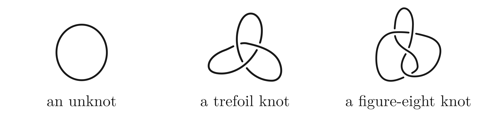

# Knot
## Definition 1
**(i)** An injective continuous map $K: S^1 \to \mathbb{R}^3$ (or $S^3$) such that $S^1 \cong K(S^1)$ is called a ***knot***. We also call $K(S^1)$ a ***knot***.

**(ii)** Two knots $K_1$ and $K_2$ are said to be ***equivalent*** or ***ambient isotopic*** if there exists a continuous map $F: \mathbb{R}^3 \times [0, 1] \to \mathbb{R}^3$ such that

1. For each $t \in [0, 1]$, $F(x, t): \mathbb{R}^3 \to \mathbb{R}^3$ is a homeomorphism

2. $F(x, 0) = x = \mathrm{id}_{\mathbb{R}^3}(x)$

3. $F(K_1, 1) = K_2$.

**(iii)** Let $K$ be a knot in $\mathbb{R}^3$. A ***regular projection*** of $K$ onto $\mathbb{R}^2$ is a projection which is injective at all but finitely many points, that are the projections of only two points. 

**(iv)** A regular projection with crossing information is called a ***knot diagram***.

수학적으로 표현하면 매듭은 $S^1$에서 $\mathbb{R}^3$로 가는 임베딩(embedding)이다. 즉 원과 위상 동형인 공간 상의 꼬인 곡선들을 의미한다. 

두 경로 사이의 연속적인 변형, 즉 호모토피가 존재하면 사실상 같은 대상으로 봤듯이, 서로 다른 두 매듭도 연속적으로 변형시킬 수 있으면 같은 매듭으로 취급한다. 위 사진의 세 매듭은 모두 연속적으로 변형될 수 없고 따라서 같은 매듭이 아니다.

한편, 매듭은 공간 상에 그려지는 대상이기 때문에 조금만 복잡해져도 머릿속으로 상상하기 굉장히 힘들다. 때문에 많은 경우 평면에 사영시켜서 바라보면 편해지는데, 그냥 사영시킬 경우 꼬인 부분들의 위치 관계가 제대로 반영되지 않는다는 문제점이 있다. 단적으로 아래 예시와 같은 경우 서로 다른 매듭이지만 같은 사영을 가진다. 때문에 위치 관계를 반영해서 사영시킬 필요가 있고, 이러한 그림을 ***knot diagram***이라고 부른다. 쭉 연결된 선이 위에 있는 선이고 끊긴 선이 아래에 있는 선이다.

놀랍게도 이렇게 사영시켜 놓고 아래 정리에서 말하는 변환들을 몇 차례 적용시켜서 같아지는 매듭들은 모두 동치가 된다.

## Theorem 1 (Reidemeister)
Let $K_1$ and $K_2$ be knots, and let $D_1$ and $D_2$ be knot diagrams of $K_1$ and $K_2$, respectively. Then $K_1$ and $K_2$ are ambient isotopic if $D_1$ can be deformed to $D_2$ by using the following moves, called ***Reidemeister moves***, finitely many times.

# Reference
- https://en.wikipedia.org/wiki/Knot_(mathematics)